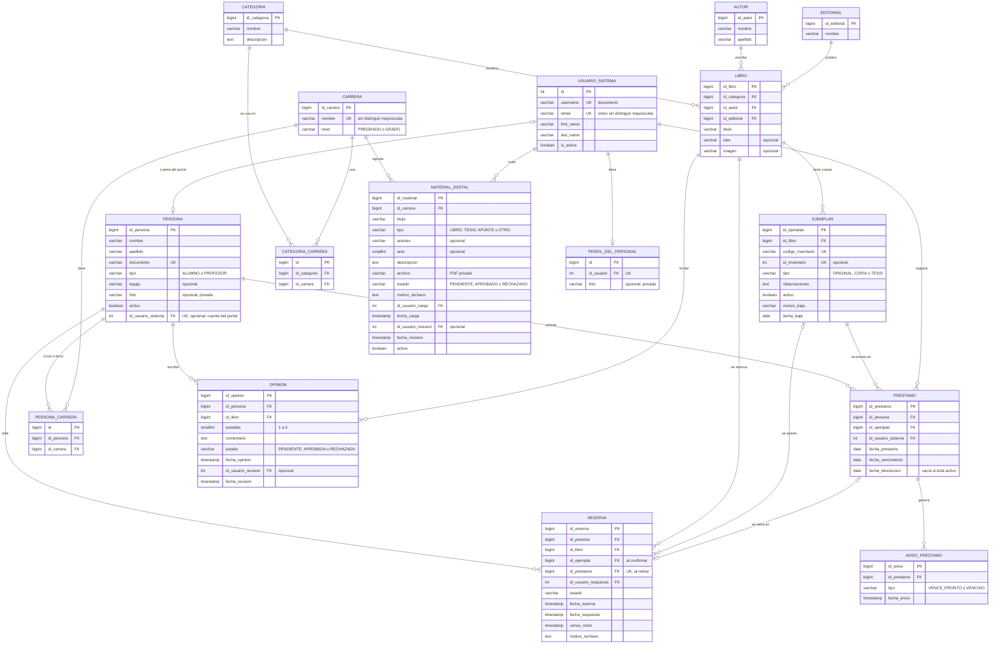

# SIGEBI — Documentación técnica

**Release 1 (biblioteca física) y Release 2 (biblioteca virtual).** Este documento describe la arquitectura, el
modelo de datos, las reglas de negocio y las decisiones técnicas de SIGEBI tal como están implementadas en el código.

## 1. Alcance

| Release 1 — Biblioteca física (Sprints 1 a 6) | Release 2 — Biblioteca virtual (Sprints 7 y 8) |
|---|---|
| Categorías, autores, editoriales, libros y ejemplares | Carreras, y carreras de cada persona y de cada categoría |
| Personas (alumnos y profesores) con baja lógica | Cuentas de estudiantes y docentes (rol Lector) y portal separado del personal |
| Préstamos, devoluciones, vencidos y disponibilidad | Catálogo por carrera con disponibilidad |
| Baja lógica de ejemplares y búsqueda por código | Material digital (PDF) por carrera, y material compartido con aprobación |
| Cuentas del personal con roles, login por correo y recuperación de contraseña | Reservas de libros físicos con retiro en 48 horas |
| Límite de intentos de ingreso | Opiniones verificadas sobre los libros |
| Informes exportables en CSV | Código QR por ejemplar, avisos automáticos por correo e informe de demanda |
| Importación del inventario en Excel | Informes en PDF, Mi perfil con foto y publicación en internet (Railway) |

**Mejora propuesta (fuera de alcance):** un asistente con IA que, a partir de un ejercicio que sube el alumno,
recomienda libros del catálogo de sus carreras. Se presupuesta en la [evaluación económica](evaluacion-economica.md).

## 2. Tecnologías

| Capa | Tecnología |
|---|---|
| Lenguaje | Python 3.13 |
| Framework web | Django 5.2.18 (patrón MTV: modelo, plantilla y vista) |
| Base de datos | PostgreSQL 16 (en el servidor publicado, 18), con la extensión `unaccent` para buscar sin tildes |
| Conector | psycopg 3.3.6 |
| Autenticación | Django Auth, con un backend propio para ingresar por correo |
| Interfaz | Plantillas de Django, HTML, CSS y JavaScript, sin frameworks externos |
| Configuración | python-dotenv en las PC del equipo (`SIGEBI/.env`, que no se versiona); variables del panel en el servidor |
| Imágenes | Pillow (portadas y fotos de perfil) |
| Importación del inventario | openpyxl 3.1.5 (lectura de archivos .xlsx) |
| Código QR | segno 1.6.6 (SVG, Python puro) |
| Informes en PDF | fpdf2 2.8.3 (Python puro) |
| Servidor publicado | Railway: gunicorn, WhiteNoise (archivos estáticos) y Brevo por django-anymail (correo) |
| Gestión del trabajo | Scrum con tablero en Trello, Git y GitHub con Pull Requests |

## 3. Arquitectura

SIGEBI es un monolito Django con cuatro aplicaciones (`biblioteca`, `portal`, `cuentas` e `interfaz`) y una
separación de responsabilidades por capas:

```
Navegador ──HTTP──► config/urls.py ──► vista (views.py) ──► formulario (forms.py) ──► modelo (models.py) ──► PostgreSQL
                                          │                      validaciones             restricciones de integridad
                                          ├─ permisos por rol (PermissionRequiredMixin) o lector (LectorRequeridoMixin)
                                          ├─ reglas de negocio (reservas.py, opiniones.py, revision_de_material.py…)
                                          └─ plantilla (templates/) ──► HTML
```

| Capa | Responsabilidad | Archivos |
|---|---|---|
| **Modelo** | Entidades, relaciones y restricciones que la base garantiza aunque se saltee la interfaz. | `biblioteca/models.py`, `cuentas/models.py`, migraciones |
| **Formularios** | Validación de datos de entrada y mensajes de error junto al campo. | `biblioteca/forms.py`, `cuentas/forms.py` |
| **Vistas** | Control de acceso, orquestación de cada operación y manejo de errores sin respuestas 500. | `biblioteca/views.py`, `portal/views.py`, `cuentas/views.py` |
| **Reglas de negocio** | Operaciones con varias reglas o pasos, usadas por el personal y por el portal. | `biblioteca/reservas.py`, `opiniones.py`, `revision_de_material.py`, `avisos.py`, `demanda.py`, `prestamos_por_persona.py`, `cuentas/lectores.py` |
| **Plantillas** | Presentación. Parciales reutilizables. | `templates/`, `*/templates/` |
| **Servicios** | Exportación CSV y PDF (`biblioteca/informes.py`), importación del inventario (`importacion.py`), QR (`qr.py`), fotos (`fotos.py`), archivos privados (`almacenamiento.py`), correo (`cuentas/correo.py`), roles (`cuentas/roles.py`), configuración por entorno (`config/entorno.py`). | |

### 3.1. Aplicaciones

- **`biblioteca`**: el sistema del personal. Catálogo, carreras, ejemplares, personas, préstamos, devoluciones,
  reservas, opiniones, material digital, informes, QR y los comandos `importar_inventario`,
  `cargar_datos_prueba`, `enviar_avisos` y `preparar_sitio`.
- **`portal`** (Release 2): el sitio de estudiantes y docentes, en `/portal/`. No tiene modelos propios: usa los
  de `biblioteca` filtrados siempre por las carreras de la persona.
- **`cuentas`**: cuentas del personal, roles (grupos de Django), login por correo, límite de intentos, cuentas de
  lectores (`lectores.py`), Mi perfil del personal y el comando `probar_correo`.
- **`interfaz`**: sin modelos; etiquetas de plantilla compartidas (íconos, filtros de presentación y ``).
- **`config`**: configuración (`settings.py` y `entorno.py`), rutas y el sitio de administración restringido a superusuarios.

### 3.2. Reutilización

- `GuardarRegistroMixin`: guarda y, si la base rechaza un dato repetido, vuelve al formulario con un error en lugar de un 500.
- `ExportarCSVMixin`: agrega la exportación CSV y PDF a cualquier listado, respetando sus filtros.
- `BuscarAntesDeListarMixin`: Libros y Ejemplares listan solo al buscar, filtrar o pedir "Ver todos" (sección 12).
- `LectorRequeridoMixin` (`portal/acceso.py`): toda vista del portal exige ser lector y deja en `self.persona` la
  persona de la cuenta, de donde salen sus carreras.
- `Libro.objects.de_las_carreras()`, `con_disponibilidad()` y `con_opiniones()`: el mismo cálculo para el personal y
  el portal, así nunca muestran números distintos.
- Parciales de plantillas para formularios, paginación, estados (de préstamo, ejemplar, reserva y material) y avatares.

### 3.3. Interfaz de usuario

La interfaz es un sistema de diseño propio, sin frameworks ni dependencias externas:

- **Estilos** (`static/css/estilos.css`): variables de color y espacio en `:root`, con la paleta institucional
  (naranja de acento, superficies blancas sobre gris claro). Los colores de texto cumplen el contraste WCAG AA
  (4,5:1): por ejemplo, el botón primario usa `#D43812` en lugar de `#F0441E`.
- **Estructura** (`templates/base.html`): un mismo esqueleto para el personal y el portal, con menús distintos.
  - Personal: Operación (Inicio, Préstamos, Reservas, Opiniones), Catálogo (Libros, Ejemplares, Autores,
    Editoriales, Categorías, Carreras, Material digital) y Gestión (Personas, Informes, Cuentas).
  - Portal: Inicio, Explorar (Catálogo, Material digital) y Mi biblioteca (Préstamos, Reservas).
  - Contadores en el menú de lo que espera respuesta, cabecera con aviso de vencidos y perfil con foto o iniciales.
  - En pantallas de hasta 900 px el menú pasa a ser un panel que se abre con un botón; sin JavaScript se muestra completo arriba.
- **Pantallas de acceso** (ingreso, recuperación y definición de contraseña): comparten el encabezado
  `templates/registration/_acceso_marca.html`, con el **logo de la UTN** (`static/img/logo-utn.svg`).
- **Componentes compartidos**: la app `interfaz` tiene los íconos SVG (``), los filtros de presentación y
  ``, que agrega a cada archivo estático una marca con un resumen de su contenido (`?v=…`): cuando
  cambia un estilo, el navegador lo vuelve a descargar en lugar de usar el viejo. `templates/componentes/` tiene
  campos de formulario, errores, estados vacíos, paginación, avisos y avatares.
- **Comportamiento** (`static/js/main.js`, mejora progresiva): modal de confirmación (`data-confirmar`), bloqueo del
  doble envío, avisos que se cierran, mostrar u ocultar la contraseña, vista previa de imágenes, menú del teléfono
  (con cierre por Esc), buscador sobre las listas desplegables largas (`data-buscador`, sección 12) y el botón
  flotante **Volver arriba**, que aparece al bajar más de 400 px y respeta "reducir movimiento".
- **Datos de presentación:** cada app aporta sus variables a la cabecera común: `cuentas/contexto.py` el rol,
  `biblioteca/contexto.py` los vencidos y los contadores del personal, y `portal/contexto.py` los del lector.
- **Accesibilidad:** enlace "Saltar al contenido", foco visible, navegación completa por teclado, etiquetas en
  todos los campos, `aria-current` en la sección activa y textos alternativos en las barras de los informes.

## 4. Modelo de datos

### 4.1. Diagrama entidad-relación

Las entidades nuevas de la Release 2 son CARRERA, PERSONA_CARRERA, CATEGORIA_CARRERA, MATERIAL_DIGITAL, RESERVA,
AVISO_PRESTAMO, OPINION y PERFIL_DEL_PERSONAL; PERSONA y EJEMPLAR ganaron columnas (cuenta, foto y tipo).
El diagrama coincide con las migraciones `biblioteca.0001` a `0019` y `cuentas.0001` a `0003`
(`test_migraciones` controla que modelos y migraciones no se separen).

El mismo diagrama, como imagen: [der-sigebi.png](der-sigebi.png).



`USUARIO_SISTEMA` es la tabla `auth_user` de Django. Los roles son grupos de Django (`auth_group`):
Administrativo, Bibliotecario y Lector. La tabla `cuentas_intentodeacceso` (límite de intentos) no tiene relaciones
y no se dibuja.

### 4.2. Modelo relacional

| Tabla | PK | FK | Únicos | Restricciones de control |
|---|---|---|---|---|
| `biblioteca_carrera` | `id_carrera` | — | `lower(nombre)` (`carrera_nombre_unico`) | — |
| `biblioteca_categoria` | `id_categoria` | — | — | — |
| `biblioteca_categoriacarrera` | `id` | `id_categoria` (`CASCADE`), `id_carrera` (`PROTECT`) | (`id_categoria`, `id_carrera`) | — |
| `biblioteca_autor` | `id_autor` | — | — | — |
| `biblioteca_editorial` | `id_editorial` | — | — | — |
| `biblioteca_libro` | `id_libro` | `id_categoria`, `id_autor`, `id_editorial` (`PROTECT`) | — | — |
| `biblioteca_ejemplar` | `id_ejemplar` | `id_libro` (`PROTECT`) | `upper(codigo_inventario)` (`codigo_inventario_unico`); `id_inventario` | `ejemplar_baja_coherente`: activo sin datos de baja, o inactivo con motivo y fecha |
| `biblioteca_persona` | `id_persona` | `id_usuario_sistema` (`PROTECT`, opcional) | `documento`; `id_usuario_sistema` | — |
| `biblioteca_personacarrera` | `id` | `id_persona` (`CASCADE`), `id_carrera` (`PROTECT`) | (`id_persona`, `id_carrera`) | — |
| `biblioteca_prestamo` | `id_prestamo` | `id_persona`, `id_ejemplar`, `id_usuario_sistema` (`PROTECT`) | parcial: un solo préstamo sin devolver por ejemplar (`un_prestamo_activo_por_ejemplar`) | `vencimiento_no_anterior_a_prestamo`; `devolucion_no_anterior_a_prestamo` |
| `biblioteca_materialdigital` | `id_material` | `id_carrera`, `id_usuario_carga`, `id_usuario_revision` (`PROTECT`) | — | `material_revision_coherente`; `material_anio_valido` (1900 a 2100) |
| `biblioteca_reserva` | `id_reserva` | `id_persona`, `id_libro`, `id_ejemplar`, `id_prestamo`, `id_usuario_respuesta` (`PROTECT`) | `id_prestamo`; parcial: una reserva CONFIRMADA por ejemplar (`una_reserva_vigente_por_ejemplar`); parcial: una reserva PENDIENTE o CONFIRMADA por persona y libro (`una_reserva_activa_por_libro`) | `reserva_coherente`: cada estado con exactamente sus datos |
| `biblioteca_avisoprestamo` | `id_aviso` | `id_prestamo` (`PROTECT`) | (`id_prestamo`, `tipo`) (`un_aviso_por_tipo_y_prestamo`) | — |
| `biblioteca_opinion` | `id_opinion` | `id_persona`, `id_libro`, `id_usuario_revision` (`PROTECT`) | (`id_persona`, `id_libro`) (`una_opinion_por_persona_y_libro`) | `opinion_estrellas_validas`; `opinion_revision_coherente` |
| `cuentas_perfildelpersonal` | `id` | `id_usuario` (`CASCADE`) | `id_usuario` | — |
| `cuentas_intentodeacceso` | `id` | — | — | — |
| `auth_user` (Django) | `id` | — | `username`; índice único parcial `lower(email) WHERE email <> ''` (`cuentas_correo_unico`) | — |

`ON DELETE PROTECT` impide borrar un registro referenciado (por ejemplo, una carrera con personas o un libro con
reservas): así se mantiene la integridad referencial (D-R2-21). Las tablas intermedias usan `CASCADE` del lado de la
persona o la categoría: si se borra la persona, se borra su vínculo con la carrera, pero nunca una carrera en uso.

### 4.3. Normalización (3FN)

- **1FN:** todos los atributos son atómicos; no hay listas ni grupos repetidos. Las carreras de una persona y de
  una categoría son relaciones muchos a muchos, resueltas con tablas intermedias (D-R2-17), no con listas en una columna.
- **2FN:** todas las claves primarias son simples (identificadores sustitutos), así que no hay dependencias parciales.
- **3FN:** no hay dependencias transitivas:
  - Los datos bibliográficos (título, ISBN, autor, editorial, categoría) están en `LIBRO` y no se repiten en cada `EJEMPLAR`.
  - Autor, editorial y categoría son entidades propias, referenciadas por clave foránea.
  - Las carreras de un libro **no se guardan**: salen de su categoría (D-R2-6). Guardarlas en el libro repetiría
    el dato y podría contradecir a la categoría.
  - La **disponibilidad** de un ejemplar **no se guarda**: se calcula (activo, sin préstamo sin devolver y sin
    reserva confirmada vigente, D-R2-20).
  - Un préstamo **vencido** tampoco se guarda: se deduce de las fechas.
  - `RESERVA` guarda el libro y, al confirmarse, el ejemplar. El libro no se deduce del ejemplar porque una reserva
    pendiente todavía no tiene ejemplar.

## 5. Reglas de negocio y dónde se garantizan

### 5.1. Release 1

| Regla | Formulario o vista | Base de datos | Pruebas |
|---|---|---|---|
| Un ejemplar no puede tener dos préstamos activos | `PrestamoForm.clean` | `un_prestamo_activo_por_ejemplar` | `test_prestamos` |
| Préstamos simultáneos del mismo ejemplar no dan error 500 | `PrestamoCreateView` captura `IntegrityError` | ídem | `test_dos_prestamos_simultaneos_no_dan_error_500` |
| Vencimiento a 14 días corridos (D2), editable | `PrestamoForm` y `PLAZO_PRESTAMO_DIAS` | — | `test_prestamos` |
| El vencimiento no es anterior al préstamo | `PrestamoForm.clean` | `vencimiento_no_anterior_a_prestamo` | `test_prestamos` |
| La fecha de préstamo no es futura | `PrestamoForm.clean_fecha_prestamo` | — | `test_prestamos` |
| La devolución no es anterior al préstamo (D8) ni futura | `DevolucionForm` | `devolucion_no_anterior_a_prestamo` | `test_prestamos` |
| Solo se presta a personas activas y ejemplares activos | `PrestamoForm` y `PrestamoCreateView` | — | `test_prestamos`, `test_ejemplares_baja` |
| No se da de baja una persona o un ejemplar con préstamos sin devolver | `PersonaBajaView`, `EjemplarBajaView` | — | `test_personas`, `test_ejemplares_baja` |
| Datos de baja de un ejemplar coherentes | — | `ejemplar_baja_coherente` | `test_ejemplares_baja` |
| Código de inventario único sin distinguir mayúsculas | `EjemplarForm.clean_codigo_inventario` | `codigo_inventario_unico` | `test_catalogo` |
| Documento de persona único: 7 u 8 dígitos, sin puntos | `PersonaForm.clean_documento` | `unique` en `documento` | `test_personas`, `test_pedidos_de_la_profesora` |
| Correo de cuenta único sin distinguir mayúsculas | `UsuarioForm.clean_email` | `cuentas_correo_unico` | `test_alta`, `test_ajustes` |

### 5.2. Release 2

| Regla | Aplicación | Base de datos | Pruebas |
|---|---|---|---|
| El lector ve solo libros y material de sus carreras (D-R2-5, D-R2-12) | `de_las_carreras()` en cada vista del portal; lo de otra carrera responde 404 | — | `portal/test_catalogo`, `test_material_digital` |
| Una persona, como máximo una cuenta; necesita estar activa y tener carrera (D-R2-10) | `cuentas/lectores.py` | `UNIQUE` en `persona.id_usuario_sistema` | `test_cuentas_lectores` |
| La baja de la persona desactiva su cuenta; la reactivación la reactiva | `PersonaBajaView`, `PersonaReactivarView` | — | `test_cuentas_lectores` |
| Un lector no entra a ninguna pantalla del personal ni al Admin (D-R2-9) | permisos por grupo (Lector no tiene ninguno) | — | `portal/test_acceso` (recorre todas las rutas) |
| Una carrera con datos no se borra | — | `PROTECT` | `test_carreras` |
| Material: PDF real (empieza con `%PDF-`) de hasta 20 MB (D-R2-13) | `validar_pdf` en `forms.py` | — | `test_material_digital` |
| Material de lectores: pendiente hasta que un bibliotecario lo aprueba; rechazo con motivo (D-R2-7) | `revision_de_material.py` | `material_revision_coherente` | `test_material_compartido` |
| Reserva: solo libros de sus carreras con ejemplares; no con vencidos ni dado de baja; máximo 2 activas (D-R2-15) | `reservas.motivos_para_no_reservar` | `una_reserva_activa_por_libro` | `test_reservas_lector` |
| Un ejemplar apartado por una sola reserva; no se presta a otra persona (D-R2-16) | `reservas.confirmar`, `PrestamoForm` | `una_reserva_vigente_por_ejemplar` | `test_reservas_personal` (incluido el caso simultáneo) |
| Cada estado de la reserva con exactamente sus datos (D-R2-14) | `reservas.py` | `reserva_coherente` | `test_reservas_personal` |
| La reserva confirmada vence a las 48 horas y libera el ejemplar (D-R2-19) | `reservas.vencer_reservas()` al consultar | — | `test_reservas_personal` |
| Opinión: solo quien tuvo el libro prestado; una por persona y libro; 1 a 5 estrellas; se publica aprobada (D-R2-29) | `opiniones.py` | `una_opinion_por_persona_y_libro`, `opinion_estrellas_validas`, `opinion_revision_coherente` | `test_opiniones` |
| Un aviso de cada tipo por préstamo (D-R2-27) | `avisos.enviar_avisos` | `un_aviso_por_tipo_y_prestamo` | `test_avisos` |
| El QR de un ejemplar solo lo abre el personal (D-R2-26) | la ficha del ejemplar exige permiso | — | `test_qr` |

## 6. Seguridad

### 6.1. Autenticación

- Django Auth (decisión D-C1). El nombre de usuario es el **documento**; se ingresa con **correo y contraseña**
  mediante `cuentas.backends.CorreoBackend` (D-C2). Si un correo coincidiera con más de una cuenta, no autentica a ninguna.
- Contraseñas guardadas con el hash de Django (PBKDF2); nunca en texto plano.
- Las cuentas nuevas, del personal y de lectores, **no tienen contraseña**: la persona la define desde un enlace
  enviado por correo (D-C3, D-R2-1). Los enlaces **vencen en una hora** y son de un solo uso (D-C4).
- El mismo mensaje para correo inexistente, contraseña incorrecta o cuenta inactiva (no revela qué cuentas existen).
- La sesión dura **8 horas**. Al ingresar, el personal va a su panel y el lector al portal.
- **Límite de intentos** (`cuentas/intentos.py`):
    - con 5 ingresos fallidos en 15 minutos para un mismo correo, ese correo queda bloqueado hasta que el primero
      de esos fallos tenga más de 15 minutos; con 20 fallos desde una misma IP, se bloquea esa IP;
    - mientras dura el bloqueo no se puede entrar, ni siquiera con la contraseña correcta;
    - los correos inexistentes se bloquean igual, así el bloqueo no revela qué cuentas existen;
    - un ingreso correcto borra los fallos de ese correo;
    - la recuperación de contraseña envía como máximo 3 correos por hora a una misma dirección y atiende 10 pedidos
      por hora desde una IP;
    - **IP detrás del proxy:** en el servidor publicado todas las visitas llegan desde el proxy de Railway. Con
      `DJANGO_HTTPS=True` se toma la IP del visitante de la cabecera `X-Real-IP`, que pone el proxy (y se ignora si
      no es una IP válida). Sin proxy de confianza, se usa `REMOTE_ADDR` y la cabecera se ignora, para que nadie pueda
      saltear el bloqueo inventándola;
    - los intentos se guardan en `cuentas_intentodeacceso` y el superusuario los consulta en el Admin (solo lectura).

### 6.2. Autorización (decisiones D-C5 y D-R2-9)

Los permisos se controlan **en el servidor**, en cada vista; ocultar un botón nunca es la única protección.
Un acceso sin permiso responde **403** con la página "Acceso no permitido".

| Acción | Superusuario | Administrativo | Bibliotecario | Lector |
|---|---|---|---|---|
| Catálogo, carreras, personas, préstamos, devoluciones, reservas, opiniones, material, informes | Sí | Sí | Sí | No |
| Crear cuentas del portal desde la ficha de la persona | Sí | Sí | Sí | No |
| Ver listado de cuentas del personal | Sí | Sí | No | No |
| Crear o editar Bibliotecarios | Sí | Sí | No | No |
| Crear o editar Administrativos | Sí | No | No | No |
| Portal: catálogo y material de sus carreras, reservas, opiniones, compartir material, su perfil | No | No | No | Sí |
| Cambiar la contraseña propia y Mi perfil | Sí | Sí | Sí | Sí |
| Panel de administración de Django (`/admin/`) | Sí | No | No | No |

Las cuentas no se borran: se desactivan. Nadie puede cambiar su propio rol ni desactivarse a sí mismo.

### 6.3. Seguridad por carrera (Release 2)

- Todo lo que ve un lector sale de **su persona y sus carreras** (`LectorRequeridoMixin`); el portal nunca recibe
  la persona ni la carrera por la dirección.
- Un libro o material de otra carrera responde **404 "no encontrado"**, aunque se escriba la dirección a mano: no
  se revela que existe. Un filtro de carrera o categoría ajeno escrito en la dirección se ignora.
- El portal nunca muestra quién tiene un libro ni datos de otras personas: solo la cantidad de ejemplares disponibles.
- El QR de un ejemplar lleva a la ficha del personal: un lector que lo escanea recibe 403.

### 6.4. Archivos privados

- Los PDF del material digital y las fotos de perfil se guardan en `MATERIAL_DIGITAL_ROOT`, una carpeta que el
  servidor **no publica** (`biblioteca/almacenamiento.py`). No tienen dirección pública: se abren solo a través de
  una vista que controla quién los pide: el material, el personal o un lector (solo el aprobado y activo de sus
  carreras, o el que subió él); la foto de un alumno o profesor, la persona y el personal; la del personal, solo su
  dueño. Un enlace suelto no alcanza para descargarlos.
- Los nombres de archivo se generan al azar, así no se pueden adivinar.
- Las fotos (JPG, PNG o WEBP de hasta 5 MB) se achican a 400 px y se vuelven a grabar como JPEG, lo que descarta
  los datos ocultos del archivo original, como la ubicación que agrega el celular.
- Las portadas de los libros sí son públicas (`MEDIA_ROOT`), porque no son datos personales.

### 6.5. Otras medidas

- Protección CSRF en todos los formularios; cerrar sesión, dar de baja, aprobar, rechazar, reservar y cancelar solo aceptan POST.
- Secretos (`DJANGO_SECRET_KEY`, base de datos, correo, clave de Brevo) fuera de Git: en `SIGEBI/.env` en las PC
  del equipo y en el panel de Railway en el servidor.
- **En el servidor publicado** (`DJANGO_HTTPS=True`, `config/entorno.py`): redirección a HTTPS, cookies de sesión
  y CSRF seguras, HSTS de un día, orígenes de confianza para CSRF y `DEBUG` apagado. Los errores se registran en
  los logs del servidor, sin mostrarle detalles al visitante.
- **CSV seguro:** las celdas que empiezan con `=`, `+`, `-` o `@` se exportan precedidas de `'` para que Excel no
  las ejecute como fórmula.
- El panel de administración de Django está limitado a superusuarios (`config/admin.py`).

### 6.6. Limitaciones conocidas

- La foto y el material privado se guardan en el disco del servidor: en Railway, en el volumen `/data`. Las copias
  de seguridad tienen que incluir esa carpeta además de la base de datos.
- HSTS no se pide para subdominios ni para la lista de precarga de los navegadores, porque el dominio de Railway
  (`up.railway.app`) es del proveedor y no de SIGEBI.

## 7. Correo

Se configura por variables de entorno (decisión D-C6, `config/entorno.py`), en este orden:

1. Con `BREVO_API_KEY`: por la API de **Brevo** (HTTPS), con django-anymail. Es lo que usa el servidor publicado,
   porque Railway bloquea el SMTP en sus planes Trial, Free y Hobby.
2. Con `EMAIL_HOST`: por **SMTP** con TLS o SSL (por ejemplo, Gmail con contraseña de aplicación), como en las PC del equipo.
3. Sin ninguna de las dos: los correos se muestran en la **consola** (modo desarrollo).

El envío se corta a los 10 segundos si el servicio no responde. Los errores de envío (SMTP, red o Brevo) se
capturan: la operación se completa igual y se avisa que el correo no salió. El comando
`python manage.py probar_correo destino@ejemplo.com` verifica la configuración sin mostrar claves.

| Correo | Cuándo |
|---|---|
| Definí tu contraseña | Al crear una cuenta del personal o del portal, y al reenviarlo |
| Recuperar contraseña | Al pedirlo desde la pantalla de ingreso |
| Respuesta a una reserva | Al confirmarla o rechazarla |
| Resultado de la revisión del material | Al aprobar o rechazar material compartido |
| Tu préstamo vence pronto / venció | Comando diario `enviar_avisos` (sección 17) |

## 8. Decisiones registradas

### 8.1. Release 1

| ID | Decisión | Estado |
|---|---|---|
| D-01 a D-12 | Tecnologías, Scrum, dos releases, modelo LIBRO/EJEMPLAR, AUTOR y EDITORIAL como entidades, ISBN como atributo opcional, imagen opcional, Django Auth (Sprints 1 y 2) | Implementadas |
| D-C1 | Autenticación con Django Auth (no Supabase Auth) | Confirmada |
| D-C2 | Usuario = documento; ingreso por correo con backend propio | Confirmada |
| D-C3 | La contraseña inicial la define la persona por correo | Confirmada |
| D-C4 | Los enlaces vencen en una hora | Confirmada |
| D-C5 | Administrativo = permisos del Bibliotecario + cuentas de Bibliotecarios; solo el superusuario crea Administrativos | Confirmada |
| D-C6 | Correo configurable: SMTP en las PC del equipo; API de Brevo en el servidor publicado | Implementada; probada por el equipo (04/11/2026 y 25/11/2026) |
| D-C7 | Nombre y apellido obligatorios en las cuentas | Confirmada |
| D2 | Plazo de préstamo: 14 días corridos, editable | Confirmada |
| D4 | Pantallas propias para personas y préstamos | Confirmada |
| D5 | Informes CSV: ejemplares, préstamos (por estado) y personas | Confirmada; en la Release 2 también en PDF |
| D7 | Rotar la `SECRET_KEY` sin reescribir el historial | Confirmada (cada integrante, en su `.env`) |
| D8 | Devolución no anterior al préstamo, en la aplicación y en la base | Confirmada |
| Baja | Baja lógica de personas y ejemplares; las cuentas se desactivan | Confirmada |
| Sesión | 8 horas | Confirmada |
| I1–I8 | Reglas para importar el inventario en Excel (sección 11) | Confirmadas por el equipo (Sprint 6) |
| Inventario | Las 7 filas inconsistentes del Excel no se cargan; se registran a mano si se identifican los ejemplares | Decidida por el equipo (Sprint 6) |

### 8.2. Release 2

| ID | Decisión | Estado |
|---|---|---|
| D-R2-1 | Las cuentas de estudiantes y docentes las crea el personal desde la ficha de la Persona; no hay registro libre | Implementada |
| D-R2-2 | El catálogo solo se consulta con cuenta; no hay páginas públicas | Implementada |
| D-R2-3 | Reserva de libros físicos: el bibliotecario confirma y aparta un ejemplar por 48 horas; al retirarlo se registra el préstamo de 14 días | Implementada |
| D-R2-4 | Release 2 en dos sprints de una semana | Cumplida (el cierre se extendió) |
| D-R2-5 | Acceso por carrera: el alumno ve las que cursa y el profesor las que dicta; puede tener varias | Implementada |
| D-R2-6 | Un libro pertenece a las carreras de su categoría | Implementada |
| D-R2-7 | Material digital: lo que suben alumnos y profesores queda pendiente hasta que lo aprueba un bibliotecario | Implementada |
| D-R2-8 | Mi perfil de solo lectura; los datos los corrige el personal | Implementada (con foto opcional, pedido de la profesora) |
| D-R2-8b | Agregados al Sprint 8: QR, avisos, informe de demanda y opiniones. La IA queda como mejora propuesta | Confirmada (13/11/2026) |
| D-R2-9 | Rol Lector sin permisos sobre el sistema del personal | Implementada |
| D-R2-10 | Como máximo una cuenta por persona, que necesita al menos una carrera | Implementada |
| D-R2-11 | Una categoría sin carreras no aparece en el portal, y el personal ve un aviso | Implementada |
| D-R2-12 | El control por carrera se hace en el servidor: lo de otra carrera responde "no encontrado" | Implementada |
| D-R2-13 | Material en PDF de hasta 20 MB, por carrera, fuera de la carpeta pública, solo con sesión | Implementada |
| D-R2-14 | Estados de la reserva: Pendiente → Confirmada → Retirada, o Rechazada, Cancelada o Vencida | Implementada |
| D-R2-15 | Como máximo 2 reservas activas; no reserva quien está dado de baja o tiene préstamos vencidos | Implementada |
| D-R2-16 | Una sola reserva vigente por ejemplar, garantizada por la base | Implementada |
| D-R2-17 | Tablas intermedias explícitas para las carreras de personas y categorías | Implementada |
| D-R2-18 y D-R2-22 | Materias | **Descartadas:** libros y material se organizan solo por carrera |
| D-R2-19 | El vencimiento de una reserva se registra como VENCIDA cuando se detecta, sin tareas programadas | Implementada |
| D-R2-20 | Disponible = activo, sin préstamo sin devolver y sin reserva confirmada vigente | Implementada |
| D-R2-21 | `PROTECT` en todas las claves foráneas, salvo el lado persona o categoría de las tablas intermedias | Implementada |
| D-R2-23 | El material guarda autores (texto libre) y año, opcionales | Implementada |
| D-R2-24 | El DER de la carpeta son los diagramas generados (Mermaid), como en la Release 1 | Aplicada (sección 4.1) |
| D-R2-25 | La carrera guarda su nivel (pregrado o grado); las 10 carreras se cargan por migración | Implementada |
| D-R2-26 | Código QR por ejemplar con la dirección de su ficha; hojas de etiquetas | Implementada |
| D-R2-27 | Avisos por correo "vence pronto" (2 días antes) y "venció", una vez por préstamo, solo a personas con cuenta | Implementada |
| D-R2-28 | Informe de demanda con préstamos y reservas de un período | Implementada |
| D-R2-29 | Opiniones: una por persona y libro, de quien lo tuvo prestado, publicadas al aprobarlas | Implementada |
| Profesora (18/11/2026) | Tipo de ejemplar (original, copia o tesis), documento de 7 u 8 dígitos, préstamos por persona, perfil en partes y foto | Implementados |
| Portal (24/11/2026) | El portal se organiza en Explorar, Mi biblioteca y Mi perfil | Implementada |
| Informes en PDF | Cada listado que se exporta en CSV también se exporta en PDF, con fpdf2 | Implementada |
| Publicación | Railway (Trial) y Brevo para la demostración; pasar a Hobby antes de que venza el Trial | Implementada (25/11/2026) |
| Evaluación económica | Se calcula al final, con las horas de las dos releases | En curso (S8-11) |

### 8.3. Desviaciones técnicas

- **A. Correo único con índice parcial.** En lugar de `unique=True` se usa
  `CREATE UNIQUE INDEX cuentas_correo_unico ON auth_user (lower(email)) WHERE email <> ''` (migración
  `cuentas.0001`). Evita duplicados que solo difieren en mayúsculas y permite cuentas sin correo.
  Como no es una restricción del modelo, `makemigrations` no la detecta; la migración falla si ya hay correos repetidos.
- **B. Prueba de correo repetido con simulación.** Como la base ya impide dos cuentas con el mismo correo,
  `test_correo_repetido_no_inicia_sesion` simula una búsqueda que devuelve dos cuentas y verifica que no se
  autentique a ninguna. La unicidad real se prueba aparte (`CorreoUnicoEnLaBaseTests`).

## 9. Migraciones

| Migración | Contenido |
|---|---|
| `biblioteca.0001`–`0004` | Modelo inicial: catálogo, persona, ejemplar y préstamo con sus restricciones |
| `biblioteca.0005` | ID de inventario, código único sin distinguir mayúsculas, ISBN opcional |
| `biblioteca.0006` | Extensión `unaccent` |
| `biblioteca.0007` | Baja lógica de personas |
| `biblioteca.0008` | Restricción D8 (devolución no anterior al préstamo) |
| `biblioteca.0009` | Baja lógica de ejemplares con motivo y fecha |
| `biblioteca.0010` | Carreras y sus vínculos con personas y categorías |
| `biblioteca.0011` | Las 10 carreras de la Extensión Áulica (datos) |
| `biblioteca.0012` | Carreras de las categorías del inventario real (datos; solo toca categorías sin carrera) |
| `biblioteca.0013` | Cuenta del portal de la persona (el grupo Lector lo crea `cuentas.roles.configurar_roles` después de cada `migrate`) |
| `biblioteca.0014` | Material digital |
| `biblioteca.0015` | Reservas |
| `biblioteca.0016` | Avisos de préstamos |
| `biblioteca.0017` | Opiniones |
| `biblioteca.0018` | Tipo de ejemplar (original, copia o tesis) |
| `biblioteca.0019` | Foto de perfil de la persona |
| `cuentas.0001` | Índice único de correo (desviación A) |
| `cuentas.0002` | Tabla de intentos de acceso (límite de intentos) |
| `cuentas.0003` | Perfil del personal (foto) |

Todas tienen operación inversa. Las de la Release 2 se aplicaron hacia adelante y hacia atrás sobre una base con el
inventario real, sin perder datos. `test_migraciones` falla si alguien cambia un modelo y se olvida la migración.

## 10. Pruebas

La suite automática tiene **884 pruebas** (Django `TestCase` sobre PostgreSQL, no una base en memoria: así se
verifican también las restricciones de la base). El detalle por módulo y el resultado están en
[Evidencias de pruebas](evidencias-de-pruebas.md).

## 11. Importación del inventario en Excel (Sprint 6)

El comando `python manage.py importar_inventario <archivo.xlsx>` carga el inventario que usaba la biblioteca.
La lógica está en `biblioteca/importacion.py`, separada en dos pasos:

1. **Lectura** (`leer_planilla`): ubica el encabezado (no depende de la posición de las columnas), limpia cada
   celda y valida la fila. No toca la base de datos.
2. **Carga** (`importar`): crea categorías, autores, editoriales, libros y ejemplares dentro de **una transacción**.
   Sin `--guardar`, la transacción se deshace al final: el modo prueba recorre exactamente el mismo camino que
   la carga real y por eso su informe es fiel. Cada fila se guarda en un punto de guardado propio: si una falla,
   se descarta solo esa fila.

Categorías, autores, editoriales y libros existentes se reutilizan comparando **sin tildes ni mayúsculas**
(`unaccent`), así que una segunda corrida no duplica nada. Un ejemplar cuyo código ya existe se omite.

**Reglas acordadas por el equipo (03/11/2026)** para los datos incompletos del Excel real:

| ID | Situación en el Excel | Qué hace la importación |
|---|---|---|
| I1 | Ejemplar sin numeración (206 de 318) | Código provisorio `SN-<ID>` (por ejemplo, `SN-0045`), editable después. |
| I2 | Varios autores en una celda (separados por salto de línea, `;`, `/`, `&`, " y " o punto entre apellidos) | El libro queda con el primer autor; los demás se guardan en las observaciones del ejemplar. El modelo no cambia (un autor por libro). |
| I3 | Sin editorial | Editorial "Sin editorial". |
| I4 | Formato | Se lee el `.xlsx` con openpyxl, que conserva los saltos de línea dentro de las celdas. |
| I5 | ID o numeración repetidos, o dos numeraciones en una celda | Se rechazan **todas** las filas involucradas y se informan con su número de fila. |
| I6 | Estado "Prestado" | Se carga disponible y se informa. El préstamo se registra a mano: el Excel no dice a quién ni desde cuándo, y no se inventan personas ni fechas (criterio del Sprint 2). |
| I7 | Fecha de inventario | Se agrega a las observaciones ("Inventariado el 14/10/2024"). |
| I8 | Nombre y apellido en una sola celda | "Apellido, Nombre" se respeta; si no hay coma, la última palabra es el apellido (con partículas como "de" y sufijos como "Jr."). Se quitan títulos como "Lic." o "Ing.". Se revisa con `--detalle`. |

Otros criterios: el ISBN se extrae del texto de la celda (se prefiere el de 13 dígitos); si no tiene 10 o 13
dígitos, el libro queda sin ISBN y se avisa. Un autor sin dato queda como "Sin autor".

**Resultado con el Excel real** (`BibliotecaAnexo.xlsx`, 318 filas), en una base de prueba: 311 ejemplares y
261 libros cargados, 206 con código provisorio, 7 filas rechazadas (una numeración repetida, tres celdas con
dos numeraciones y el ID 227 repetido) y 7 ejemplares que figuraban prestados. Una segunda corrida no agregó nada.

**Decisión del equipo (05/11/2026):** las 7 filas rechazadas **se quitan del Excel** y no se cargan. Si más
adelante se identifican esos ejemplares en la biblioteca, se registran a mano desde **Ejemplares → Nuevo ejemplar**.
La revisión de nombre y apellido de los autores se corrige, cuando haga falta, desde la pantalla **Autores**.

## 12. Catálogo grande (Sprint 6, S6-11)

Se midió el sistema con el inventario real cargado (311 ejemplares, 261 libros, 225 autores):

| Pantalla | Antes | Después |
|---|---|---|
| Listado de ejemplares (20 por página) | 25 consultas (una por fila para saber si está prestado) | 5 consultas, sin importar cuántas filas haya |
| Detalle de un libro | 1 consulta extra por ejemplar | Cantidad fija de consultas |
| Nuevo libro / nuevo ejemplar | Listas de 225 autores y 261 libros sin forma de buscar | Buscador sobre cada lista |

Todas las pantallas responden en menos de 40 ms; los listados ya estaban paginados (20 por página), así que
nunca cargan el catálogo completo. El problema era de **uso**, no de velocidad: elegir un libro en una lista de 261.

- **Estado de préstamo en la misma consulta:** `Ejemplar.objects.con_estado_de_prestamo()` agrega
  `con_prestamo_activo` con una subconsulta `EXISTS`. La propiedad `Ejemplar.prestado` usa ese dato cuando está
  y, si no, consulta la base como antes. Lo usan el listado de ejemplares, el detalle del libro y el CSV.
- **Buscador en las listas:** los formularios marcan las listas largas con `con_buscador()` (`biblioteca/forms.py`),
  que agrega el atributo `data-buscador`. `static/js/main.js` inserta un campo que filtra las opciones mientras se
  escribe (sin distinguir tildes ni mayúsculas), elige la primera coincidencia si la opción elegida quedó afuera y lo
  anuncia en un aviso accesible (`role="status"`). Enter no envía el formulario. Sin JavaScript, la lista es la misma
  de siempre. No agrega dependencias ni rutas.
- **Buscar antes de listar (decisión del equipo):** Libros y Ejemplares no listan registros al entrar; muestran el
  total y el buscador. Se listan al buscar, al aplicar un filtro (estado del ejemplar) o con **Ver todos**
  (`?todos=1`, que la paginación conserva). Lo resuelve `BuscarAntesDeListarMixin` (`biblioteca/views.py`): al
  entrar solo se hace un `COUNT`. La exportación CSV no cambia y sigue exportando todo lo filtrado.
- **Atajo existente:** "Agregar ejemplar" en el detalle del libro abre el formulario con el libro ya elegido.
- Un buscador que consulte al servidor mientras se escribe se descartó por ahora: solo hace falta con decenas de miles de registros.

## 13. Portal de estudiantes y docentes (Release 2, S7-03 a S7-06)

- **Cuentas de lectores** (`cuentas/lectores.py`): el personal crea la cuenta desde la ficha de la Persona
  (`PersonaCuentaCreateView`). Se crea un usuario de Django con el documento como nombre de usuario, el grupo
  **Lector** y la relación uno a uno `Persona.cuenta`. La persona recibe el mismo correo "Definí tu contraseña"
  que el personal. Requisitos: persona activa, con al menos una carrera y sin cuenta.
- **Separación:** después del ingreso todos van a `biblioteca:inicio` (`LOGIN_REDIRECT_URL`), que redirige al
  lector a `portal:inicio`. Las vistas del personal exigen permisos que el grupo Lector no tiene (403), y las del
  portal exigen `LectorRequeridoMixin` (el personal recibe 403 en el portal).
- **Catálogo** (`portal/views.py`): `Libro.objects.de_las_carreras(persona.carreras)` con `con_disponibilidad()`
  y `con_opiniones()`, en una cantidad fija de consultas sin importar cuántos libros haya. Búsqueda por título,
  autor o ISBN sin tildes (`unaccent`); el ISBN se encuentra aunque se escriba con guiones.
- **Organización** (24/11/2026): **Explorar** (catálogo y material), **Mi biblioteca** (préstamos y reservas) y
  **Mi perfil** (datos, foto y contraseña). Las direcciones anteriores del perfil (`/portal/perfil/reservas/` y
  similares) redirigen a las nuevas.

## 14. Material digital (S7-07 y S8-01)

- `MaterialDigital` pertenece a una carrera y tiene estado **Pendiente**, **Aprobado** o **Rechazado**, más un
  `activo` para la baja lógica. La restricción `material_revision_coherente` exige que cada estado tenga sus datos
  de revisión (quién, cuándo y, si se rechazó, el motivo).
- Lo que sube el personal queda **Aprobado** al guardarse; lo que suben alumnos y profesores queda **Pendiente**
  (D-R2-7). Quien sube desde el portal solo puede elegir entre sus carreras y tiene que aceptar una declaración
  sobre derechos de autor.
- `validar_pdf` (`biblioteca/forms.py`) controla que el archivo empiece con `%PDF-` (un archivo renombrado no pasa)
  y que no supere `MATERIAL_DIGITAL_MAXIMO_MB` (20 MB).
- La revisión (`biblioteca/revision_de_material.py`) bloquea la fila con `select_for_update` para que dos
  bibliotecarios no revisen el mismo material a la vez, y avisa por correo a quien lo subió.
- Los archivos se abren con `abrir_pdf`, que los entrega desde la carpeta privada para verlos en el navegador
  (sección 6.4).

## 15. Reservas (S8-02 y S8-03)

```
             reservar            confirmar (aparta un ejemplar, 48 h)        retirar (crea el préstamo)
   (lector) ─────────► PENDIENTE ───────────────────────────────► CONFIRMADA ─────────────────────────► RETIRADA
                          │  │                                        │   │
                 cancelar │  │ rechazar (con motivo)          liberar │   │ pasan 48 h sin retiro
                          ▼  ▼                                        ▼   ▼
                    CANCELADA  RECHAZADA                       CANCELADA   VENCIDA
```

- Las reglas están en `biblioteca/reservas.py` y las usan el portal y el personal. Cada cambio de estado bloquea
  la reserva (`select_for_update`) y comprueba que siga en el estado esperado: dos personas del personal no pueden
  responder la misma reserva a la vez.
- **Confirmar** elige un ejemplar disponible del libro (activo, sin préstamo y sin otra reserva vigente). La
  restricción parcial `una_reserva_vigente_por_ejemplar` garantiza en la base que un ejemplar no quede apartado dos
  veces, aunque dos bibliotecarios confirmen al mismo tiempo.
- **Retirar** registra el préstamo de 14 días del ejemplar apartado y lo vincula con la reserva (`id_prestamo`).
- **Vencimiento sin tareas programadas** (D-R2-19): `vencer_reservas()` se ejecuta al consultar reservas o
  disponibilidad, y pasa a **Vencida** toda reserva confirmada cuyo `vence_retiro` ya pasó. Así el ejemplar se
  libera aunque nadie haga nada.
- Un ejemplar apartado figura como **Apartado**: no se cuenta como disponible, no se presta a otra persona
  (`PrestamoForm`) y no se puede dar de baja.

## 16. Opiniones (S8-04)

- `biblioteca/opiniones.py`: `opinar()` comprueba que la persona haya tenido el libro prestado (cualquier préstamo,
  devuelto o no), valida las estrellas (1 a 5) y el comentario (hasta 1000 caracteres), y crea o actualiza la única
  opinión de esa persona sobre ese libro. Al editarla, vuelve a **Pendiente**.
- `revisar()` la aprueba o rechaza (con quién y cuándo). Solo las aprobadas cuentan para el promedio
  (`Libro.objects.con_opiniones()`) y se muestran en el portal, con el nombre y la inicial del apellido.

## 17. Avisos automáticos por correo (S8-06)

- `biblioteca/avisos.py`, comando `enviar_avisos` (con `--simular` para ver qué enviaría sin enviar nada).
- **Vence pronto:** préstamos sin devolver que vencen dentro de `DIAS_DE_ANTICIPACION` (2) días o hoy. Se cuenta
  desde hoy, no solo el día exacto: si el comando no corrió algún día, el aviso igual sale.
- **Venció:** préstamos sin devolver con el vencimiento pasado. Se envía una sola vez, no todos los días.
- Solo a personas con cuenta activa y correo. Un préstamo devuelto no recibe avisos.
- Cada envío se registra en `AvisoPrestamo`; la restricción `un_aviso_por_tipo_y_prestamo` garantiza un aviso de
  cada tipo por préstamo, aunque el comando se ejecute dos veces a la vez. Si el correo falla, el aviso no se
  registra y se vuelve a intentar la próxima vez.
- En producción se programa una vez por día (README, sección 7).

## 18. Código QR, informes en PDF e informes nuevos

- **QR** (`biblioteca/qr.py`, S8-05): se genera en el servidor como SVG con segno, con la dirección completa de la
  ficha del ejemplar y el mismo dominio por el que se está usando el sistema. Nivel de corrección M: se sigue
  leyendo con un raspón o una mancha. La hoja de etiquetas avisa si se está usando con `localhost` o `127.0.0.1`,
  porque esa dirección no funciona desde otro dispositivo.
- **Informes en PDF** (`biblioteca/informes.py`, 24/11/2026): fpdf2, con las mismas columnas y filas que el CSV, el
  encabezado repetido en cada hoja y el número de página. El ancho de cada columna se calcula según su contenido,
  para que no se corten palabras. Las fuentes estándar del PDF usan Latin-1, que tiene todas las letras del español.
- **Préstamos por persona** (`biblioteca/prestamos_por_persona.py`): para un rango de hasta 31 días, los préstamos
  que empezaron en el rango por persona, y cuántos se devolvieron, siguen sin devolver o están vencidos.
- **Informe de demanda** (`biblioteca/demanda.py`, S8-07): para un período (por defecto, 90 días) y por libro,
  préstamos, reservas, reservas sin ejemplar (pendientes o rechazadas) y ejemplares activos. "Conviene comprar más"
  cuando las reservas sin ejemplar superan a los ejemplares activos. Se exporta en CSV y PDF.

## 19. Publicación en internet (S8-09)

SIGEBI está publicado en **Railway** (plan Trial) con correo por **Brevo**. La guía paso a paso, con los problemas
encontrados y cómo se resolvieron, está en [Publicación en Railway](despliegue-railway.md).

```
GitHub (main) ──► Railway: servicio SIGEBI (gunicorn + Django, iniciar_servidor.sh)
                     │  volumen /data: portadas (/data/media) y archivos privados (/data/privado)
                     ├─► Railway: PostgreSQL
                     └─► Brevo (API por HTTPS): correos
```

- **Configuración por entorno** (`config/entorno.py`): funciones sin efectos que reciben las variables y devuelven
  los valores para `settings.py`. Leen `DATABASE_URL` (o las `DB_*` de siempre), los hosts permitidos (más la
  dirección pública que Railway agrega sola), los ajustes de HTTPS y el correo. En una PC del equipo todo sigue
  funcionando igual con el `.env`.
- **Antes de cada publicación** corre `python manage.py preparar_sitio`: aplica las migraciones, crea la cuenta de
  administración si no existe (con `SIGEBI_ADMIN_CORREO` y `SIGEBI_ADMIN_CLAVE`, sin modificar nunca una cuenta
  existente) y, si `SIGEBI_DATOS_DEMO=True`, carga los datos de prueba.
- **Arranque** (`iniciar_servidor.sh`): `collectstatic` y gunicorn en el puerto que indica Railway. WhiteNoise sirve
  los estilos comprimidos; las portadas las sirve Django desde el volumen.
- Cada PR integrado en `main` se publica solo.
- **Pendiente del despliegue:** copias de seguridad de la base y del volumen con una restauración de prueba,
  programar `enviar_avisos` y pasar al plan Hobby antes de que venza el Trial.
