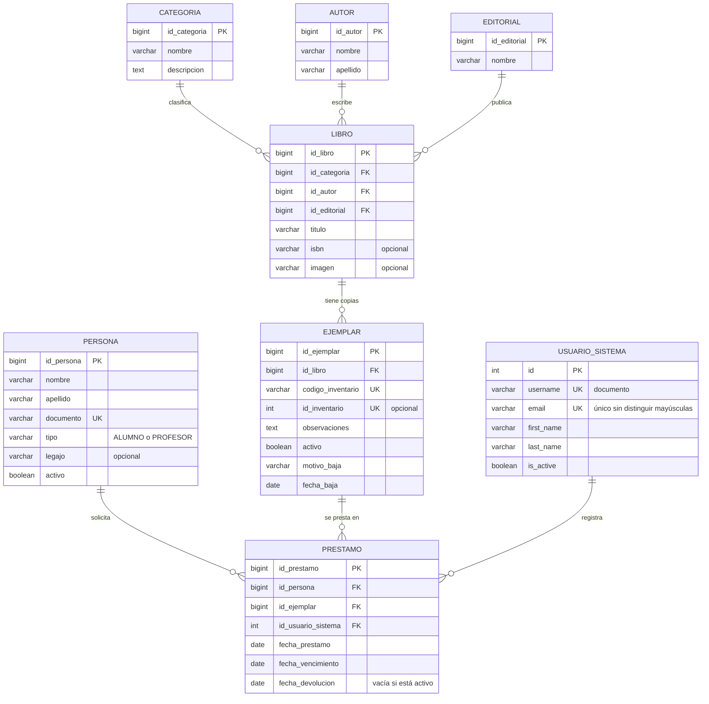

# SIGEBI — Documentación técnica

**Release 1 — Biblioteca física.** Este documento describe la arquitectura, el modelo de datos, las reglas
de negocio y las decisiones técnicas de SIGEBI tal como están implementadas en el código.

## 1. Alcance

| Incluido en Release 1 | Fuera de alcance (Release 2) |
|---|---|
| Categorías, autores, editoriales, libros y ejemplares | Libros digitales y descarga de material |
| Personas (alumnos y profesores) con baja lógica | Acceso de estudiantes y docentes |
| Préstamos, devoluciones, vencidos y disponibilidad | Solicitudes virtuales de préstamo |
| Baja lógica de ejemplares y búsqueda por código | |
| Cuentas del personal con roles, login por correo y recuperación de contraseña | |
| Informes exportables en CSV | |

## 2. Tecnologías

| Capa | Tecnología |
|---|---|
| Lenguaje | Python 3.13 |
| Framework web | Django 5.2.18 (patrón MTV: modelo, plantilla y vista) |
| Base de datos | PostgreSQL 16, con la extensión `unaccent` para buscar sin tildes |
| Conector | psycopg 3.3.6 |
| Autenticación | Django Auth, con un backend propio para ingresar por correo |
| Interfaz | Plantillas de Django, HTML, CSS y JavaScript, sin frameworks externos |
| Configuración | python-dotenv: los secretos se leen de `SIGEBI/.env`, que no se versiona |
| Imágenes | Pillow (portadas de libros) |
| Importación del inventario | openpyxl 3.1.5 (lectura de archivos .xlsx) |
| Gestión del trabajo | Scrum con tablero en Trello, Git y GitHub con Pull Requests |

## 3. Arquitectura

SIGEBI es un monolito Django con tres aplicaciones (`biblioteca`, `cuentas` e `interfaz`) y una separación de responsabilidades por capas:

```
Navegador ──HTTP──► config/urls.py ──► vista (views.py) ──► formulario (forms.py) ──► modelo (models.py) ──► PostgreSQL
                                          │                      validaciones             restricciones de integridad
                                          ├─ permisos por rol (PermissionRequiredMixin)
                                          └─ plantilla (templates/) ──► HTML
```

| Capa | Responsabilidad | Archivos |
|---|---|---|
| **Modelo** | Entidades, relaciones y restricciones que la base garantiza aunque se saltee la interfaz. | `biblioteca/models.py`, migraciones |
| **Formularios** | Validación de datos de entrada y mensajes de error junto al campo. | `biblioteca/forms.py`, `cuentas/forms.py` |
| **Vistas** | Control de acceso por permiso, orquestación de cada operación, manejo de errores sin respuestas 500. | `biblioteca/views.py`, `cuentas/views.py` |
| **Plantillas** | Presentación. Parciales reutilizables (`_formulario.html`, `_paginacion.html`, `_estado_*.html`). | `templates/`, `*/templates/` |
| **Servicios** | Exportación CSV (`biblioteca/informes.py`), importación del inventario en Excel (`biblioteca/importacion.py`), correo de definición de contraseña (`cuentas/correo.py`), roles (`cuentas/roles.py`). | |

### 3.1. Aplicaciones

- **`biblioteca`**: catálogo, ejemplares, personas, préstamos, devoluciones e informes.
- **`cuentas`**: cuentas del personal, roles (grupos de Django), login por correo, alta de cuentas con
  definición de contraseña por correo y el comando `probar_correo`.
- **`interfaz`**: sin modelos; etiquetas de plantilla compartidas (íconos y filtros de presentación).
- **`config`**: configuración, rutas y el sitio de administración restringido a superusuarios.

### 3.2. Reutilización

- `GuardarRegistroMixin`: guarda y, si la base rechaza un dato repetido, vuelve al formulario con un error en lugar de un 500.
- `ExportarCSVMixin`: agrega la exportación CSV a cualquier listado, respetando sus filtros.
- Parciales de plantillas para formularios, paginación y estados (de préstamo y de ejemplar).

### 3.3. Interfaz de usuario

La interfaz es un sistema de diseño propio, sin frameworks ni dependencias externas:

- **Estilos** (`static/css/estilos.css`): variables de color y espacio en `:root`, con la paleta institucional
  (naranja de acento, superficies blancas sobre gris claro). Los colores de texto se ajustaron para cumplir
  el contraste WCAG AA (4,5:1): por ejemplo, el botón primario usa `#D43812` en lugar de `#F0441E` y el texto
  secundario usa `#5F6672` en lugar de `#8A9099`.
- **Estructura** (`templates/base.html`): menú lateral agrupado (Operación, Catálogo, Gestión), cabecera con
  ubicación, aviso de préstamos vencidos y perfil (nombre y rol). En pantallas de hasta 900 px el menú pasa a
  ser un panel que se abre con un botón; sin JavaScript se muestra completo arriba.
- **Componentes compartidos** (sin dependencia de ninguna app de negocio): la app `interfaz` tiene los íconos
  SVG y filtros de presentación (``, etiqueta ``), y `templates/componentes/` tiene
  campos de formulario, errores, estados vacíos, paginación y avisos. Las insignias de estado de ejemplares y
  préstamos (`biblioteca/_estado_*.html`) quedan en `biblioteca` porque dependen de sus modelos.
- **Comportamiento** (`static/js/main.js`, mejora progresiva): modal de confirmación para dar de baja
  (`data-confirmar`), estado de carga y bloqueo de doble envío, avisos que se pueden cerrar, mostrar u ocultar
  la contraseña, vista previa de la portada, menú lateral en el teléfono (con cierre por Esc) y un **buscador
  sobre las listas desplegables largas** (`data-buscador`, ver sección 12).
- **Datos de presentación:** cada app aporta sus variables a la cabecera común: `cuentas/contexto.py` el rol
  (`rol_usuario`) y `biblioteca/contexto.py` la cantidad de préstamos vencidos (`prestamos_vencidos_total`).
  La plantilla base documenta al inicio qué variables espera; el panel (`inicio`) y la página de Informes (`InformesView`) calculan indicadores con
  consultas de solo lectura y respetan los permisos de cada rol.
- **Accesibilidad:** enlace "Saltar al contenido", foco visible, navegación completa por teclado, etiquetas
  en todos los campos, `aria-current` en la sección activa y textos alternativos en las barras de los informes.

## 4. Modelo de datos

### 4.1. Diagrama entidad-relación



`USUARIO_SISTEMA` es la tabla `auth_user` de Django. Los roles son grupos de Django (`auth_group`).

### 4.2. Modelo relacional

| Tabla | PK | FK | Únicos | Restricciones de control |
|---|---|---|---|---|
| `biblioteca_categoria` | `id_categoria` | — | — | — |
| `biblioteca_autor` | `id_autor` | — | — | — |
| `biblioteca_editorial` | `id_editorial` | — | — | — |
| `biblioteca_libro` | `id_libro` | `id_categoria`, `id_autor`, `id_editorial` (`ON DELETE PROTECT`) | — | — |
| `biblioteca_ejemplar` | `id_ejemplar` | `id_libro` (`PROTECT`) | `upper(codigo_inventario)` (`codigo_inventario_unico`); `id_inventario` | `ejemplar_baja_coherente`: activo sin datos de baja, o inactivo con motivo y fecha |
| `biblioteca_persona` | `id_persona` | — | `documento` | — |
| `biblioteca_prestamo` | `id_prestamo` | `id_persona`, `id_ejemplar`, `id_usuario_sistema` (`PROTECT`) | parcial: un solo préstamo con `fecha_devolucion IS NULL` por ejemplar (`un_prestamo_activo_por_ejemplar`) | `vencimiento_no_anterior_a_prestamo`; `devolucion_no_anterior_a_prestamo` |
| `auth_user` (Django) | `id` | — | `username`; índice único parcial `lower(email) WHERE email <> ''` (`cuentas_correo_unico`) | — |

`ON DELETE PROTECT` impide borrar un registro referenciado (por ejemplo, una categoría con libros o una
persona con préstamos): así se mantiene la integridad referencial.

### 4.3. Normalización (3FN)

- **1FN:** todos los atributos son atómicos; no hay listas ni grupos repetidos (cada ejemplar es una fila).
- **2FN:** todas las claves primarias son simples (identificadores sustitutos), así que no hay dependencias parciales.
- **3FN:** no hay dependencias transitivas:
  - Los datos bibliográficos (título, ISBN, autor, editorial, categoría) están en `LIBRO` y no se repiten en cada `EJEMPLAR`.
  - Autor, editorial y categoría son entidades propias, referenciadas por clave foránea (revisión con el profesor, Sprint 1).
  - La **disponibilidad** de un ejemplar **no se guarda**: se calcula a partir de si tiene un préstamo con
    `fecha_devolucion` vacía. Guardarla sería una redundancia que podría contradecir a los préstamos.
  - Un préstamo **vencido** tampoco se guarda: se deduce de las fechas.

## 5. Reglas de negocio y dónde se garantizan

| Regla | Formulario o vista | Base de datos | Pruebas |
|---|---|---|---|
| Un ejemplar no puede tener dos préstamos activos | `PrestamoForm.clean` | `un_prestamo_activo_por_ejemplar` | `test_prestamos` |
| Préstamos simultáneos del mismo ejemplar no dan error 500 | `PrestamoCreateView` captura `IntegrityError` | ídem | `test_dos_prestamos_simultaneos_no_dan_error_500` |
| Vencimiento a 14 días corridos (D2), editable | `PrestamoForm` y `PLAZO_PRESTAMO_DIAS` en `models.py` | — | `test_prestamos` |
| El vencimiento no es anterior al préstamo | `PrestamoForm.clean` | `vencimiento_no_anterior_a_prestamo` | `test_prestamos` |
| La fecha de préstamo no es futura | `PrestamoForm.clean_fecha_prestamo` | — | `test_prestamos` |
| La devolución no es anterior al préstamo (D8) | `DevolucionForm` | `devolucion_no_anterior_a_prestamo` | `test_prestamos` |
| La devolución no es futura | `DevolucionForm` | — | `test_prestamos` |
| Solo se presta a personas activas | `PrestamoForm.clean_documento` | — | `test_prestamos` |
| Solo se prestan ejemplares activos | `PrestamoForm.clean` y `PrestamoCreateView` | — | `test_ejemplares_baja` |
| No se da de baja una persona o un ejemplar con préstamos sin devolver | `PersonaBajaView`, `EjemplarBajaView` | — | `test_personas`, `test_ejemplares_baja` |
| Datos de baja de un ejemplar coherentes | — | `ejemplar_baja_coherente` | `test_ejemplares_baja` |
| Código de inventario único sin distinguir mayúsculas | `EjemplarForm.clean_codigo_inventario` | `codigo_inventario_unico` | `test_catalogo` |
| Documento de persona único (sin puntos ni espacios) | `PersonaForm.clean_documento` | `unique` en `documento` | `test_personas` |
| Correo de cuenta único sin distinguir mayúsculas | `UsuarioForm.clean_email` | `cuentas_correo_unico` | `test_alta`, `test_ajustes` |
| La disponibilidad se calcula desde los préstamos | propiedad `Ejemplar.disponible` | — | `test_modelos` |

## 6. Seguridad

### 6.1. Autenticación

- Django Auth (decisión D-C1). El nombre de usuario es el **documento**; se ingresa con **correo y contraseña**
  mediante `cuentas.backends.CorreoBackend` (D-C2). Si un correo coincidiera con más de una cuenta, no autentica a ninguna.
- Contraseñas guardadas con el hash de Django (PBKDF2); nunca en texto plano.
- Las cuentas nuevas **no tienen contraseña**: la persona la define desde un enlace enviado por correo (D-C3).
  Los enlaces de definición y recuperación **vencen en una hora** y son de un solo uso (D-C4).
- El mismo mensaje para correo inexistente, contraseña incorrecta o cuenta inactiva (no revela qué cuentas existen).
- La sesión dura **8 horas**.

### 6.2. Autorización (decisión D-C5)

Los permisos se controlan **en el servidor**, en cada vista (`PermissionRequiredMixin`); ocultar un botón
nunca es la única protección. Un acceso sin permiso responde **403** con la página "Acceso no permitido".

| Acción | Superusuario | Administrativo | Bibliotecario |
|---|---|---|---|
| Catálogo, personas, préstamos, devoluciones, informes | Sí | Sí | Sí |
| Ver listado de cuentas | Sí | Sí | No |
| Crear o editar Bibliotecarios | Sí | Sí | No |
| Crear o editar Administrativos | Sí | No | No |
| Reenviar el correo de definición | Sí | Sí, solo a Bibliotecarios | No |
| Cambiar la contraseña propia | Sí | Sí | Sí |
| Panel de administración de Django (`/admin/`) | Sí | No | No |

Las cuentas no se borran: se desactivan. Nadie puede cambiar su propio rol ni desactivarse a sí mismo.

### 6.3. Otras medidas

- Protección CSRF en todos los formularios; cerrar sesión, dar de baja y reactivar solo aceptan POST.
- Secretos (`DJANGO_SECRET_KEY`, base de datos, correo) en `SIGEBI/.env`, fuera de Git. `ALLOWED_HOSTS` desde el entorno.
- **CSV seguro:** las celdas que empiezan con `=`, `+`, `-` o `@` se exportan precedidas de `'` para que Excel no las ejecute como fórmula.
- El panel de administración de Django está limitado a superusuarios (`config/admin.py`).

### 6.4. Limitaciones conocidas

- No hay límite de intentos de ingreso. Se decidió no sumar dependencias en Release 1.
- HTTPS y los parámetros de producción dependen del servidor donde se despliegue; el sistema está preparado
  para leerlos del entorno (`DJANGO_DEBUG`, `DJANGO_ALLOWED_HOSTS`, `STATIC_ROOT`).

## 7. Correo

Configurable por variables de entorno (decisión D-C6). Si `EMAIL_HOST` está vacía, los correos se muestran
en la consola (modo desarrollo, "recuperación simulada"). Con `EMAIL_HOST` se envían por SMTP con TLS o SSL.
El comando `python manage.py probar_correo destino@ejemplo.com` verifica la configuración sin mostrar la contraseña.
Si el envío falla al crear una cuenta, la cuenta se crea igual, se avisa y se puede reenviar el correo después.

## 8. Decisiones registradas

| ID | Decisión | Estado |
|---|---|---|
| D-01 a D-12 | Tecnologías, Scrum, dos releases, modelo LIBRO/EJEMPLAR, AUTOR y EDITORIAL como entidades, ISBN como atributo opcional, imagen opcional, Django Auth (Sprints 1 y 2) | Implementadas |
| D-C1 | Autenticación con Django Auth (no Supabase Auth) | Confirmada |
| D-C2 | Usuario = documento; ingreso por correo con backend propio | Confirmada |
| D-C3 | La contraseña inicial la define la persona por correo | Confirmada |
| D-C4 | Los enlaces vencen en una hora | Confirmada |
| D-C5 | Administrativo = permisos del Bibliotecario + cuentas de Bibliotecarios; solo el superusuario crea Administrativos | Confirmada |
| D-C6 | Correo por SMTP configurable (Gmail con contraseña de aplicación recomendado) | Implementada; prueba real pendiente del equipo |
| D-C7 | Nombre y apellido obligatorios en las cuentas | Confirmada |
| D2 | Plazo de préstamo: 14 días corridos, editable | Confirmada |
| D4 | Pantallas propias para personas y préstamos | Confirmada |
| D5 | Informes CSV: ejemplares, préstamos (por estado) y personas | Confirmada |
| D7 | Rotar la `SECRET_KEY` sin reescribir el historial | Confirmada (cada integrante, en su `.env`) |
| D8 | Devolución no anterior al préstamo, en la aplicación y en la base | Confirmada |
| Baja | Baja lógica de personas y ejemplares; las cuentas se desactivan | Confirmada |
| Sesión | 8 horas | Confirmada |
| I1–I8 | Reglas para importar el inventario en Excel (sección 11) | Confirmadas por el equipo (Sprint 6) |

### 8.1. Desviaciones técnicas

- **A. Correo único con índice parcial.** En lugar de `unique=True` se usa
  `CREATE UNIQUE INDEX cuentas_correo_unico ON auth_user (lower(email)) WHERE email <> ''` (migración
  `cuentas.0001`). Evita duplicados que solo difieren en mayúsculas y permite cuentas sin correo.
  Como no es una restricción del modelo, `makemigrations` no la detecta; la migración falla si ya hay correos repetidos.
- **B. Prueba de correo repetido con simulación.** Como la base ya impide dos cuentas con el mismo correo,
  `test_correo_repetido_no_inicia_sesion` simula una búsqueda que devuelve dos cuentas y verifica que no se
  autentique a ninguna. La unicidad real se prueba aparte (`CorreoUnicoEnLaBaseTests`).

## 9. Migraciones

| Migración | Contenido |
|---|---|
| `biblioteca.0001`–`0004` | Modelo inicial: catálogo, persona, ejemplar y préstamo con sus restricciones |
| `biblioteca.0005` | ID de inventario, código único sin distinguir mayúsculas, ISBN opcional |
| `biblioteca.0006` | Extensión `unaccent` |
| `biblioteca.0007` | Baja lógica de personas |
| `biblioteca.0008` | Restricción D8 (devolución no anterior al préstamo) |
| `biblioteca.0009` | Baja lógica de ejemplares con motivo y fecha |
| `cuentas.0001` | Índice único de correo (desviación A) |

Todas tienen operación inversa. Las migraciones `biblioteca.0007` a `0009` se probaron hacia adelante y hacia atrás sobre una base con los datos de prueba.

## 10. Pruebas

La suite automática tiene **328 pruebas** (Django `TestCase` sobre PostgreSQL). El detalle por módulo y
el resultado están en [Evidencias de pruebas](evidencias-de-pruebas.md).

## 11. Importación del inventario en Excel (Sprint 6)

El comando `python manage.py importar_inventario <archivo.xlsx>` carga el inventario que usaba la biblioteca.
La lógica está en `biblioteca/importacion.py`, separada en dos pasos:

1. **Lectura** (`leer_planilla`): ubica el encabezado (no depende de la posición de las columnas), limpia cada
   celda y valida la fila. No toca la base de datos.
2. **Carga** (`importar`): crea categorías, autores, editoriales, libros y ejemplares dentro de **una transacción**.
   Sin `--guardar`, la transacción se deshace al final: el modo prueba recorre exactamente el mismo camino que
   la carga real y por eso su informe es fiel. Cada fila se guarda en un punto de guardado propio: si una falla,
   se descarta solo esa fila.

Categorías, autores, editoriales y libros existentes se reutilizan comparando **sin tildes ni mayúsculas**
(`unaccent`), así que una segunda corrida no duplica nada. Un ejemplar cuyo código ya existe se omite.

**Reglas acordadas por el equipo (03/11/2026)** para los datos incompletos del Excel real:

| ID | Situación en el Excel | Qué hace la importación |
|---|---|---|
| I1 | Ejemplar sin numeración (206 de 318) | Código provisorio `SN-<ID>` (por ejemplo, `SN-0045`), editable después. |
| I2 | Varios autores en una celda (separados por salto de línea, `;`, `/`, `&`, " y " o punto entre apellidos) | El libro queda con el primer autor; los demás se guardan en las observaciones del ejemplar. El modelo no cambia (un autor por libro). |
| I3 | Sin editorial | Editorial "Sin editorial". |
| I4 | Formato | Se lee el `.xlsx` con openpyxl, que conserva los saltos de línea dentro de las celdas. |
| I5 | ID o numeración repetidos, o dos numeraciones en una celda | Se rechazan **todas** las filas involucradas y se informan con su número de fila. |
| I6 | Estado "Prestado" | Se carga disponible y se informa. El préstamo se registra a mano: el Excel no dice a quién ni desde cuándo, y no se inventan personas ni fechas (criterio del Sprint 2). |
| I7 | Fecha de inventario | Se agrega a las observaciones ("Inventariado el 14/10/2024"). |
| I8 | Nombre y apellido en una sola celda | "Apellido, Nombre" se respeta; si no hay coma, la última palabra es el apellido (con partículas como "de" y sufijos como "Jr."). Se quitan títulos como "Lic." o "Ing.". Se revisa con `--detalle`. |

Otros criterios: el ISBN se extrae del texto de la celda (se prefiere el de 13 dígitos); si no tiene 10 o 13
dígitos, el libro queda sin ISBN y se avisa. Un autor sin dato queda como "Sin autor".

**Resultado con el Excel real** (`BibliotecaAnexo.xlsx`, 318 filas), en una base de prueba: 311 ejemplares y
261 libros cargados, 206 con código provisorio, 7 filas rechazadas (una numeración repetida, tres celdas con
dos numeraciones y el ID 227 repetido) y 7 ejemplares que figuraban prestados. Una segunda corrida no agregó nada.

## 12. Catálogo grande (Sprint 6, S6-11)

Se midió el sistema con el inventario real cargado (311 ejemplares, 261 libros, 225 autores):

| Pantalla | Antes | Después |
|---|---|---|
| Listado de ejemplares (20 por página) | 25 consultas (una por fila para saber si está prestado) | 5 consultas, sin importar cuántas filas haya |
| Detalle de un libro | 1 consulta extra por ejemplar | Cantidad fija de consultas |
| Nuevo libro / nuevo ejemplar | Listas de 225 autores y 261 libros sin forma de buscar | Buscador sobre cada lista |

Todas las pantallas responden en menos de 40 ms; los listados ya estaban paginados (20 por página), así que
nunca cargan el catálogo completo. El problema era de **uso**, no de velocidad: elegir un libro en una lista de 261.

- **Estado de préstamo en la misma consulta:** `Ejemplar.objects.con_estado_de_prestamo()` agrega
  `con_prestamo_activo` con una subconsulta `EXISTS`. La propiedad `Ejemplar.prestado` usa ese dato cuando está
  y, si no, consulta la base como antes. Lo usan el listado de ejemplares, el detalle del libro y el CSV.
- **Buscador en las listas:** los formularios marcan las listas largas con `con_buscador()` (`biblioteca/forms.py`),
  que agrega el atributo `data-buscador`. `static/js/main.js` inserta un campo que filtra las opciones mientras se
  escribe (sin distinguir tildes ni mayúsculas), elige la primera coincidencia si la opción elegida quedó afuera y lo
  anuncia en un aviso accesible (`role="status"`). Enter no envía el formulario. Sin JavaScript, la lista es la misma
  de siempre. No agrega dependencias ni rutas.
- **Atajo existente:** "Agregar ejemplar" en el detalle del libro abre el formulario con el libro ya elegido.
- Un buscador que consulte al servidor mientras se escribe se descartó por ahora: solo hace falta con decenas de miles de registros.
