# SIGEBI — Manual de usuario

**Release 1 — Biblioteca física.** UTN FRT, Extensión Áulica Concepción.

Este manual explica, pantalla por pantalla, cómo usar SIGEBI. Está pensado para el personal de la
biblioteca: **Bibliotecarios** y **Administrativos**. Las capturas son del sistema funcionando con los
datos de prueba (`cargar_datos_prueba`).

> Los campos de fecha usan el calendario del navegador. En un navegador configurado en español se ven
> como día/mes/año; en las capturas algunos aparecen como mes/día porque se tomaron con un navegador en inglés.

## Índice

1. [Ingreso al sistema](#1-ingreso-al-sistema)
2. [Inicio y menú](#2-inicio-y-menú)
3. [Catálogo: libros, autores, editoriales y categorías](#3-catálogo-libros-autores-editoriales-y-categorías)
4. [Ejemplares y búsqueda por código](#4-ejemplares-y-búsqueda-por-código)
5. [Préstamos](#5-préstamos)
6. [Devoluciones](#6-devoluciones)
7. [Personas](#7-personas)
8. [Baja de ejemplares](#8-baja-de-ejemplares)
9. [Informes CSV](#9-informes-csv)
10. [Cuentas del personal (Administrativo)](#10-cuentas-del-personal-administrativo)
11. [Cambiar la contraseña](#11-cambiar-la-contraseña)
12. [Acceso no permitido](#12-acceso-no-permitido)
13. [Uso desde el teléfono](#13-uso-desde-el-teléfono)
14. [Mensajes frecuentes](#14-mensajes-frecuentes)

---

## 1. Ingreso al sistema

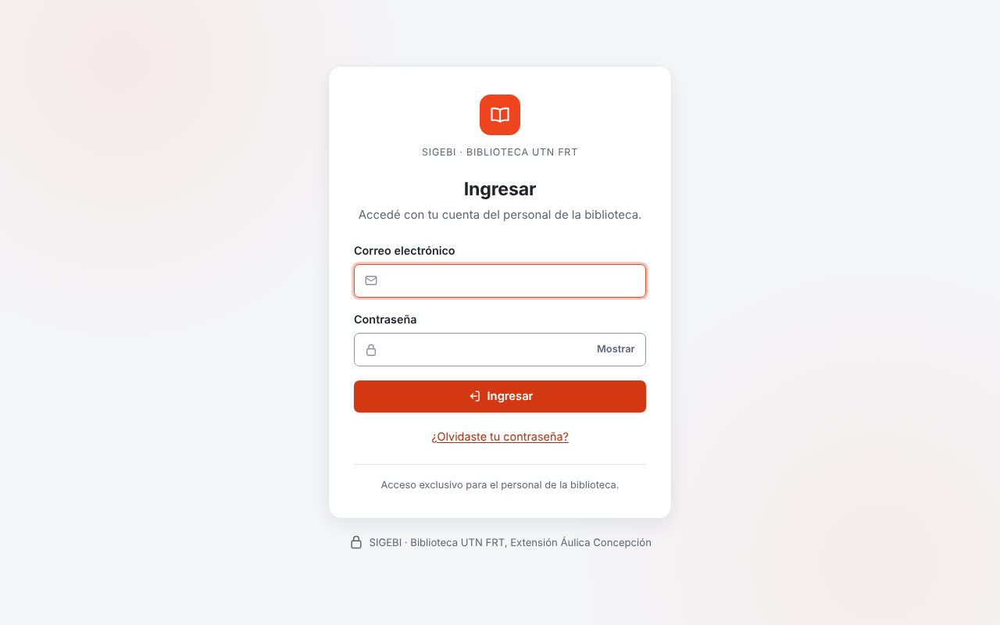

1. Escribí tu **correo electrónico** y tu **contraseña**.
2. Tocá **Ingresar**.

Si el correo o la contraseña no son correctos, el sistema muestra un único mensaje ("El correo o la
contraseña no son correctos") sin indicar cuál de los dos falló. Así nadie puede averiguar qué cuentas existen.

La sesión dura **8 horas**. Para salir, usá **Salir (tu nombre)**, al pie del menú lateral.

### 1.1. Primera vez: definir la contraseña

Cuando un Administrativo te crea la cuenta, te llega un correo **"Definí tu contraseña de SIGEBI"** con un
enlace. Abrilo, elegí tu contraseña y confirmala. El enlace **vence en una hora** y sirve una sola vez; si
venció, pedile al Administrativo que te lo reenvíe. Nadie más conoce tu contraseña.

### 1.2. Olvidé mi contraseña

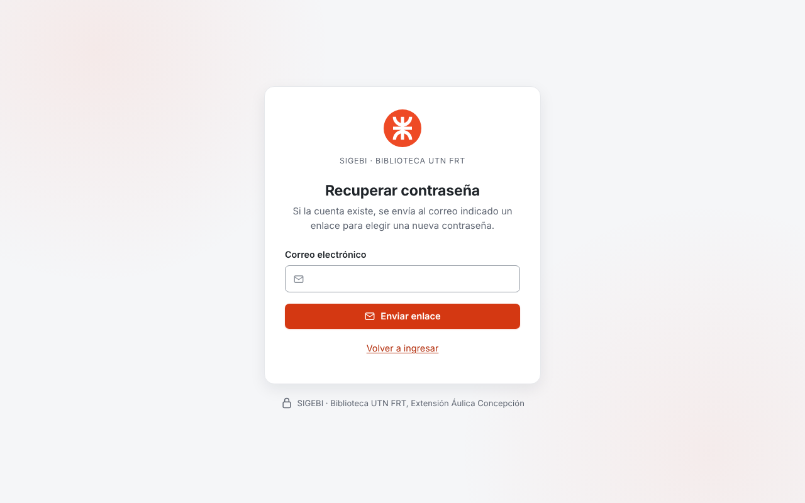

1. En la pantalla de ingreso, tocá **¿Olvidaste tu contraseña?**
2. Escribí tu correo y tocá **Enviar enlace**.
3. Revisá tu correo y abrí el enlace (vence en una hora). Elegí la contraseña nueva.

Por seguridad, la pantalla muestra el mismo mensaje exista o no una cuenta con ese correo.

---

## 2. Inicio y menú

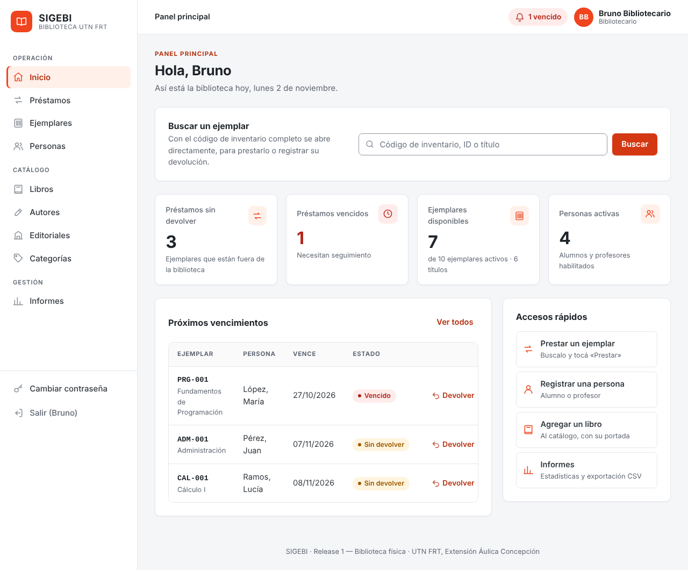

Después de ingresar se abre el **panel principal**, con el estado de la biblioteca en ese momento:

- **Buscar un ejemplar:** escribí el código de inventario completo y se abre directamente el ejemplar,
  listo para prestarlo o registrar su devolución.
- **Indicadores:** préstamos sin devolver, préstamos vencidos (en rojo si hay alguno), ejemplares
  disponibles y personas activas. Cada indicador lleva al listado correspondiente.
- **Próximos vencimientos:** los préstamos sin devolver, empezando por los más urgentes, con el acceso
  directo para registrar la devolución.
- **Accesos rápidos** a las tareas más frecuentes.

El **menú lateral** está siempre visible y agrupa las secciones:

| Grupo | Secciones |
|---|---|
| Operación | Inicio, Préstamos, Ejemplares, Personas |
| Catálogo | Libros, Autores, Editoriales, Categorías |
| Gestión | Informes y **Cuentas** (solo Administrativos) |

Al pie del menú están **Cambiar contraseña** y **Salir**. La sección en la que estás aparece resaltada en naranja.
En la cabecera se ven tu nombre y tu rol, y un **aviso rojo con la cantidad de préstamos vencidos**
(si los hay): al tocarlo se abre el listado de vencidos.

Los mensajes de confirmación (verde), aviso (amarillo) y error (rojo) aparecen arriba del contenido y se
pueden cerrar con la **✕**.

---

## 3. Catálogo: libros, autores, editoriales y categorías

### 3.1. Libros

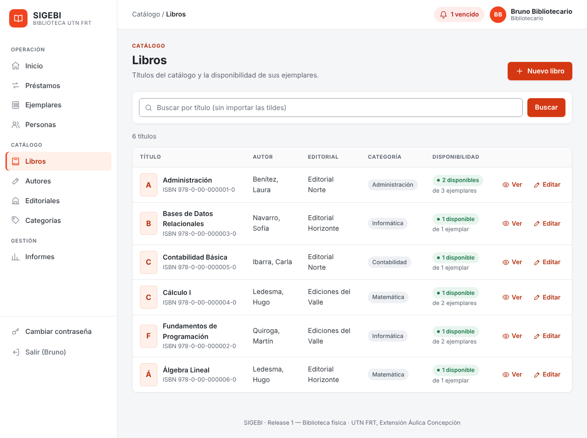

- **Buscar:** escribí parte del título. No hace falta poner tildes: "administracion" encuentra "Administración".
- **Nuevo libro:** botón arriba a la derecha.
- Tocá el título para ver el detalle.

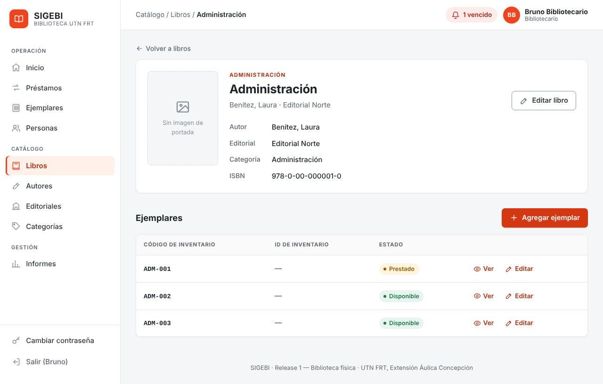

El detalle muestra los datos del libro, la imagen de portada (si se cargó) y sus **ejemplares** con el
estado de cada uno: **Disponible**, **Prestado** o **Dado de baja**. Desde acá podés **Agregar ejemplar**.

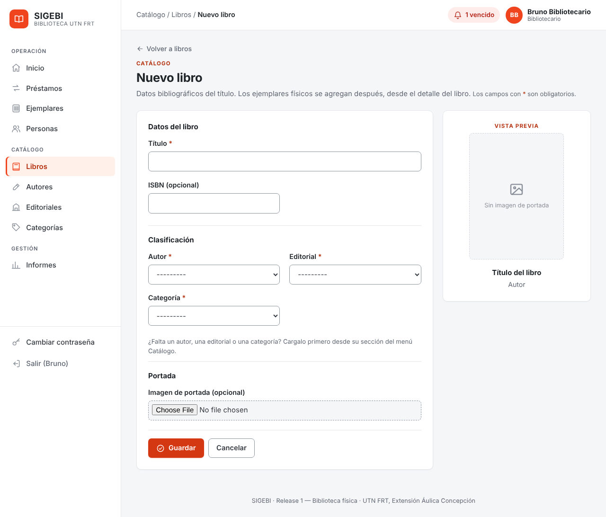

Para cargar un libro completá título, categoría, autor y editorial (obligatorios, marcados con `*`).
El **ISBN** y la **imagen de portada** son opcionales: hay material sin ISBN, como tesis o fotocopias.
Si la categoría, el autor o la editorial no existen, primero cargalos en su sección.

**Buscar en las listas:** arriba de las listas de categoría, autor y editorial hay un campo de búsqueda.
Escribí parte del nombre (sin tildes, por ejemplo "ishikawa") y la lista se reduce a las coincidencias; se
elige la primera y debajo se indica cuál quedó elegida. Si no es la correcta, abrí la lista y elegí otra.
Al borrar la búsqueda vuelve la lista completa.

### 3.2. Autores, editoriales y categorías

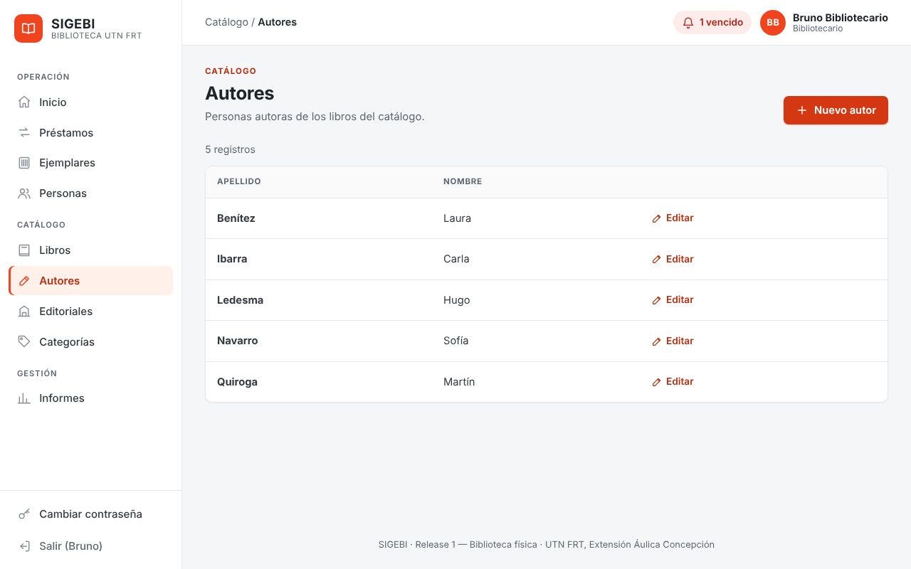

Las tres secciones funcionan igual: un listado con el botón **Nuevo** y la opción **Editar** en cada fila.
Estos registros no se eliminan desde las pantallas. Además, la base de datos impide borrar un autor, una
editorial o una categoría que esté en uso por algún libro, así nunca quedan libros sin esos datos.

---

## 4. Ejemplares y búsqueda por código

Un **libro** es la obra (por ejemplo, *Administración*); un **ejemplar** es cada copia física, identificada
por su **código de inventario** (la numeración escrita en el ejemplar).

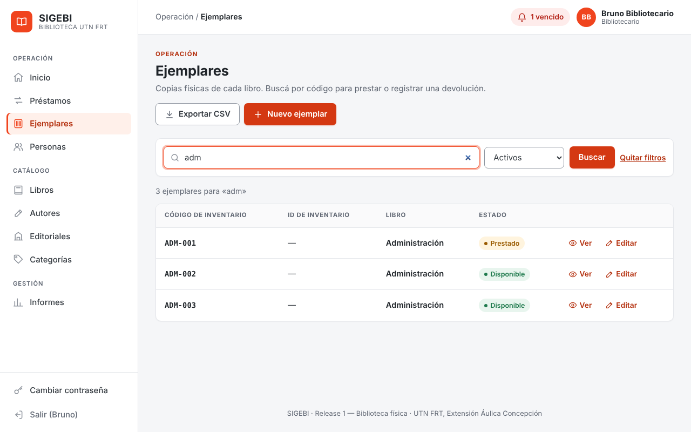

- **Buscar:** por **código de inventario**, **ID de inventario** o **título**.
  - Si escribís un código **completo** (por ejemplo `ADM-002`), se abre **directamente** ese ejemplar.
    Es lo más rápido cuando tenés el libro en la mano. No importan las mayúsculas.
  - Si escribís parte del código (por ejemplo `ADM`), se listan todos los que coinciden.
- **Estado:** por defecto se ven los ejemplares **activos**. Elegí **Dados de baja** o **Todos** para ver el resto.
- **Nuevo ejemplar:** el código de inventario es obligatorio y no se puede repetir.
  - **La forma más cómoda** es entrar al libro y tocar **Agregar ejemplar**: el formulario se abre con el libro ya elegido.
  - Si lo cargás desde **Ejemplares → Nuevo ejemplar**, usá el campo de búsqueda que está arriba de la lista de
    libros: escribí parte del título y la lista se reduce a las coincidencias.

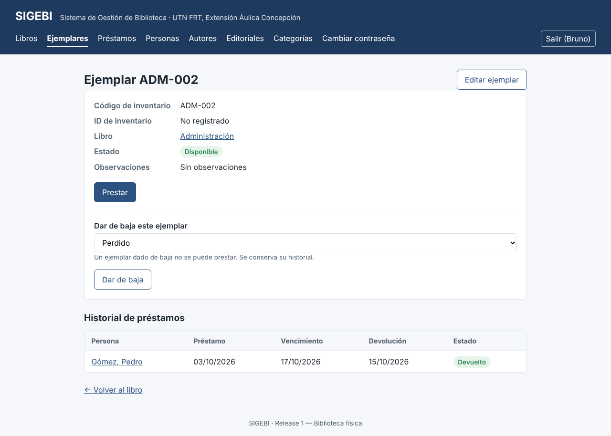

El detalle del ejemplar muestra su estado, el botón **Prestar** (si está disponible), la opción para
**darlo de baja** y el **historial de préstamos**.

---

## 5. Préstamos

### 5.1. Registrar un préstamo

1. Buscá el ejemplar (sección 4) y tocá **Prestar**.

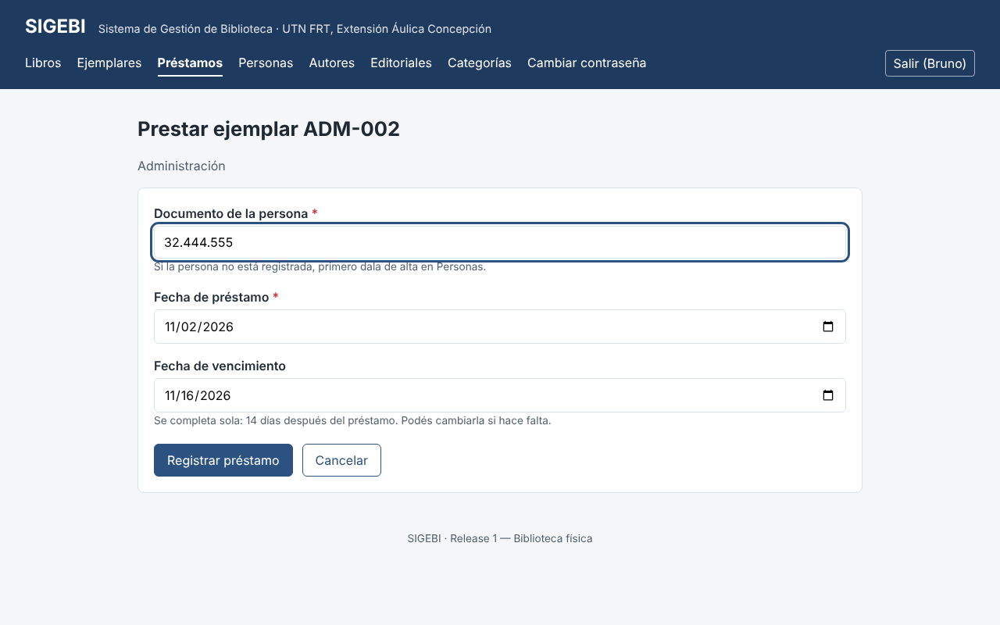

2. Escribí el **documento** de la persona. Puede ir con o sin puntos.
3. La **fecha de préstamo** viene con el día de hoy.
4. La **fecha de vencimiento** se completa sola: **14 días corridos** después del préstamo. Podés cambiarla si hace falta.
5. Tocá **Registrar préstamo**.

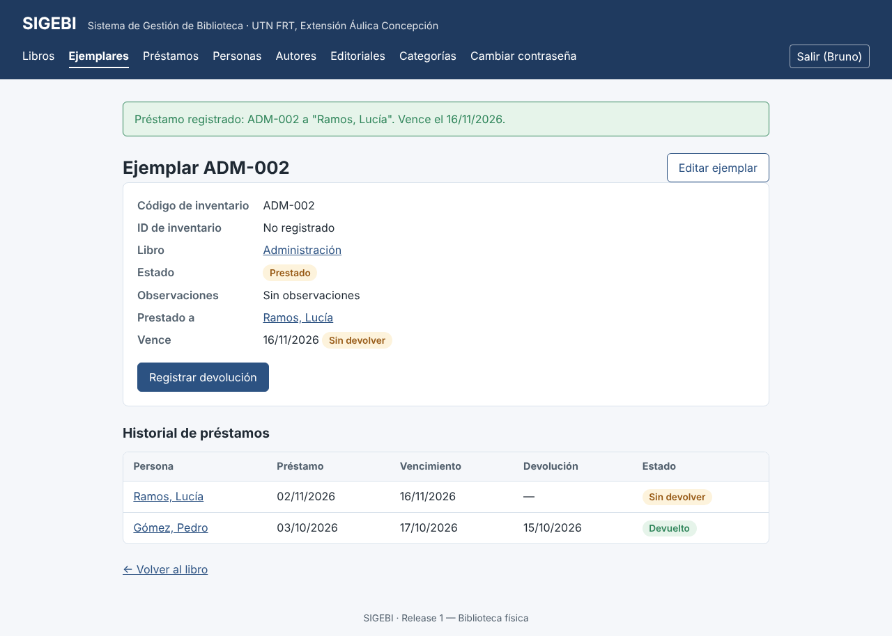

El sistema confirma el préstamo con la fecha de vencimiento, y el ejemplar pasa a **Prestado**, con el nombre de la persona.

**El sistema no deja prestar si:**

- el documento no corresponde a ninguna persona registrada (primero hay que darla de alta en **Personas**);
- la persona está **dada de baja**;
- el ejemplar ya está **prestado** o está **dado de baja**;
- la fecha de préstamo es **futura**, o el vencimiento es **anterior** al préstamo.

Si dos personas intentan prestar el mismo ejemplar al mismo tiempo, solo se registra el primer préstamo;
el segundo recibe un aviso.

### 5.2. Consultar préstamos

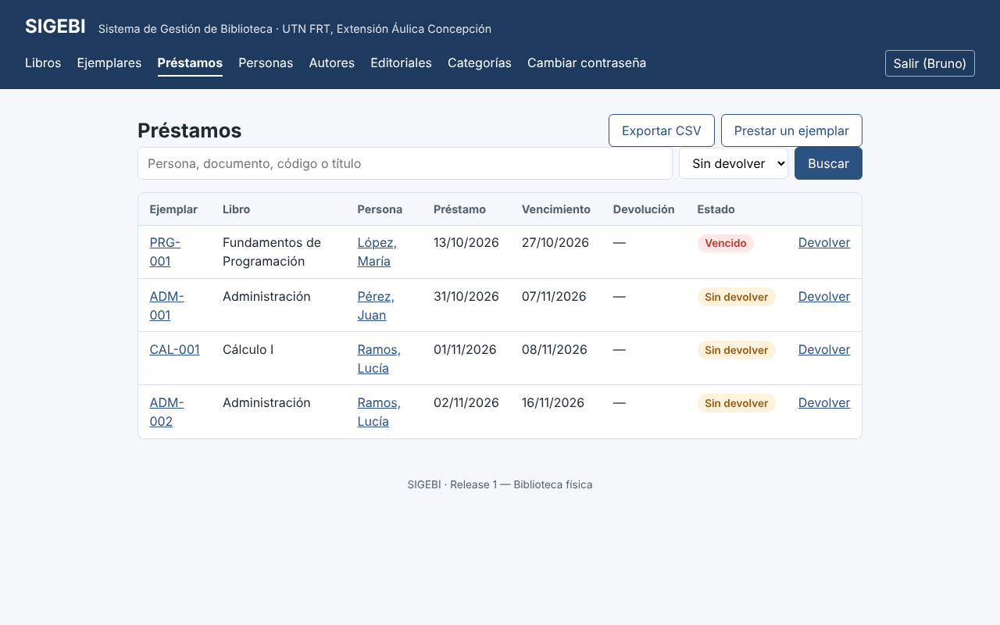

La sección **Préstamos** muestra por defecto los **sin devolver**, ordenados por vencimiento (los más
urgentes primero). Con el filtro podés ver:

| Filtro | Muestra |
|---|---|
| **Sin devolver** | Préstamos activos (vigentes y vencidos). |
| **Vencidos** | Préstamos sin devolver cuya fecha de vencimiento ya pasó. |
| **Devueltos** | Préstamos cerrados. |
| **Todos** | Todo el historial. |

El buscador encuentra por persona (sin tildes), documento, código de inventario o título.

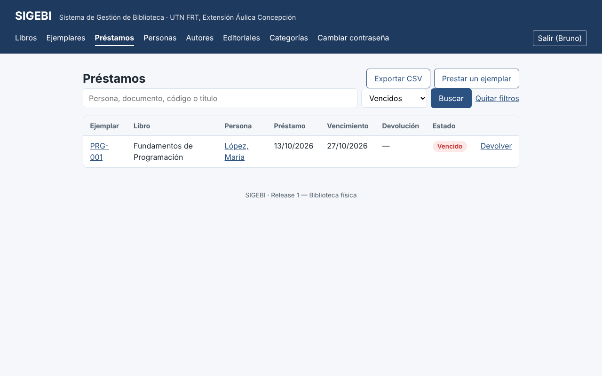

Los vencidos se marcan en rojo. Un préstamo que vence **hoy** todavía no está vencido.

---

## 6. Devoluciones

Se puede registrar la devolución desde el listado de préstamos (**Devolver**), desde el detalle del
ejemplar o desde el detalle de la persona (**Registrar devolución**).

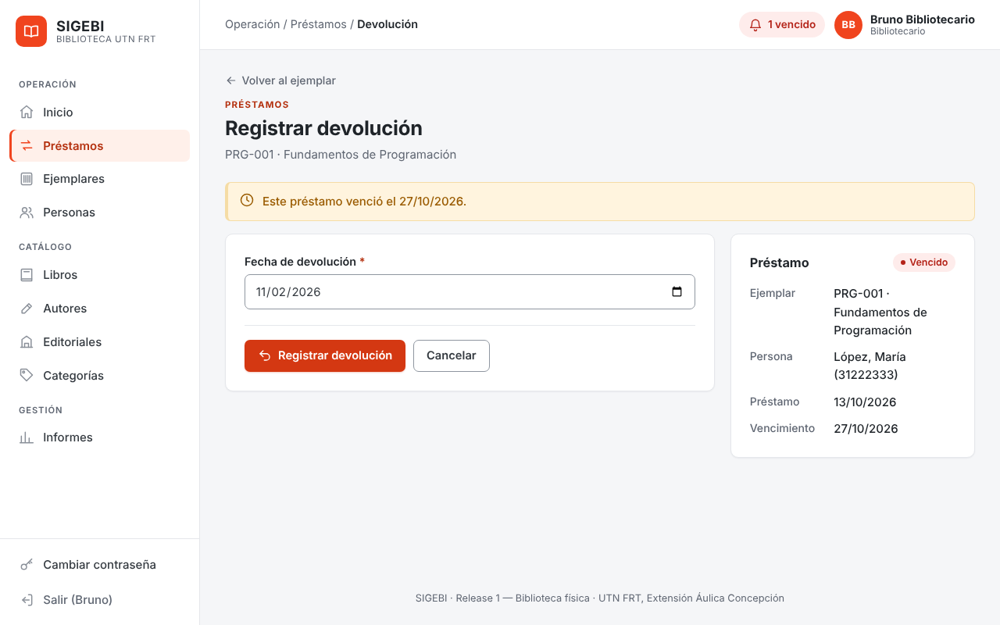

1. Revisá los datos del préstamo.
2. La **fecha de devolución** viene con el día de hoy; podés cambiarla si el libro se devolvió otro día.
3. Tocá **Registrar devolución**. El ejemplar vuelve a quedar **Disponible**.

La fecha de devolución **no puede ser anterior a la fecha del préstamo ni futura**. Esta regla también
la controla la base de datos, así que no se puede saltear por ningún medio.

---

## 7. Personas

Las personas son los alumnos y profesores que pueden pedir préstamos.

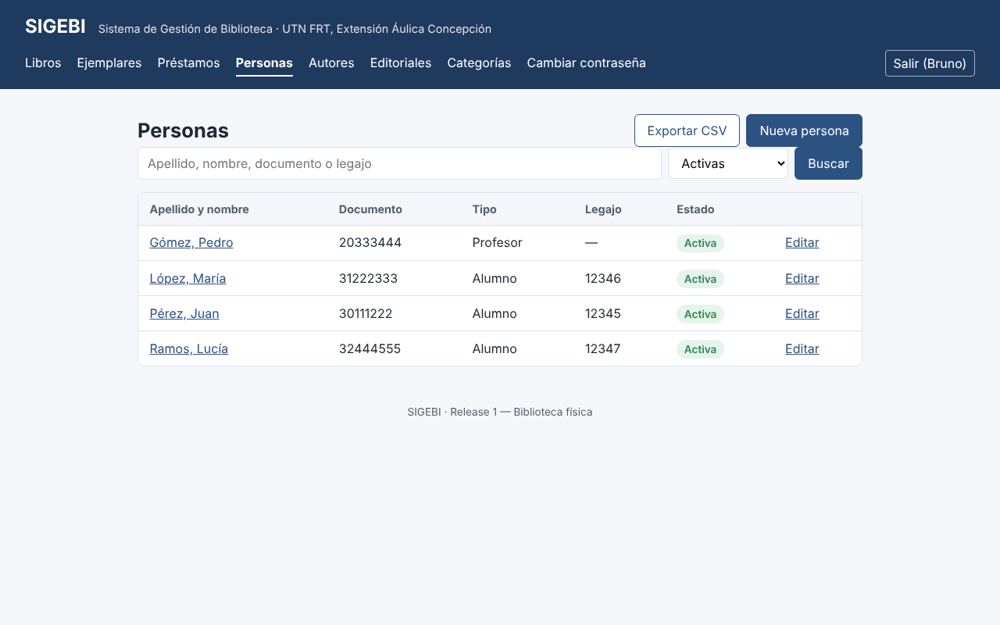

- **Buscar:** por apellido o nombre (sin tildes), documento (con o sin puntos) o legajo.
- **Estado:** por defecto se ven las **activas**; podés ver las **dadas de baja** o **todas**.
- **Nueva persona:** botón arriba a la derecha.

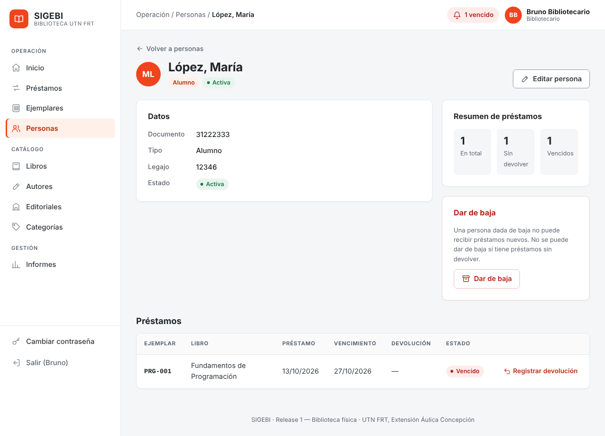

El detalle muestra los datos, el estado y el **historial de préstamos** de la persona, con la opción de
registrar la devolución de los que tiene sin devolver.

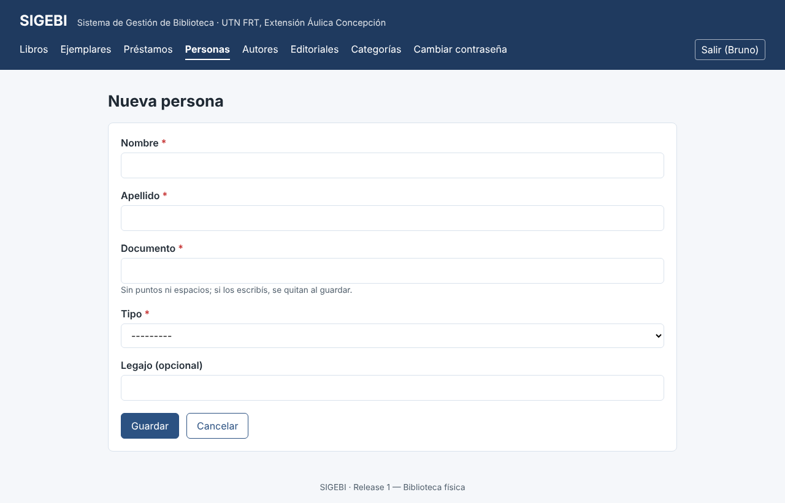

Nombre, apellido, documento y tipo (Alumno o Profesor) son obligatorios; el legajo es opcional.
El documento se guarda sin puntos ni espacios y **no se puede repetir**.

### 7.1. Dar de baja o reactivar una persona

En el detalle de la persona, **Dar de baja** la deja inactiva: no puede recibir préstamos nuevos, pero se
conserva su historial. Antes de hacerlo, el sistema pide **confirmar** en una ventana; con **Cancelar** no cambia nada. **No se puede dar de baja a una persona con préstamos sin devolver.**
Para volver a habilitarla, usá **Reactivar**.

---

## 8. Baja de ejemplares

Cuando un ejemplar se pierde, se daña o se descarta, se da de baja desde su detalle:

1. Elegí el **motivo**: Perdido, Dañado, Descarte u Otro.
2. Tocá **Dar de baja** y confirmá en la ventana que aparece (con **Cancelar** no cambia nada).

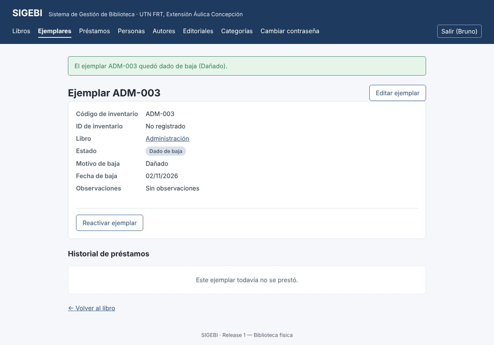

El ejemplar queda **Dado de baja**, con el motivo y la fecha. No se puede prestar, pero se conserva su
historial. **No se puede dar de baja un ejemplar prestado:** primero hay que registrar la devolución.
Si fue un error (por ejemplo, apareció el ejemplar perdido), usá **Reactivar ejemplar**.

---

## 9. Informes CSV

La sección **Informes** (menú lateral, grupo Gestión) muestra el estado de préstamos, ejemplares y personas
con barras de colores y los botones para descargar los informes más usados.

Además, los listados de **Ejemplares**, **Préstamos** y **Personas** tienen el botón **Exportar CSV**
(se ve en las capturas de esas secciones). El archivo trae **exactamente lo que estás viendo**: la misma
búsqueda y el mismo filtro, con todas las páginas.

| Informe | Desde | Ejemplo |
|---|---|---|
| Catálogo de ejemplares | Ejemplares | Todos los ejemplares activos con su estado. |
| Préstamos vencidos | Préstamos, filtro **Vencidos** | Incluye los **días de atraso** de cada préstamo. |
| Préstamos sin devolver, devueltos o todos | Préstamos, con el filtro elegido | — |
| Personas | Personas | Incluye cuántos préstamos sin devolver tiene cada persona. |

El archivo se descarga con la fecha en el nombre (por ejemplo `sigebi-prestamos-vencidos-2026-11-02.csv`)
y se abre con doble clic en Excel o LibreOffice: cada dato queda en su columna y las fechas en formato dd/mm/aaaa.

---

## 10. Cuentas del personal (Administrativo)

Solo los **Administrativos** (y el superusuario) ven la sección **Cuentas**.

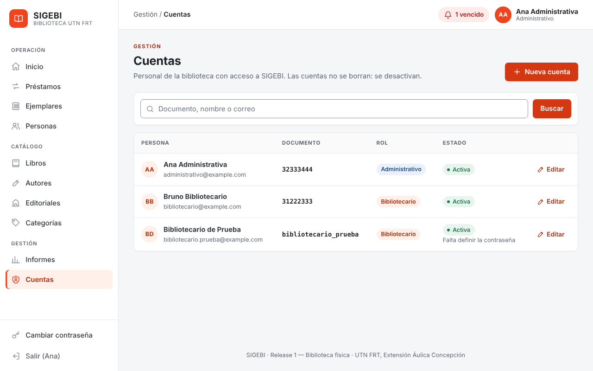

- El listado muestra documento, nombre, correo, rol y estado de cada cuenta.
- El Administrativo puede **crear y editar cuentas de Bibliotecarios**. Las cuentas Administrativas las
  gestiona solo el superusuario.

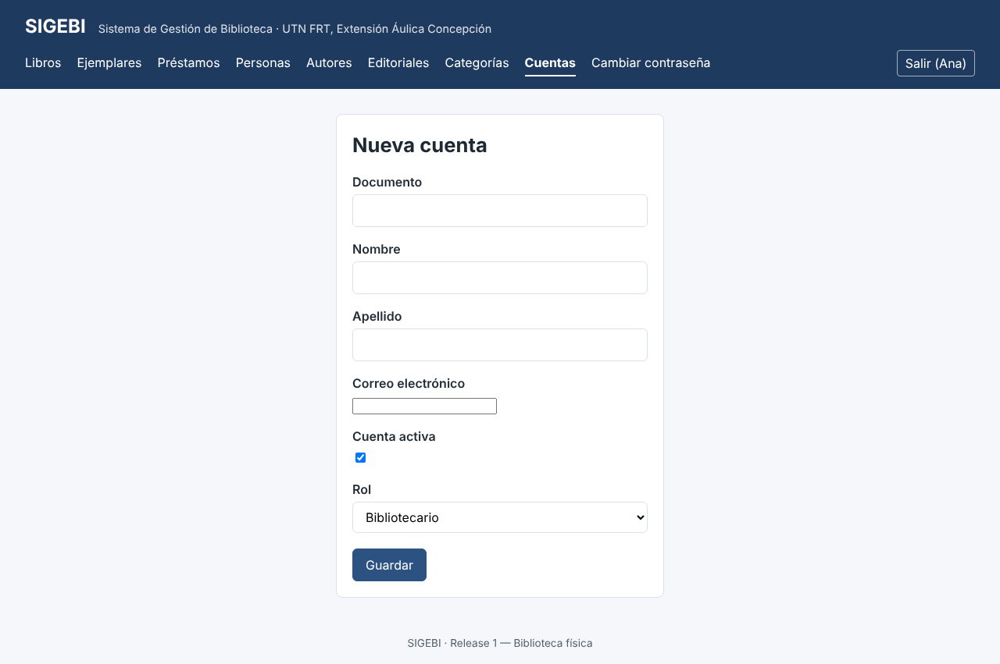

Para crear una cuenta completá documento, nombre, apellido, correo y rol. **No se escribe ninguna
contraseña:** el sistema le envía a la persona un correo para que la defina ella misma (sección 1.1).

- **Desactivar una cuenta:** en **Editar**, destildá **Cuenta activa**. Las cuentas no se borran.
- **Reenviar el correo de definición:** en **Editar**, si la persona todavía no definió su contraseña,
  aparece el botón **Reenviar correo de definición**.
- Nadie puede cambiar su propio rol ni desactivarse a sí mismo.

---

## 11. Cambiar la contraseña

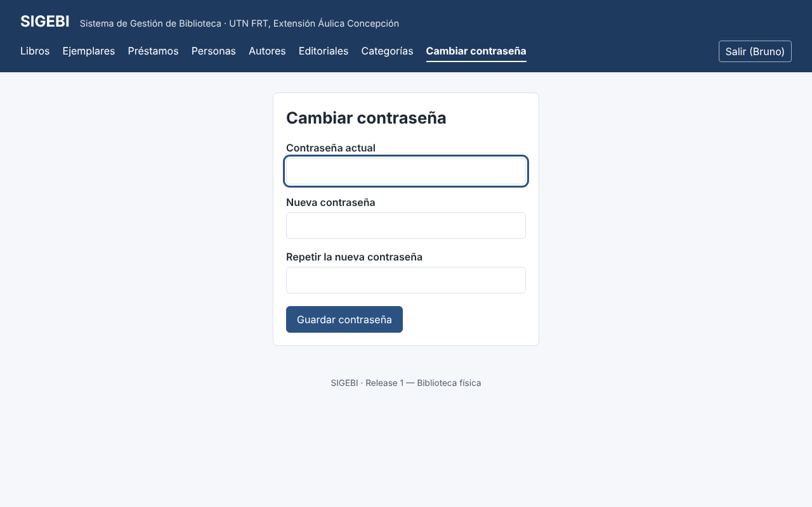

Desde **Cambiar contraseña** en el menú: escribí la contraseña actual y dos veces la nueva.
El sistema rechaza contraseñas demasiado cortas, muy comunes, solo numéricas o parecidas a tus datos.

---

## 12. Acceso no permitido

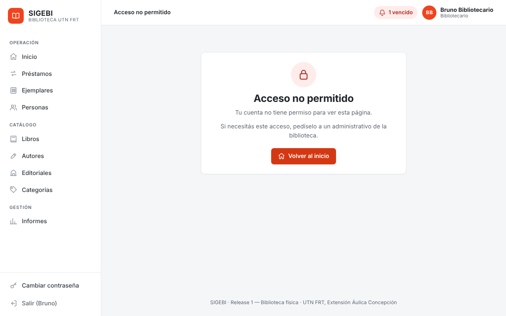

Si intentás entrar a una sección para la que tu cuenta no tiene permiso (por ejemplo, un Bibliotecario
que escribe la dirección de Cuentas), el sistema muestra **Acceso no permitido** y un botón para volver al inicio.

---

## 13. Uso desde el teléfono

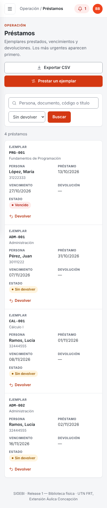

Todas las pantallas se adaptan al teléfono y a la tablet. En pantallas chicas el menú lateral se oculta:
se abre con el botón **☰** de la cabecera y se cierra con la **✕**, tocando fuera del menú o con la tecla Esc.
Las tablas se muestran como tarjetas, sin desplazamiento horizontal.

---

## 14. Mensajes frecuentes

| Mensaje | Qué significa | Qué hacer |
|---|---|---|
| El correo o la contraseña no son correctos. | Datos de ingreso incorrectos o cuenta desactivada. | Revisar los datos o usar "¿Olvidaste tu contraseña?". |
| No hay ninguna persona registrada con ese documento. | El documento no está cargado. | Dar de alta a la persona en **Personas**. |
| "…" está dada de baja: no puede recibir préstamos. | La persona está inactiva. | Reactivarla desde su detalle, si corresponde. |
| Este ejemplar ya está prestado. | Tiene un préstamo sin devolver. | Registrar primero la devolución. |
| Este ejemplar está dado de baja: no se puede prestar. | El ejemplar está inactivo. | Reactivarlo desde su detalle, si corresponde. |
| La fecha de devolución no puede ser anterior a la fecha de préstamo. | Fecha mal cargada. | Corregir la fecha. |
| No se puede dar de baja…: tiene préstamos sin devolver. | Persona o ejemplar con un préstamo activo. | Registrar la devolución y volver a intentar. |
| Ya existe una persona con ese documento. / Ya existe una cuenta con ese correo. | Dato repetido. | Buscar el registro existente. |
| Acceso no permitido. | La cuenta no tiene permiso para esa sección. | Pedir el acceso a un Administrativo. |
