# SIGEBI — Manual de usuario

**Release 1 (biblioteca física) y Release 2 (biblioteca virtual).** UTN FRT, Extensión Áulica Concepción.

Este manual explica, pantalla por pantalla, cómo usar SIGEBI. Tiene dos partes:

- **Parte 1 — Personal de la biblioteca:** Bibliotecarios y Administrativos.
- **Parte 2 — Estudiantes y docentes:** el portal donde alumnos y profesores consultan el catálogo, reservan
  libros y comparten material.

Las capturas son del sistema funcionando con el inventario real de la biblioteca y con personas, cuentas y
préstamos **ficticios** (datos de prueba).

> Los campos de fecha usan el calendario del navegador. En un navegador configurado en español se ven como
> día/mes/año; en las capturas aparecen como mes/día porque se tomaron con un navegador en inglés. Por el mismo
> motivo, el botón para elegir un archivo aparece como "Choose File".

## Índice

**Parte 1 — Personal de la biblioteca**

1. [Ingreso al sistema](#1-ingreso-al-sistema)
2. [Inicio y menú](#2-inicio-y-menú)
3. [Libros, autores, editoriales y categorías](#3-libros-autores-editoriales-y-categorías)
4. [Ejemplares y búsqueda por código](#4-ejemplares-y-búsqueda-por-código)
5. [Código QR y etiquetas](#5-código-qr-y-etiquetas)
6. [Préstamos](#6-préstamos)
7. [Devoluciones](#7-devoluciones)
8. [Reservas](#8-reservas)
9. [Opiniones](#9-opiniones)
10. [Personas y cuentas del portal](#10-personas-y-cuentas-del-portal)
11. [Carreras y categorías](#11-carreras-y-categorías)
12. [Material digital](#12-material-digital)
13. [Baja de ejemplares](#13-baja-de-ejemplares)
14. [Informes](#14-informes)
15. [Avisos automáticos por correo](#15-avisos-automáticos-por-correo)
16. [Cuentas del personal (Administrativo)](#16-cuentas-del-personal-administrativo)
17. [Mi perfil y cambiar la contraseña](#17-mi-perfil-y-cambiar-la-contraseña)
18. [Acceso no permitido](#18-acceso-no-permitido)
19. [Uso desde el teléfono](#19-uso-desde-el-teléfono)
20. [Mensajes frecuentes del personal](#20-mensajes-frecuentes-del-personal)

**Parte 2 — Estudiantes y docentes**

21. [Cómo obtener la cuenta e ingresar](#21-cómo-obtener-la-cuenta-e-ingresar)
22. [Inicio del portal](#22-inicio-del-portal)
23. [Catálogo](#23-catálogo)
24. [Detalle de un libro: reservar y opinar](#24-detalle-de-un-libro-reservar-y-opinar)
25. [Material digital: consultar y compartir](#25-material-digital-consultar-y-compartir)
26. [Mis préstamos](#26-mis-préstamos)
27. [Mis reservas](#27-mis-reservas)
28. [Mi perfil](#28-mi-perfil)
29. [El portal en el celular](#29-el-portal-en-el-celular)
30. [Mensajes frecuentes del portal](#30-mensajes-frecuentes-del-portal)

---

# Parte 1 — Personal de la biblioteca

## 1. Ingreso al sistema

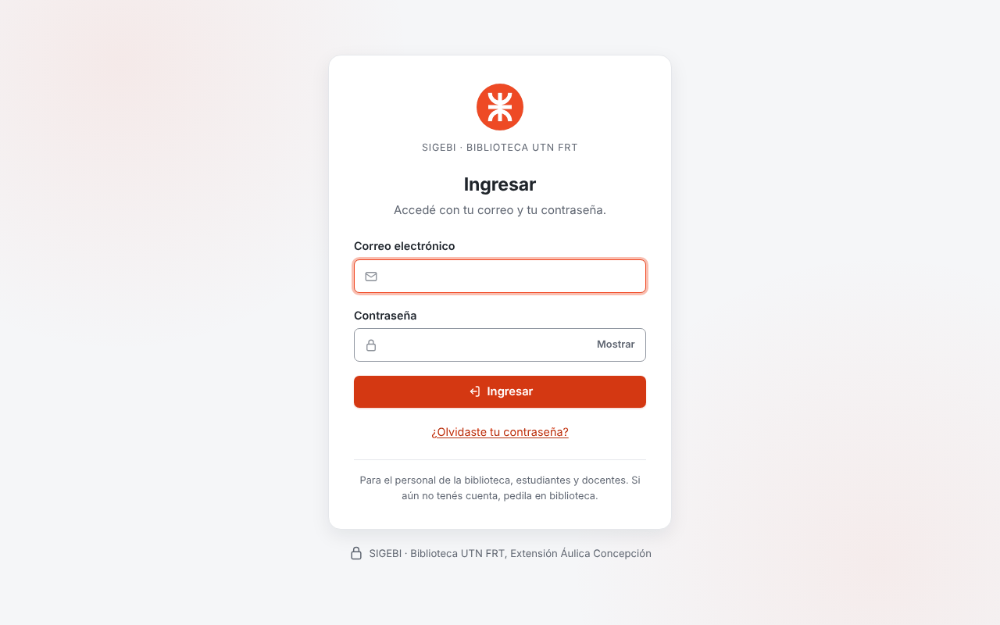

1. Escribí tu **correo electrónico** y tu **contraseña**.
2. Tocá **Ingresar**.

La misma pantalla sirve para el personal y para estudiantes y docentes: el sistema reconoce la cuenta y lleva a
cada uno a su parte (el personal al **panel principal**; alumnos y profesores al **portal**, Parte 2).

Si el correo o la contraseña no son correctos, el sistema muestra un único mensaje ("El correo o la
contraseña no son correctos") sin indicar cuál de los dos falló. Así nadie puede averiguar qué cuentas existen.

Después de **5 intentos fallidos en 15 minutos**, el sistema muestra "Hubo demasiados intentos fallidos.
Esperá 15 minutos y volvé a intentar." Durante ese tiempo no se puede entrar, ni siquiera con la contraseña
correcta. Si hace falta desbloquear la cuenta antes, el superusuario borra esos intentos desde el panel de
administración (**Intentos de acceso**).

La sesión dura **8 horas**. Para salir, usá **Salir (tu nombre)**, al pie del menú lateral.

### 1.1. Primera vez: definir la contraseña

Cuando te crean la cuenta, te llega un correo **"Definí tu contraseña de SIGEBI"** con un enlace. Abrilo, elegí
tu contraseña y confirmala. El enlace **vence en una hora** y sirve una sola vez; si venció, pedí que te lo
reenvíen. Nadie más conoce tu contraseña.

### 1.2. Olvidé mi contraseña

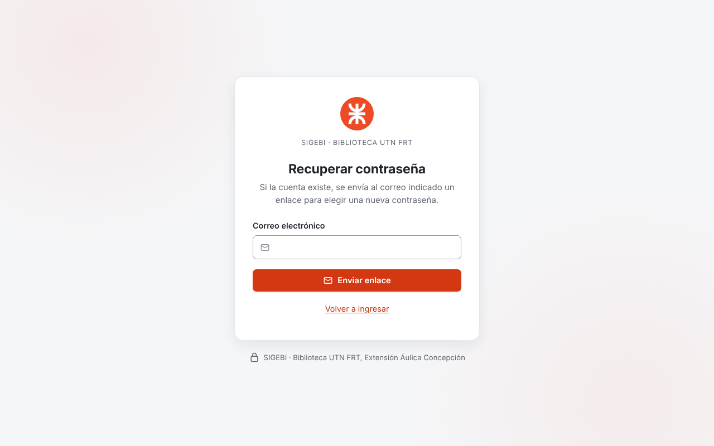

1. En la pantalla de ingreso, tocá **¿Olvidaste tu contraseña?**
2. Escribí tu correo y tocá **Enviar enlace**.
3. Revisá tu correo (también la carpeta de spam) y abrí el enlace, que vence en una hora. Elegí la contraseña nueva.

Por seguridad, la pantalla muestra el mismo mensaje exista o no una cuenta con ese correo. Se envían como
máximo **3 correos por hora** a una misma dirección: si no llega, esperá una hora antes de volver a pedirlo.

---

## 2. Inicio y menú

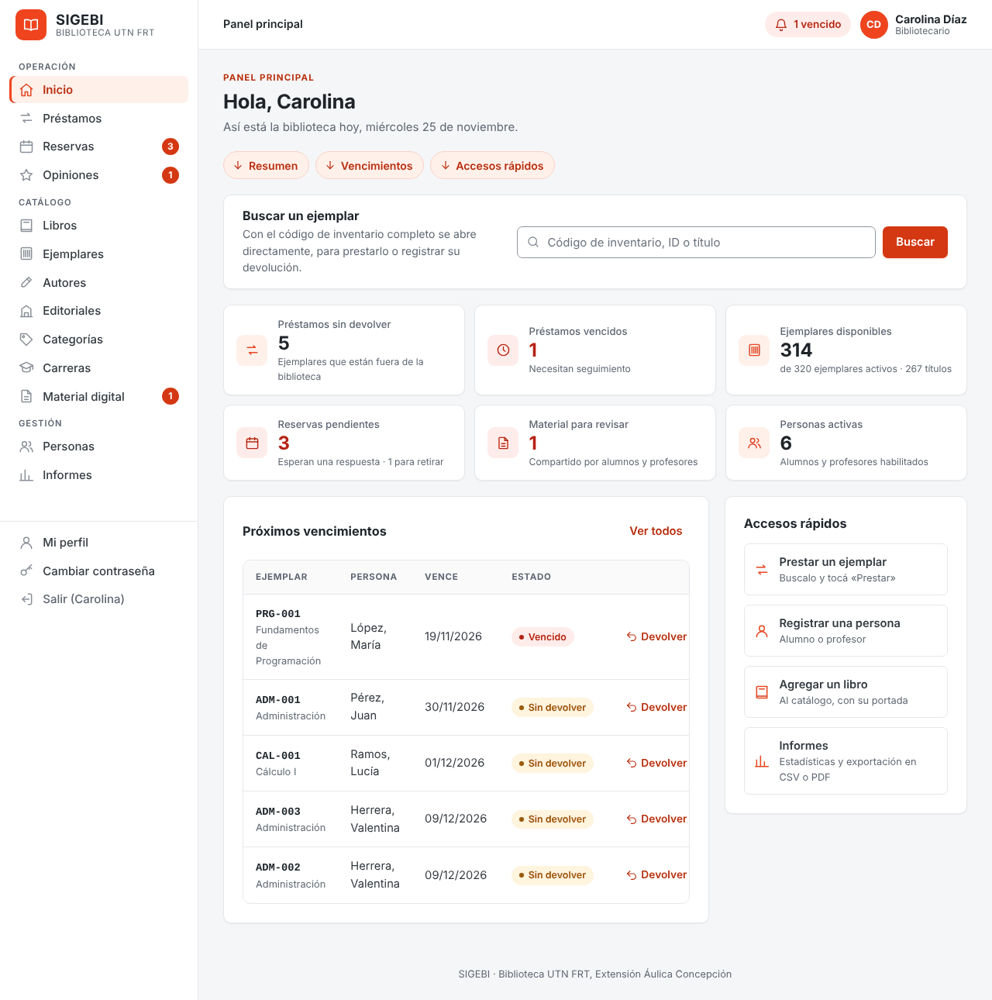

Después de ingresar se abre el **panel principal**, con el estado de la biblioteca en ese momento. Los botones
**Resumen**, **Vencimientos** y **Accesos rápidos** llevan directo a cada parte de la página.

- **Buscar un ejemplar:** escribí el código de inventario completo y se abre directamente el ejemplar,
  listo para prestarlo o registrar su devolución.
- **Indicadores:** préstamos sin devolver, préstamos vencidos (en rojo si hay alguno), ejemplares disponibles,
  **reservas pendientes**, **material para revisar** y personas activas. Cada indicador lleva a su listado.
- **Próximos vencimientos:** los préstamos sin devolver, empezando por los más urgentes, con el acceso
  directo para registrar la devolución.
- **Accesos rápidos** a las tareas más frecuentes.

El **menú lateral** agrupa las secciones. Los números rojos indican lo que espera una respuesta (reservas
pendientes, opiniones y material para revisar).

| Grupo | Secciones |
|---|---|
| Operación | Inicio, Préstamos, **Reservas**, **Opiniones** |
| Catálogo | Libros, Ejemplares, Autores, Editoriales, Categorías, **Carreras**, **Material digital** |
| Gestión | Personas, Informes y **Cuentas** (solo Administrativos) |

Al pie del menú están **Mi perfil**, **Cambiar contraseña** y **Salir**. La sección en la que estás aparece
resaltada en naranja. En la cabecera se ven tu nombre y tu rol, y un **aviso rojo con la cantidad de préstamos
vencidos** (si los hay): al tocarlo se abre el listado de vencidos.

Los mensajes de confirmación (verde), aviso (amarillo) y error (rojo) aparecen arriba del contenido y se
pueden cerrar con la **✕**. En las páginas largas aparece, al bajar, un botón redondo **Volver arriba**
abajo a la derecha.

---

## 3. Libros, autores, editoriales y categorías

### 3.1. Libros

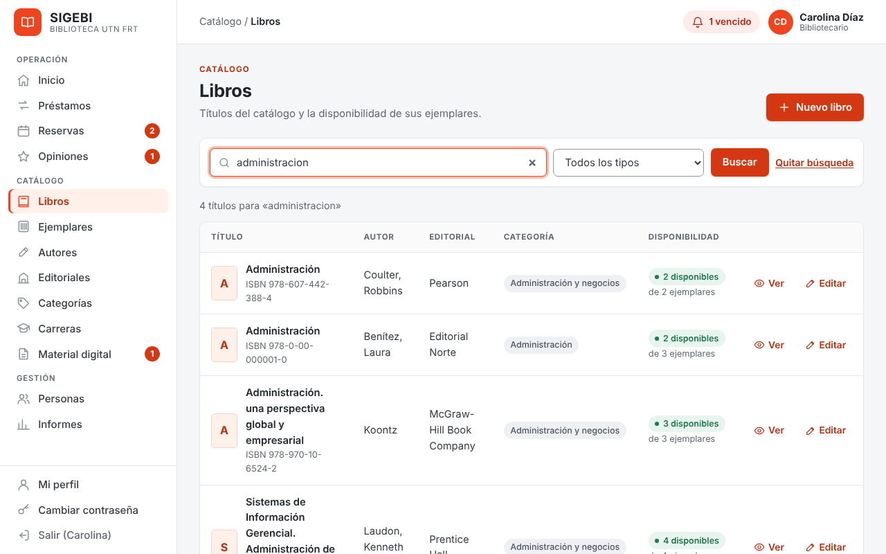

- **Al entrar** no se muestra la lista completa: se ve cuántos títulos tiene el catálogo y el buscador.
  Así la pantalla no carga todos los libros cada vez.
- **Buscar:** escribí parte del título. No hace falta poner tildes: "administracion" encuentra "Administración".
- **Tipo:** podés ver solo los libros que tienen ejemplares originales, copias o tesis.
- **Ver todos los libros:** si necesitás recorrer el catálogo completo (se muestra de a 20 por página).
- La columna **Disponibilidad** indica cuántos ejemplares hay en la biblioteca.
- **Nuevo libro:** botón arriba a la derecha. Tocá **Ver** para abrir el detalle.

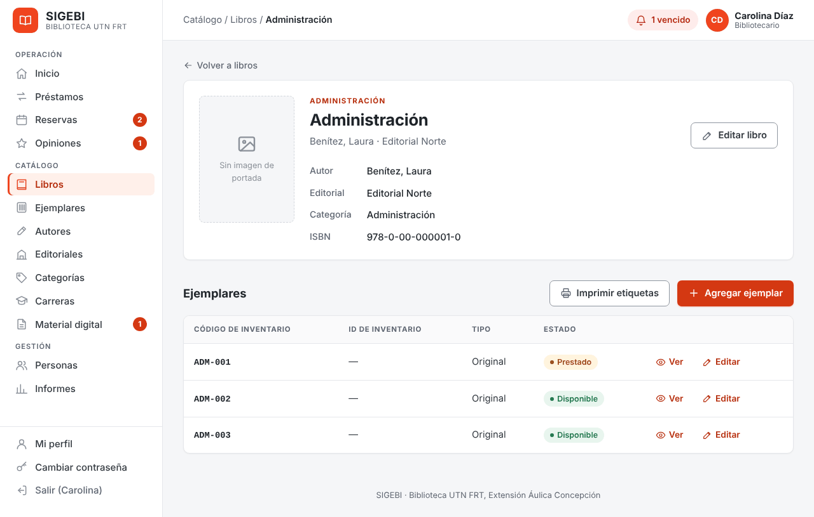

El detalle muestra los datos del libro, la imagen de portada (si se cargó) y sus **ejemplares** con el tipo y
el estado de cada uno: **Disponible**, **Prestado**, **Apartado** (por una reserva) o **Dado de baja**.
Desde acá podés **Agregar ejemplar** e **Imprimir etiquetas** con el QR de todos sus ejemplares (sección 5).

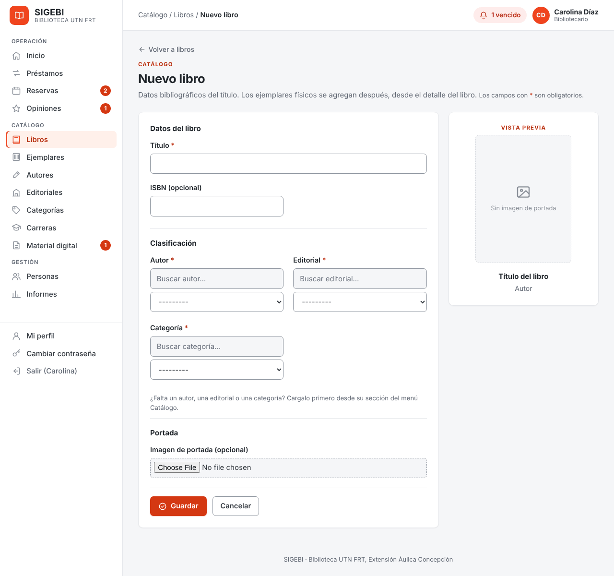

Para cargar un libro completá título, autor, editorial y categoría (obligatorios, marcados con `*`).
El **ISBN** y la **imagen de portada** son opcionales: hay material sin ISBN, como tesis o fotocopias.
Si la categoría, el autor o la editorial no existen, primero cargalos en su sección.

**Buscar en las listas:** arriba de las listas de autor, editorial y categoría hay un campo de búsqueda.
Escribí parte del nombre (sin tildes) y la lista se reduce a las coincidencias; se elige la primera y debajo se
indica cuál quedó elegida. Si no es la correcta, abrí la lista y elegí otra.

> La **categoría** decide qué alumnos y profesores ven el libro en el portal: cada categoría tiene sus carreras
> (sección 11).

### 3.2. Autores, editoriales y categorías

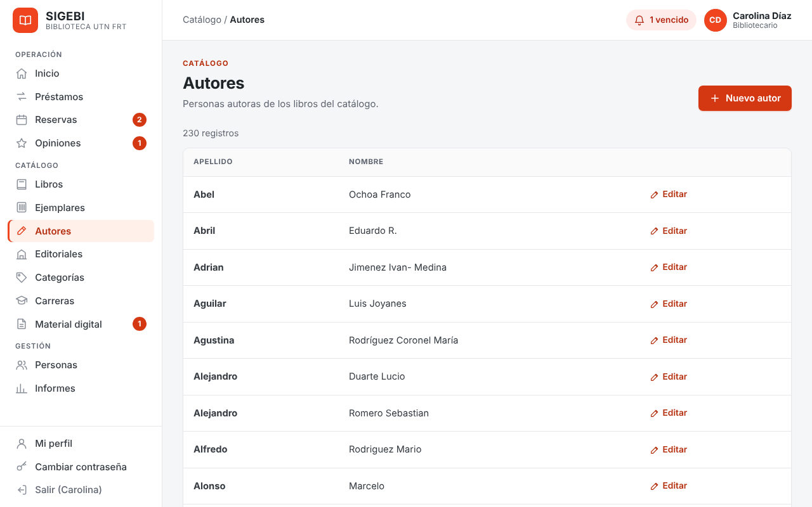

Las tres secciones funcionan igual: un listado con el botón **Nuevo** y la opción **Editar** en cada fila.
Estos registros no se eliminan desde las pantallas. Además, la base de datos impide borrar un autor, una
editorial o una categoría que esté en uso por algún libro. Las categorías tienen además sus **carreras**
(sección 11).

---

## 4. Ejemplares y búsqueda por código

Un **libro** es la obra (por ejemplo, *Administración*); un **ejemplar** es cada copia física, identificada
por su **código de inventario** (la numeración escrita en el ejemplar).

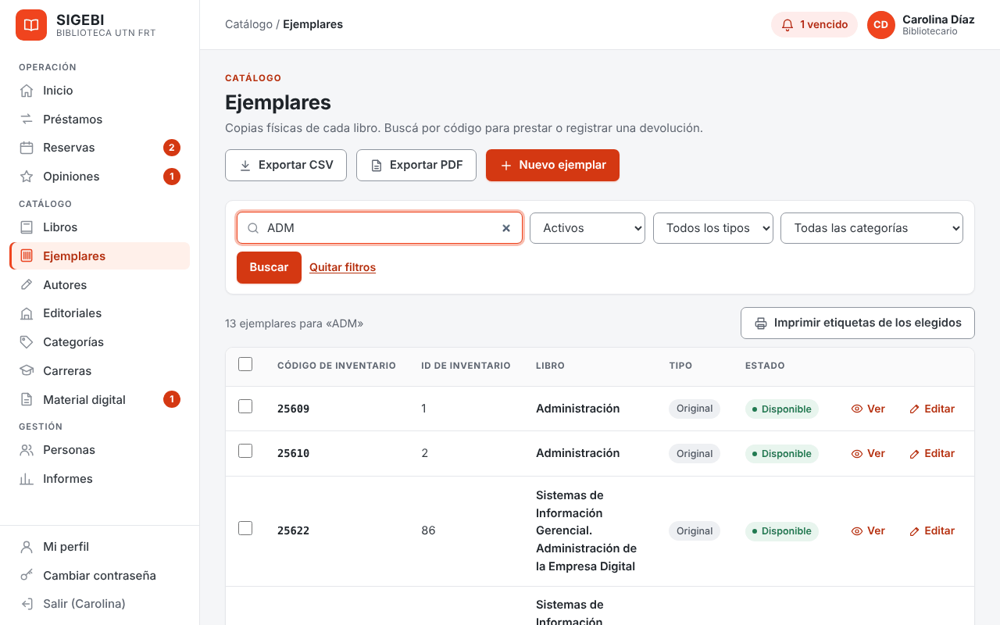

- **Buscar:** por **código de inventario**, **ID de inventario** o **título**.
  - Si escribís un código **completo** (por ejemplo `ADM-002`), se abre **directamente** ese ejemplar.
    No importan las mayúsculas.
  - Si escribís parte del código o del título, se listan todos los que coinciden.
- **Filtros:** estado (**Activos**, **Dados de baja** o **Todos**), tipo (**Original**, **Copia** o **Tesis**)
  y categoría.
- **Al entrar** no se muestra la lista: se ve cuántos ejemplares activos hay y el buscador. Para recorrerlos
  todos, tocá **Ver todos los ejemplares activos**.
- **Exportar CSV** y **Exportar PDF** descargan lo que estás viendo (sección 14).
- **Imprimir etiquetas de los elegidos:** marcá las casillas de la izquierda y tocá ese botón (sección 5).
- **Nuevo ejemplar:** el código de inventario es obligatorio y no se puede repetir. Elegí también el **tipo**:
  original, copia o tesis. **La forma más cómoda** es entrar al libro y tocar **Agregar ejemplar**: el
  formulario se abre con el libro ya elegido.

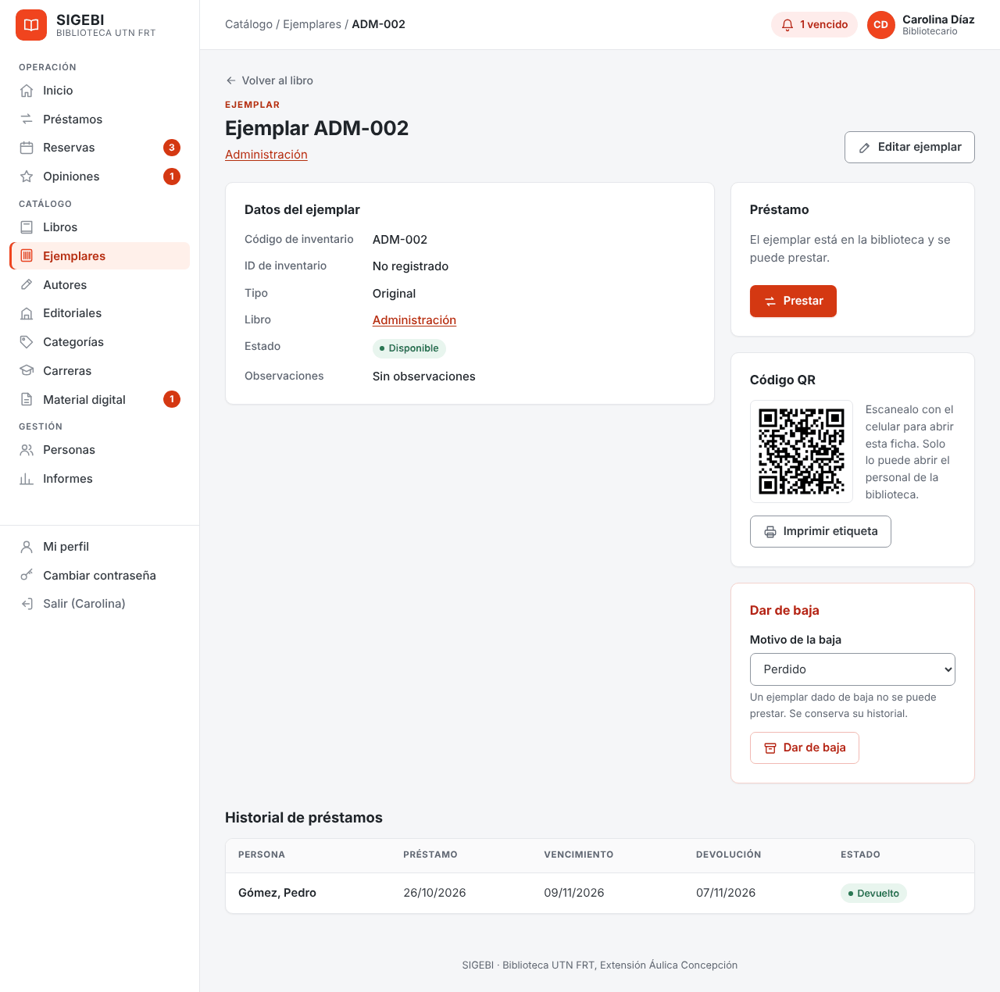

El detalle del ejemplar muestra sus datos y su estado, el botón **Prestar** (si está disponible), el
**código QR**, la opción para **darlo de baja** y el **historial de préstamos**.

---

## 5. Código QR y etiquetas

Cada ejemplar tiene un **código QR** con la dirección de su ficha. Al escanearlo con la cámara del celular
(con la sesión iniciada en SIGEBI), se abre la ficha del ejemplar para prestarlo o registrar la devolución.
**Solo lo puede abrir el personal:** si lo escanea un alumno o un profesor, ve "Acceso no permitido".

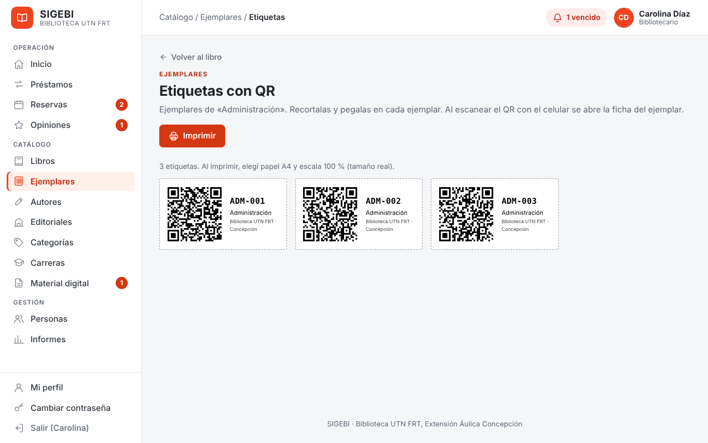

Para imprimir etiquetas:

- **De un ejemplar:** en su detalle, **Imprimir etiqueta**.
- **De todos los ejemplares de un libro:** en el detalle del libro, **Imprimir etiquetas**.
- **De varios ejemplares:** en **Ejemplares**, marcá las casillas y tocá **Imprimir etiquetas de los elegidos**.

Cada etiqueta tiene el QR, el código de inventario y el título. Tocá **Imprimir**, elegí papel A4 y escala
100 % (tamaño real); después recortalas y pegalas en cada ejemplar.

> Las etiquetas tienen que imprimirse desde el sistema publicado (o con la dirección del servidor en la red de
> la biblioteca). Si se imprimen desde `127.0.0.1` o `localhost`, la pantalla avisa que el QR no va a funcionar
> en otro dispositivo.

---

## 6. Préstamos

### 6.1. Registrar un préstamo

1. Buscá el ejemplar (sección 4) y tocá **Prestar**.

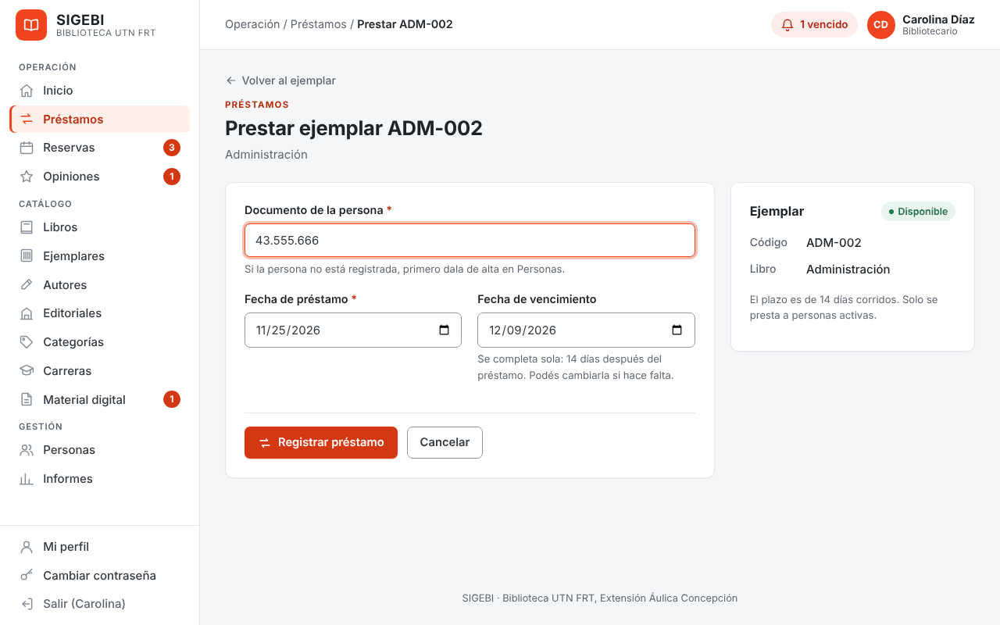

2. Escribí el **documento** de la persona. Puede ir con o sin puntos.
3. La **fecha de préstamo** viene con el día de hoy.
4. La **fecha de vencimiento** se completa sola: **14 días corridos** después del préstamo. Podés cambiarla si hace falta.
5. Tocá **Registrar préstamo**.

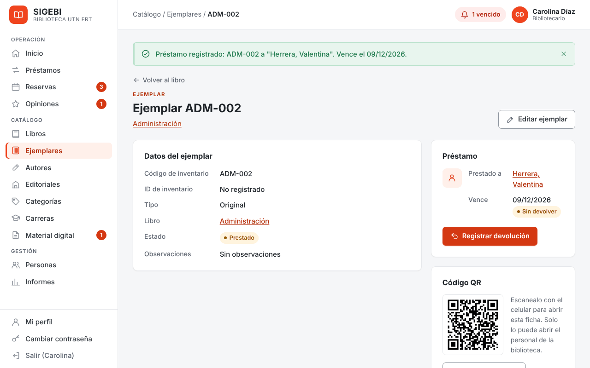

El sistema confirma el préstamo con la fecha de vencimiento, y el ejemplar pasa a **Prestado**, con el nombre de la persona.

**El sistema no deja prestar si:**

- el documento no corresponde a ninguna persona registrada (primero hay que darla de alta en **Personas**);
- la persona está **dada de baja**;
- el ejemplar ya está **prestado** o está **dado de baja**;
- el ejemplar está **apartado por una reserva** de otra persona (solo se le presta a quien lo reservó);
- la fecha de préstamo es **futura**, o el vencimiento es **anterior** al préstamo.

Si dos personas intentan prestar el mismo ejemplar al mismo tiempo, solo se registra el primer préstamo;
el segundo recibe un aviso.

### 6.2. Consultar préstamos

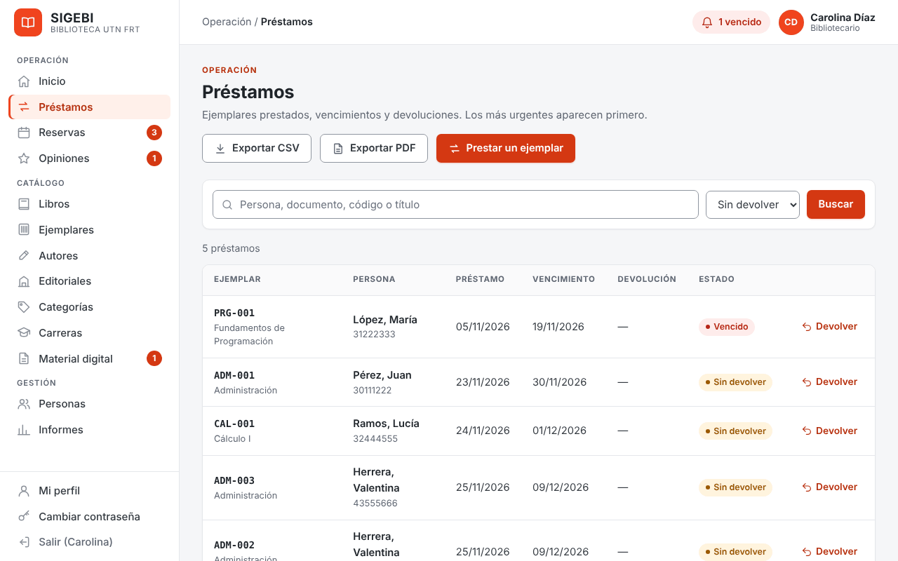

La sección **Préstamos** muestra por defecto los **sin devolver**, ordenados por vencimiento (los más
urgentes primero). Con el filtro podés ver:

| Filtro | Muestra |
|---|---|
| **Sin devolver** | Préstamos activos (vigentes y vencidos). |
| **Vencidos** | Préstamos sin devolver cuya fecha de vencimiento ya pasó. |
| **Devueltos** | Préstamos cerrados. |
| **Todos** | Todo el historial. |

El buscador encuentra por persona (sin tildes), documento, código de inventario o título.

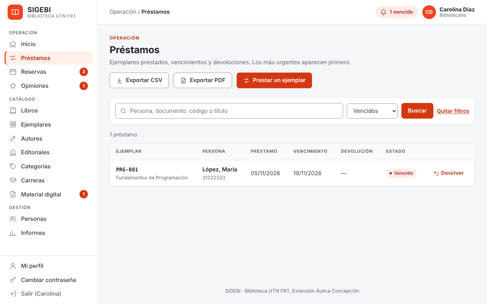

Los vencidos se marcan en rojo. Un préstamo que vence **hoy** todavía no está vencido.

---

## 7. Devoluciones

Se puede registrar la devolución desde el listado de préstamos (**Devolver**), desde el detalle del
ejemplar o desde el detalle de la persona (**Registrar devolución**).

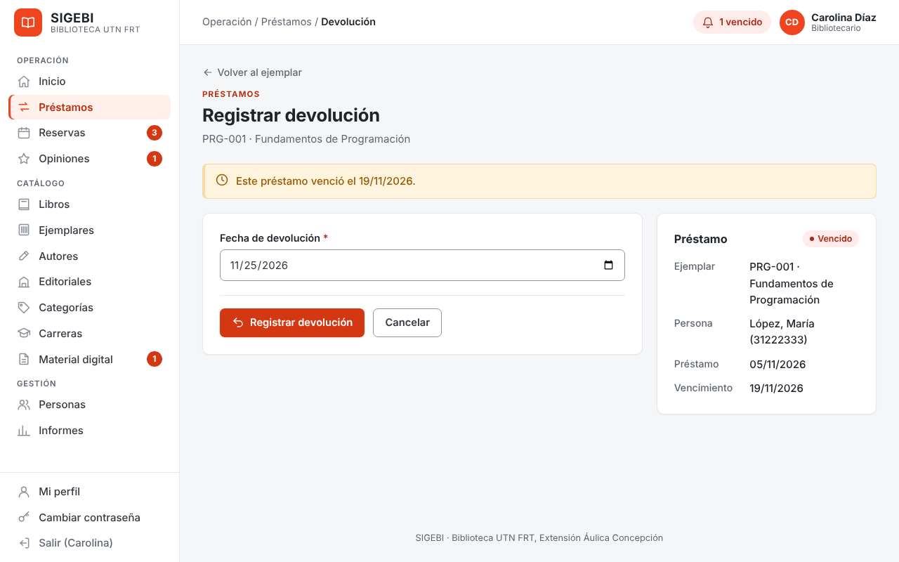

1. Revisá los datos del préstamo. Si está vencido, se indica desde cuándo.
2. La **fecha de devolución** viene con el día de hoy; podés cambiarla si el libro se devolvió otro día.
3. Tocá **Registrar devolución**. El ejemplar vuelve a quedar **Disponible**.

La fecha de devolución **no puede ser anterior a la fecha del préstamo ni futura**. Esta regla también
la controla la base de datos, así que no se puede saltear por ningún medio.

---

## 8. Reservas

Los alumnos y profesores pueden **reservar libros físicos** desde el portal (Parte 2). La biblioteca confirma
la reserva y le aparta un ejemplar por **48 horas** para que lo retire.

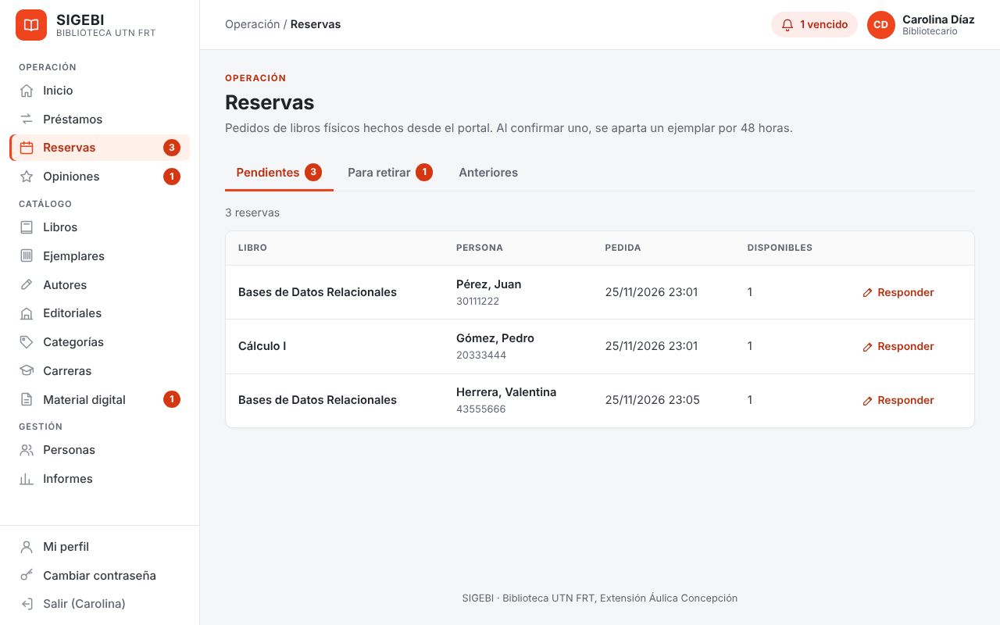

La sección **Reservas** tiene tres pestañas:

| Pestaña | Muestra |
|---|---|
| **Pendientes** | Reservas que esperan una respuesta, con cuántos ejemplares disponibles hay. |
| **Para retirar** | Reservas confirmadas, con el ejemplar apartado y hasta cuándo se puede retirar. |
| **Anteriores** | Retiradas, rechazadas, canceladas y vencidas. |

### 8.1. Confirmar o rechazar

Tocá **Responder** en una reserva pendiente.

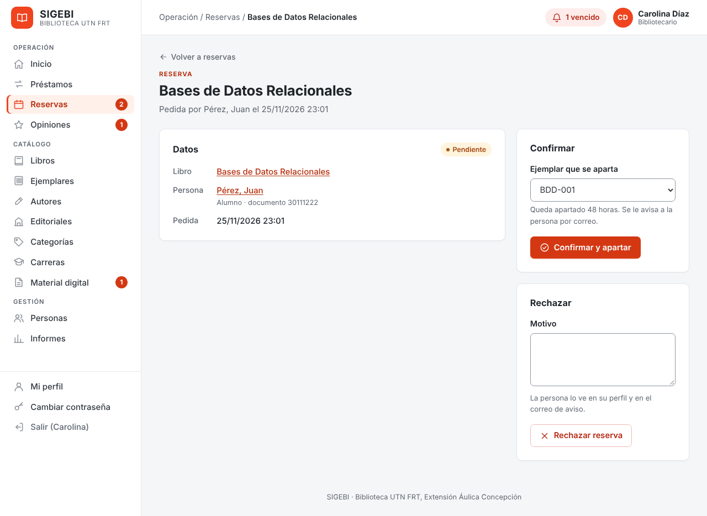

- **Confirmar:** elegí el **ejemplar que se aparta** y tocá **Confirmar y apartar**. El ejemplar queda
  **Apartado** durante 48 horas: no figura disponible y no se le puede prestar a otra persona.
- **Rechazar:** escribí el **motivo** (la persona lo ve en el portal y en el correo) y tocá **Rechazar reserva**.

En los dos casos, a la persona le llega un correo con la respuesta.

### 8.2. Retiro

Cuando la persona viene a buscar el libro, abrí la reserva desde **Para retirar** y tocá
**Registrar retiro y prestar**: se registra el préstamo del ejemplar apartado con el plazo habitual de 14 días,
y la reserva queda **Retirada**.

- Si la persona avisa que no lo va a retirar, tocá **Liberar ejemplar**: vuelve a estar disponible.
- Si no viene, la reserva **vence sola** a las 48 horas y el ejemplar se libera, sin que haya que hacer nada.

---

## 9. Opiniones

Los alumnos y profesores pueden poner **de 1 a 5 estrellas y un comentario** a los libros que tuvieron
prestados. Las opiniones se publican en el portal **recién cuando las aprueba la biblioteca**.

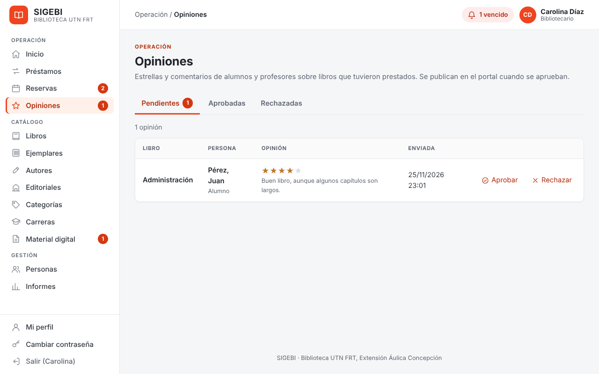

En **Opiniones**, la pestaña **Pendientes** muestra las que esperan revisión. Tocá **Aprobar** para publicarla
o **Rechazar** si no corresponde (por ejemplo, un comentario ofensivo o que no habla del libro). Las pestañas
**Aprobadas** y **Rechazadas** guardan lo revisado. Si la persona edita una opinión publicada, vuelve a quedar
pendiente.

---

## 10. Personas y cuentas del portal

Las personas son los alumnos y profesores que pueden pedir préstamos.

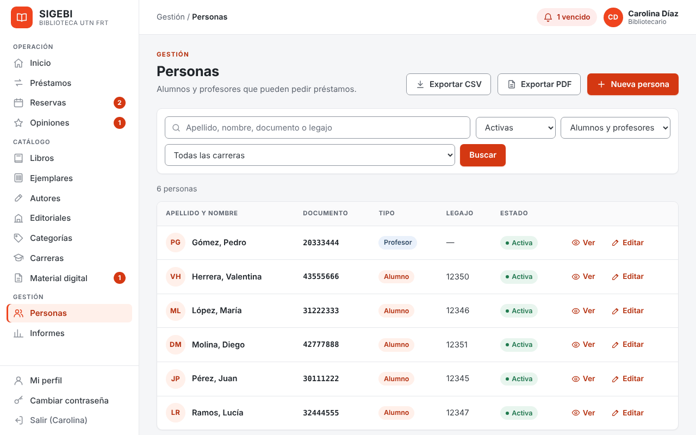

- **Buscar:** por apellido o nombre (sin tildes), documento (con o sin puntos) o legajo.
- **Filtros:** estado (**Activas**, **Dadas de baja** o **Todas**), tipo (alumnos, profesores o ambos) y **carrera**.
- **Exportar CSV** y **Exportar PDF** descargan el listado filtrado.
- **Nueva persona:** botón arriba a la derecha.

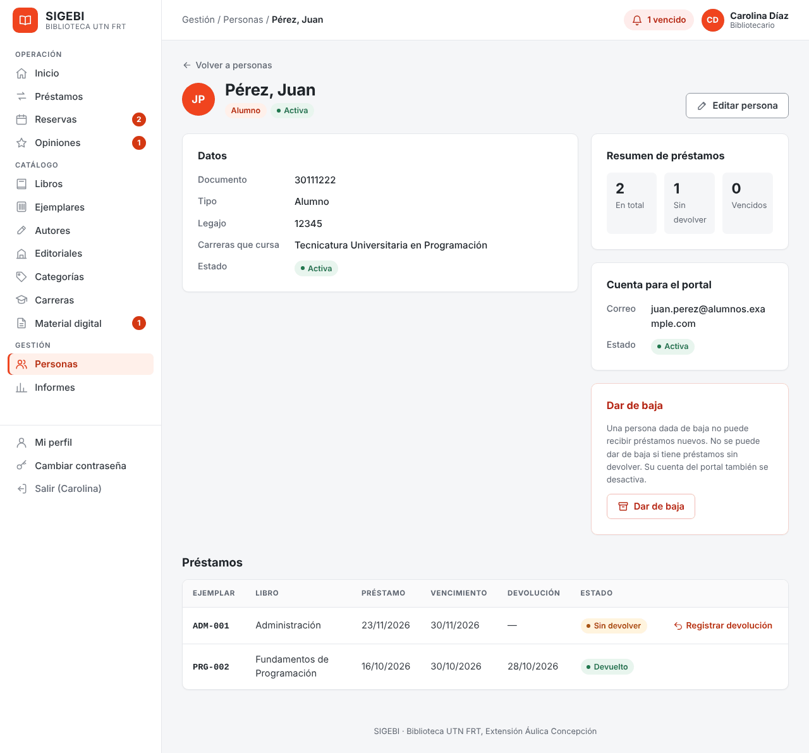

El detalle muestra los datos, las **carreras que cursa** (alumno) o **que dicta** (profesor), un resumen y el
**historial de préstamos**, con la opción de registrar la devolución de los que tiene sin devolver. Si la
persona subió una foto en el portal, se ve en su ficha.

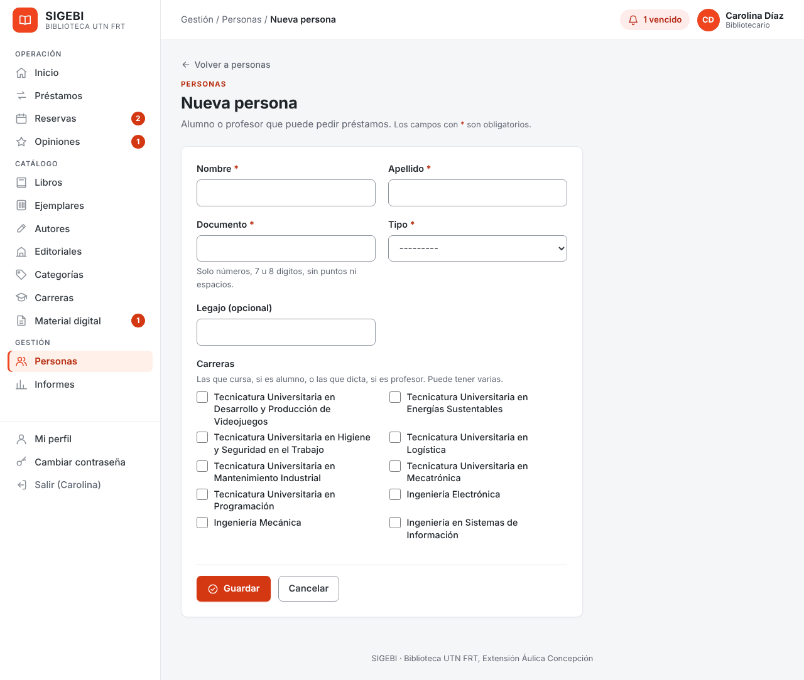

Nombre, apellido, documento y tipo (Alumno o Profesor) son obligatorios; el legajo es opcional.
El **documento** son **7 u 8 números**, sin puntos ni letras (el campo no deja escribir más de 8 caracteres), y
**no se puede repetir**. Al prestar, en cambio, el documento se puede escribir con o sin puntos. Marcá las **carreras** de la persona: son las que va a ver en el portal.

### 10.1. Cuenta para el portal

Para que un alumno o profesor use el portal, el personal le crea una cuenta desde su ficha
(**Cuenta para el portal → Crear cuenta**). No hay registro libre.

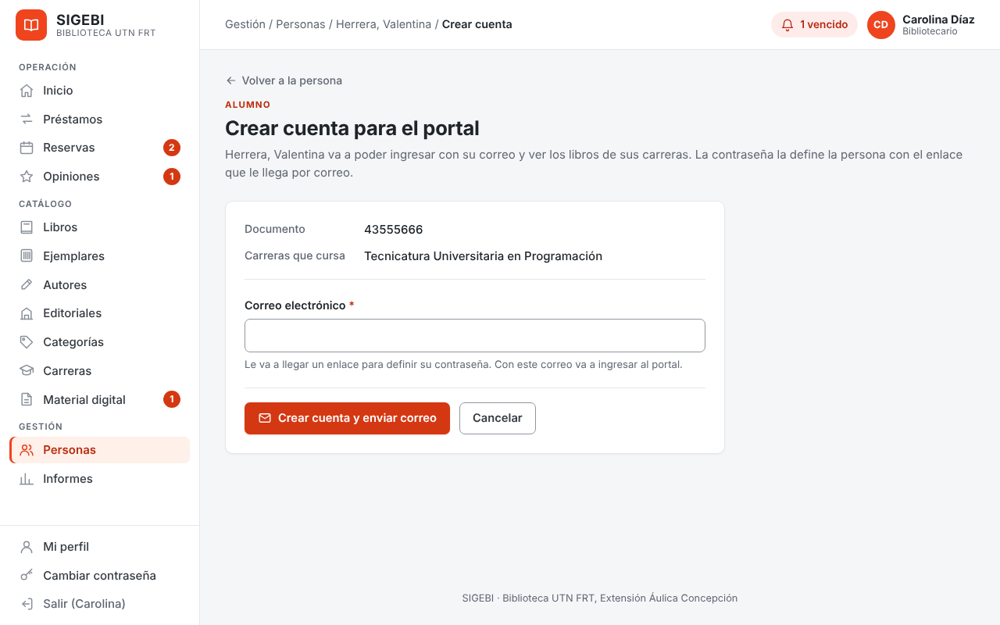

1. Escribí el **correo electrónico** de la persona.
2. Tocá **Crear cuenta y enviar correo**. Le llega el correo para definir su contraseña (sección 1.1).

Requisitos: la persona tiene que estar **activa** y tener **al menos una carrera** (sin carrera no vería ningún
libro). Cada persona tiene como máximo una cuenta, y el correo no puede estar usado por otra cuenta.
Si la persona todavía no definió su contraseña, en su ficha aparece **Reenviar correo**.

### 10.2. Dar de baja o reactivar una persona

En el detalle de la persona, **Dar de baja** la deja inactiva: no puede recibir préstamos nuevos y **su cuenta
del portal también se desactiva**, pero se conserva su historial. Antes de hacerlo, el sistema pide
**confirmar**; con **Cancelar** no cambia nada. **No se puede dar de baja a una persona con préstamos sin
devolver.** Para volver a habilitarla, usá **Reactivar**: la cuenta del portal se reactiva también.

---

## 11. Carreras y categorías

Cada alumno y profesor ve en el portal **los libros y el material de sus carreras**. Un libro pertenece a las
carreras de su **categoría**.

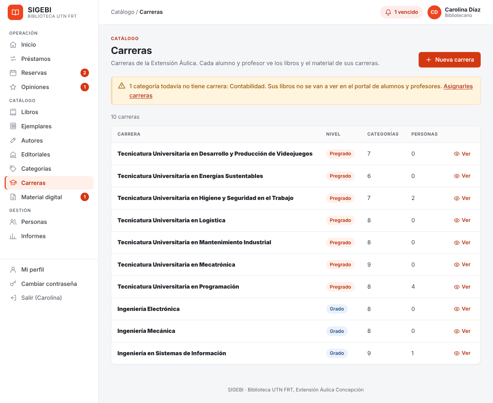

- **Carreras** lista las 10 carreras de la Extensión Áulica, con su nivel (pregrado o grado), cuántas categorías
  tiene cada una y cuántas personas.
- Si hay **categorías sin carrera**, aparece un aviso amarillo: los libros de esas categorías no los ve nadie en
  el portal hasta que se les asigne una carrera.
- **Nueva carrera** y **Editar carrera** permiten cargar o corregir el nombre y el nivel. Una carrera con datos
  asociados no se puede borrar.

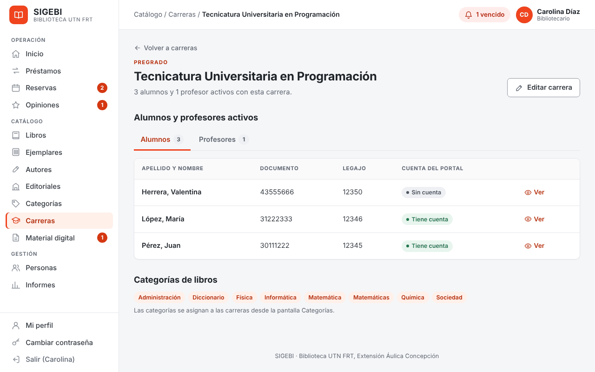

El detalle de una carrera muestra sus **alumnos y profesores activos** (en pestañas), si ya tienen cuenta para
el portal, y las **categorías de libros** de esa carrera.

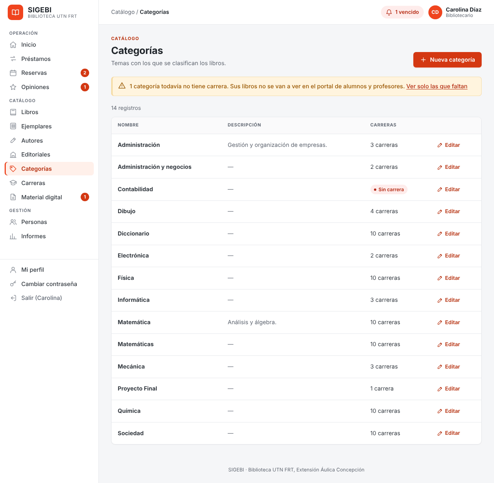

En **Categorías**, cada fila indica cuántas carreras tiene. Para asignarlas, tocá **Editar** y marcá las
carreras. Una categoría general (por ejemplo, Diccionario o Matemáticas) se asigna a todas. **Ver solo las que
faltan** muestra las categorías que todavía no tienen carrera.

---

## 12. Material digital

Libros, tesis, apuntes y otros archivos **PDF** para alumnos y profesores, organizados por carrera.

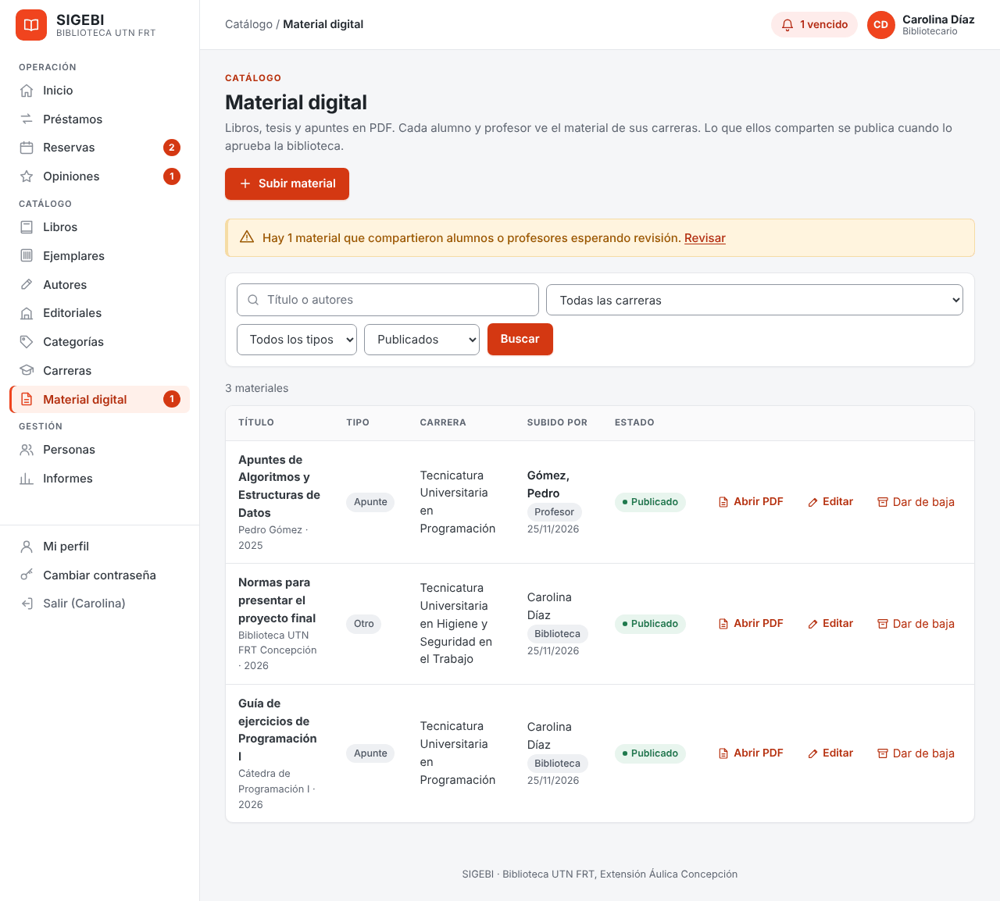

- **Filtros:** carrera, tipo (libro, tesis, apunte u otro) y estado (**Publicados**, **Para revisar**,
  **Rechazados**, **Dados de baja** o **Todos**).
- **Abrir PDF**, **Editar** (los datos, no el archivo) y **Dar de baja** (deja de verse en el portal; se puede
  **Reactivar**).

### 12.1. Subir material

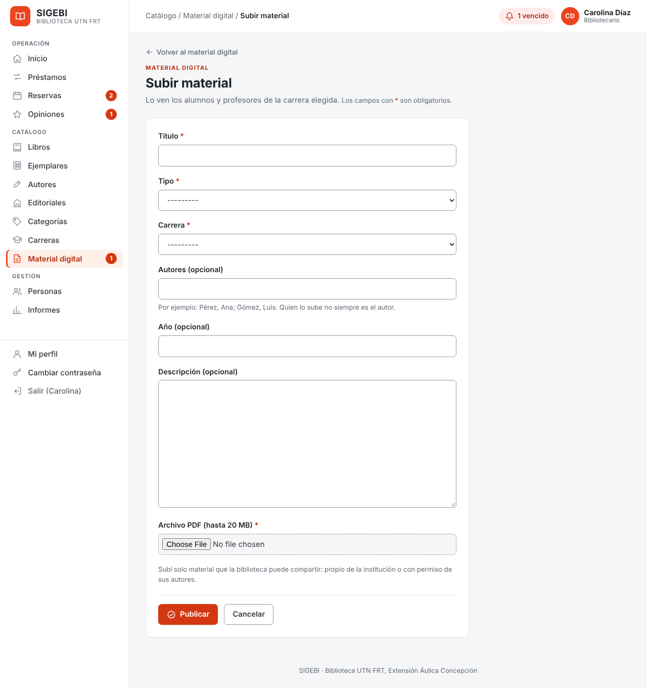

Tocá **Subir material** y completá título, tipo, carrera y el **archivo PDF** (hasta **20 MB**). Autores, año y
descripción son opcionales. Lo que sube el personal se **publica directamente**. Subí solo material que la
biblioteca puede compartir: propio de la institución o con permiso de sus autores.

### 12.2. Revisar lo que comparten alumnos y profesores

Lo que suben alumnos y profesores queda **Para revisar** y no lo ve nadie más. El aviso amarillo y el número
rojo del menú indican cuántos esperan.

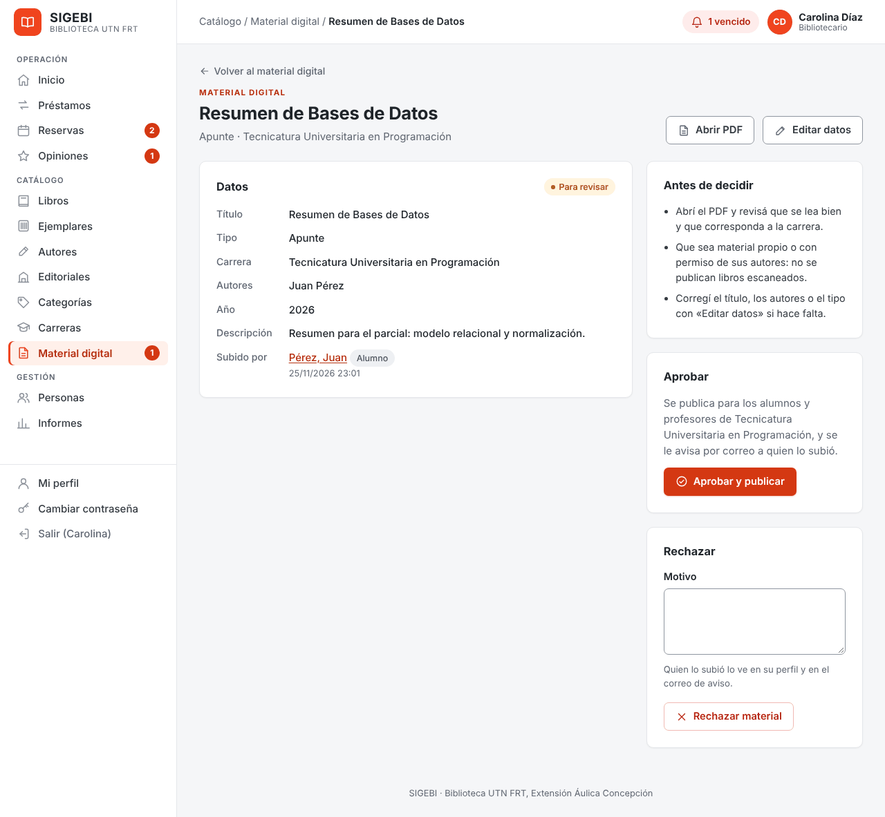

1. Tocá **Revisar** y después **Abrir PDF** para ver el archivo.
2. Si hace falta, corregí el título, los autores o el tipo con **Editar datos**.
3. **Aprobar y publicar:** lo ven los alumnos y profesores de esa carrera.
   **Rechazar:** escribí el motivo y tocá **Rechazar material**.

Quien lo subió recibe un correo con el resultado y lo ve en el portal.

---

## 13. Baja de ejemplares

Cuando un ejemplar se pierde, se daña o se descarta, se da de baja desde su detalle:

1. Elegí el **motivo**: Perdido, Dañado, Descarte u Otro.
2. Tocá **Dar de baja** y confirmá en la ventana que aparece (con **Cancelar** no cambia nada).

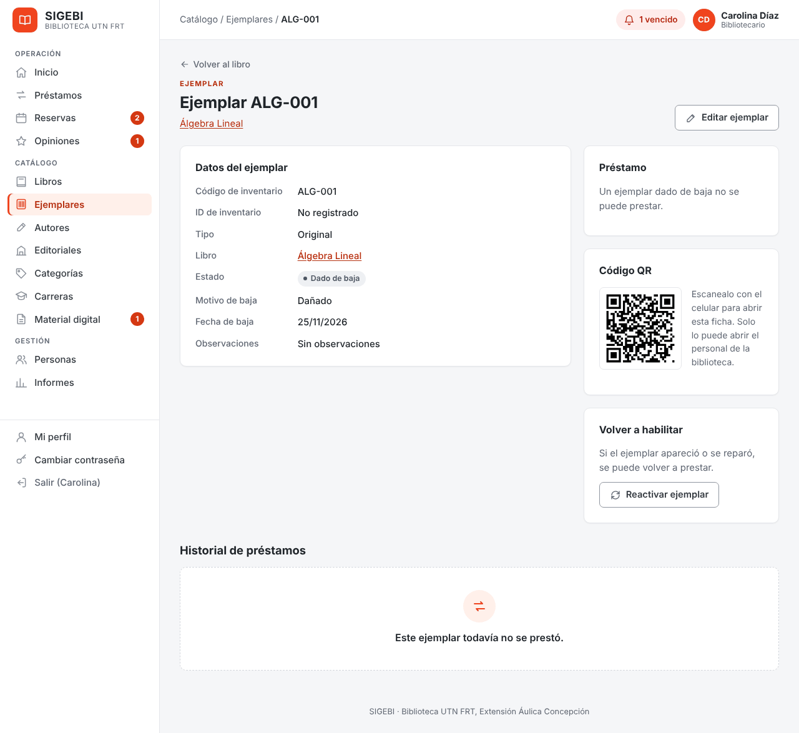

El ejemplar queda **Dado de baja**, con el motivo y la fecha. No se puede prestar, pero se conserva su
historial. **No se puede dar de baja un ejemplar prestado ni uno apartado por una reserva.** Si fue un error
(por ejemplo, apareció el ejemplar perdido), usá **Reactivar ejemplar**.

---

## 14. Informes

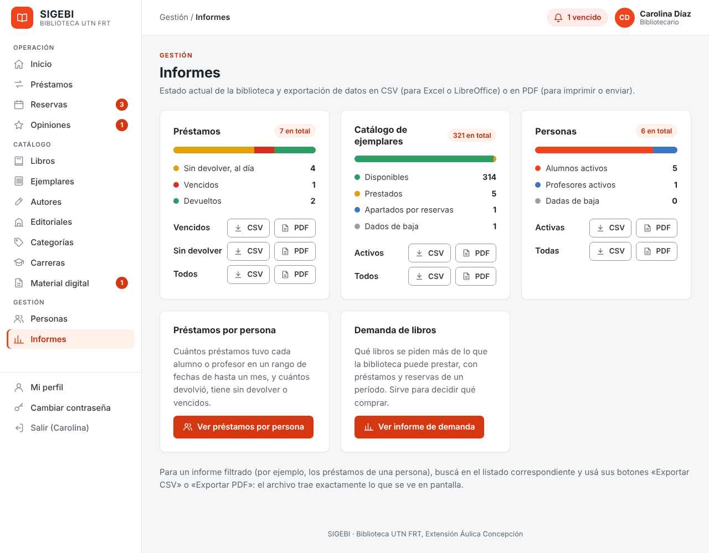

La sección **Informes** muestra el estado de préstamos, ejemplares y personas con barras de colores, y botones
para descargar los informes más usados en **CSV** (para abrir en Excel o LibreOffice) o en **PDF** (para
imprimir o enviar).

Además, los listados de **Ejemplares**, **Préstamos** y **Personas** tienen los botones **Exportar CSV** y
**Exportar PDF**. El archivo trae **exactamente lo que estás viendo**: la misma búsqueda y el mismo filtro,
con todas las páginas.

| Informe | Desde | Detalle |
|---|---|---|
| Catálogo de ejemplares | Ejemplares | Los ejemplares con su tipo y estado. |
| Préstamos vencidos | Préstamos, filtro **Vencidos** | Incluye los **días de atraso** de cada préstamo. |
| Préstamos sin devolver, devueltos o todos | Préstamos, con el filtro elegido | — |
| Personas | Personas | Incluye cuántos préstamos sin devolver tiene cada persona. |
| Préstamos por persona | Informes | Ver 14.1. |
| Demanda de libros | Informes | Ver 14.2. |

El archivo se descarga con la fecha en el nombre (por ejemplo `sigebi-prestamos-vencidos-2026-11-25.csv`).
El CSV se abre con doble clic en Excel o LibreOffice: cada dato queda en su columna y las fechas en formato
dd/mm/aaaa.

### 14.1. Préstamos por persona

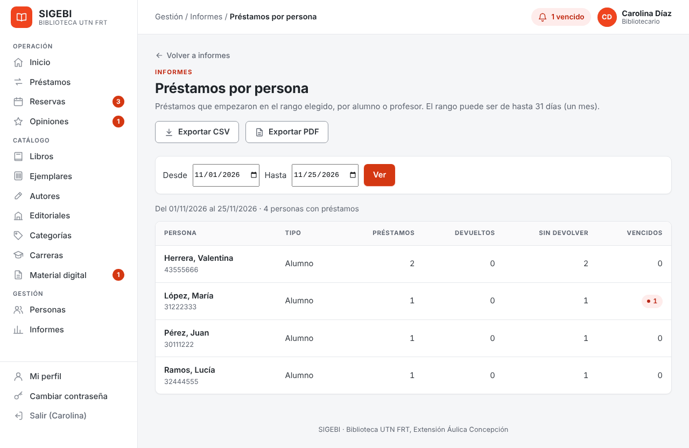

Cuántos préstamos empezaron en el rango elegido (hasta 31 días), por alumno o profesor: cuántos devolvió,
cuántos tiene sin devolver y cuántos están vencidos.

### 14.2. Informe de demanda

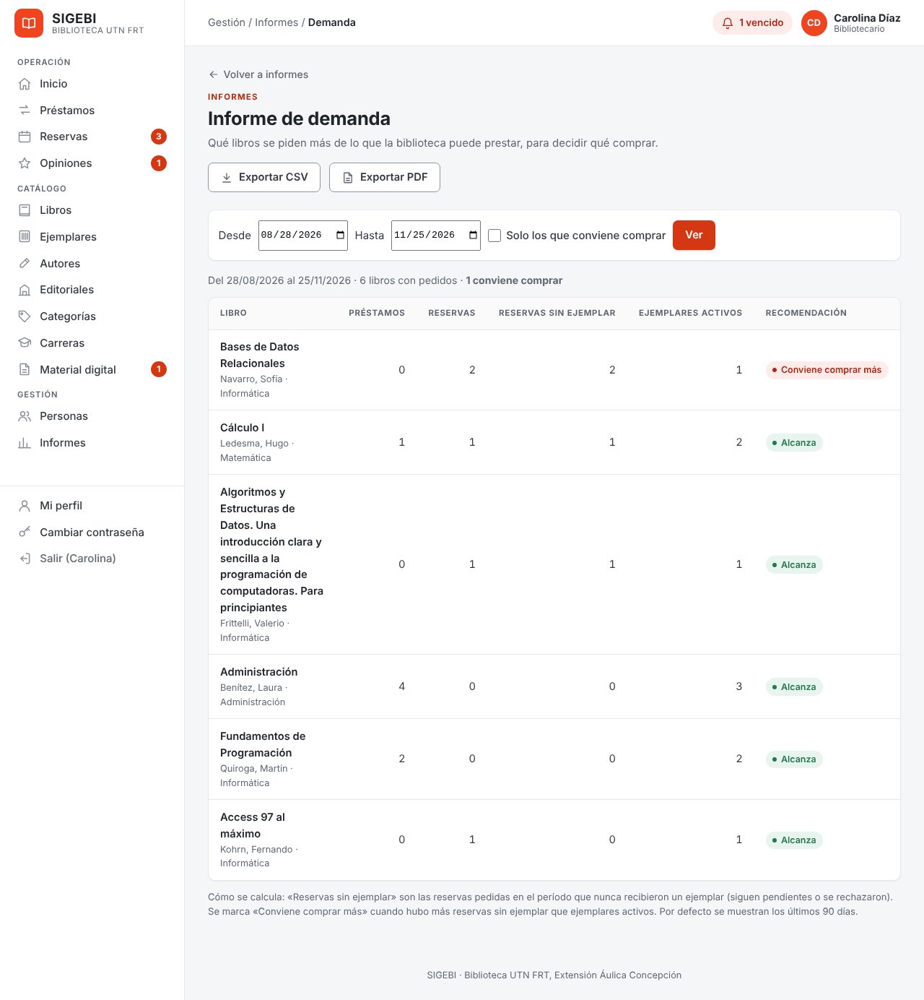

Qué libros se piden más de lo que la biblioteca puede prestar, para decidir qué comprar. Para el período elegido
(por defecto, los últimos 90 días) muestra por libro los préstamos, las reservas, las **reservas sin ejemplar**
(pedidas que nunca recibieron un ejemplar) y los ejemplares activos. Se marca **Conviene comprar más** cuando
hubo más reservas sin ejemplar que ejemplares activos. **Solo los que conviene comprar** filtra esos libros.

---

## 15. Avisos automáticos por correo

SIGEBI les envía correos a los alumnos y profesores **que tienen cuenta en el portal**:

- **"Tu préstamo vence pronto":** cuando faltan 2 días o menos para el vencimiento.
- **"Tu préstamo venció":** una vez, cuando ya pasó la fecha.

Cada aviso se envía **una sola vez** por préstamo; si el libro ya se devolvió, no se envía. Los avisos los
manda el comando `enviar_avisos`, que el servidor ejecuta una vez por día (ver el README). El personal no tiene
que hacer nada. Además, el sistema envía correos al responder una reserva y al revisar el material compartido.

---

## 16. Cuentas del personal (Administrativo)

Solo los **Administrativos** (y el superusuario) ven la sección **Cuentas**.

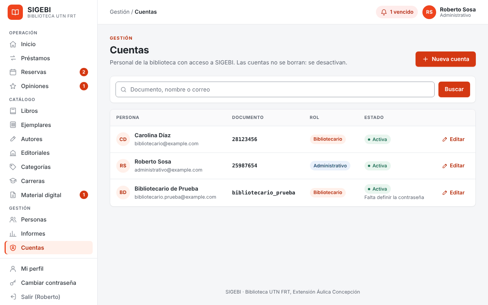

- El listado muestra nombre, correo, documento, rol y estado de cada cuenta del personal. Las cuentas de
  alumnos y profesores no aparecen acá: se gestionan desde **Personas** (sección 10.1).
- El Administrativo puede **crear y editar cuentas de Bibliotecarios**. Las cuentas Administrativas las
  gestiona solo el superusuario.

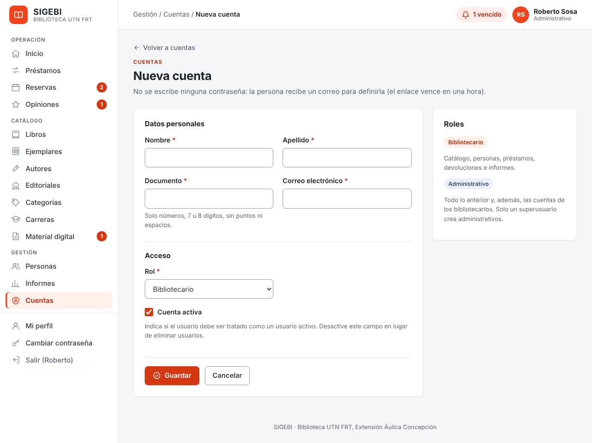

Para crear una cuenta completá nombre, apellido, documento, correo y rol. **No se escribe ninguna
contraseña:** el sistema le envía a la persona un correo para que la defina ella misma (sección 1.1).

- **Desactivar una cuenta:** en **Editar**, destildá **Cuenta activa**. Las cuentas no se borran.
- **Reenviar el correo de definición:** en **Editar**, si la persona todavía no definió su contraseña,
  aparece el botón **Reenviar correo de definición**.
- Nadie puede cambiar su propio rol ni desactivarse a sí mismo.

---

## 17. Mi perfil y cambiar la contraseña

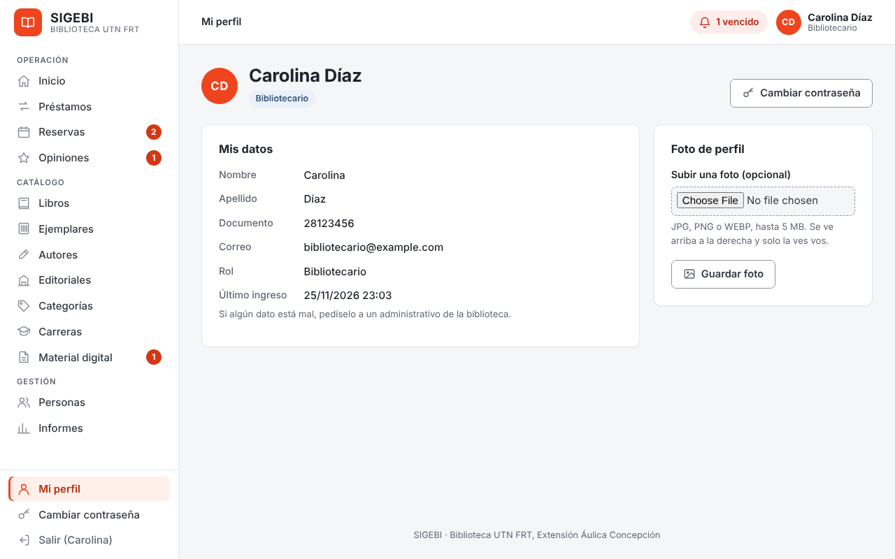

**Mi perfil** muestra tus datos (nombre, documento, correo, rol y último ingreso). Si algún dato está mal,
pedíselo a un Administrativo. Podés subir una **foto de perfil** opcional (JPG, PNG o WEBP, hasta 5 MB), que se
ve arriba a la derecha y solo ves vos.

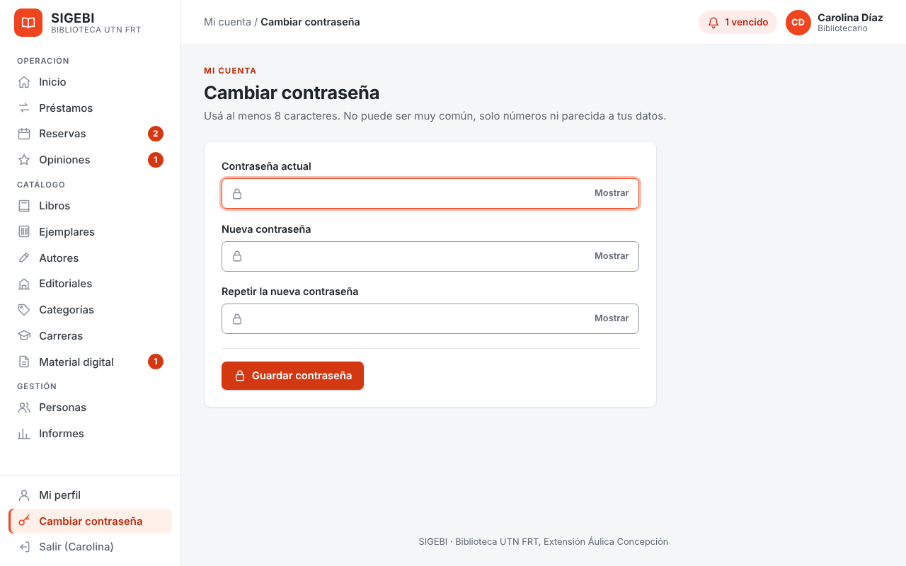

Desde **Cambiar contraseña**: escribí la contraseña actual y dos veces la nueva. El sistema rechaza contraseñas
de menos de 8 caracteres, muy comunes, solo numéricas o parecidas a tus datos.

---

## 18. Acceso no permitido

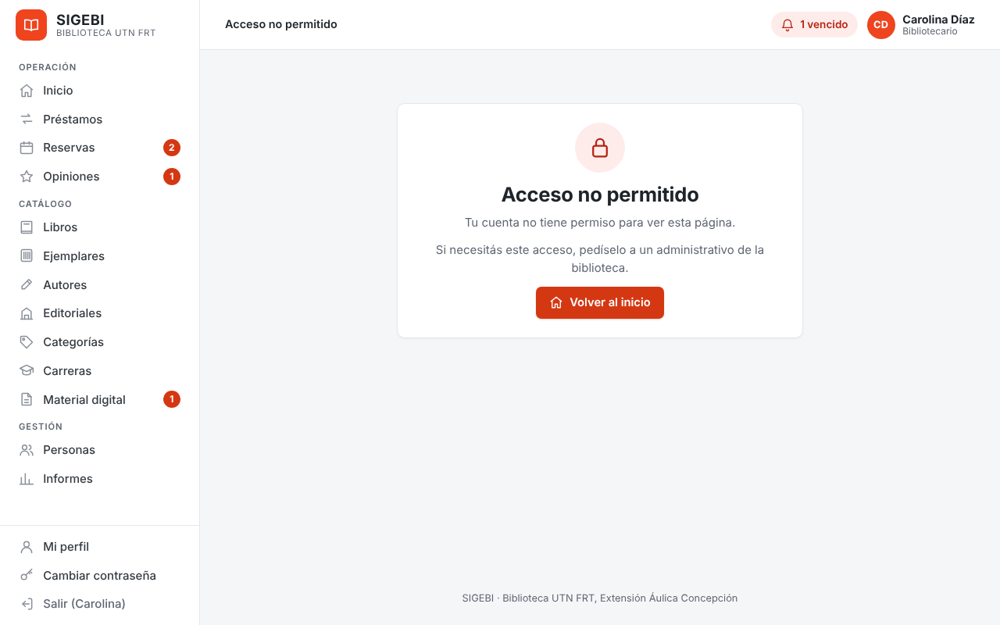

Si intentás entrar a una sección para la que tu cuenta no tiene permiso (por ejemplo, un Bibliotecario
que escribe la dirección de Cuentas, o un alumno que escribe una dirección del personal), el sistema muestra
**Acceso no permitido** y un botón para volver al inicio.

---

## 19. Uso desde el teléfono

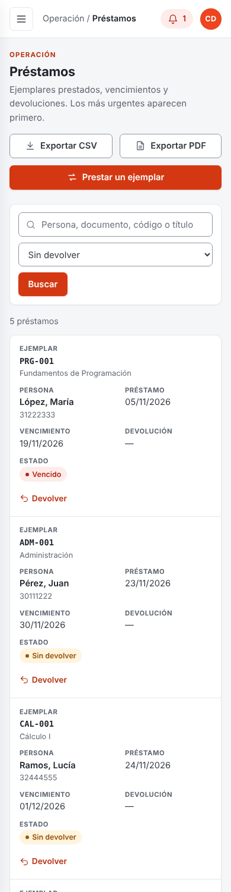

Todas las pantallas se adaptan al teléfono y a la tablet. En pantallas chicas el menú lateral se oculta:
se abre con el botón **☰** de la cabecera y se cierra con la **✕**, tocando fuera del menú o con la tecla Esc.
Las tablas se muestran como tarjetas, sin desplazamiento horizontal.

---

## 20. Mensajes frecuentes del personal

| Mensaje | Qué significa | Qué hacer |
|---|---|---|
| El correo o la contraseña no son correctos. | Datos de ingreso incorrectos o cuenta desactivada. | Revisar los datos o usar "¿Olvidaste tu contraseña?". |
| Hubo demasiados intentos fallidos. | 5 intentos fallidos en 15 minutos. | Esperar 15 minutos. |
| No hay ninguna persona registrada con ese documento. | El documento no está cargado. | Dar de alta a la persona en **Personas**. |
| "…" está dada de baja: no puede recibir préstamos. | La persona está inactiva. | Reactivarla desde su detalle, si corresponde. |
| Este ejemplar ya está prestado. | Tiene un préstamo sin devolver. | Registrar primero la devolución. |
| Este ejemplar está apartado para … | Está reservado para otra persona. | Prestar otro ejemplar o esperar el retiro. |
| Este ejemplar está dado de baja: no se puede prestar. | El ejemplar está inactivo. | Reactivarlo desde su detalle, si corresponde. |
| La fecha de devolución no puede ser anterior a la fecha de préstamo. | Fecha mal cargada. | Corregir la fecha. |
| No se puede dar de baja…: tiene préstamos sin devolver. | Persona o ejemplar con un préstamo activo. | Registrar la devolución y volver a intentar. |
| No tiene ninguna carrera asignada. | Se quiso crear la cuenta del portal de una persona sin carreras. | Editar la persona y marcar sus carreras. |
| Ya existe una persona con ese documento. / Ya existe una cuenta con ese correo. | Dato repetido. | Buscar el registro existente. |
| Acceso no permitido. | La cuenta no tiene permiso para esa sección. | Pedir el acceso a un Administrativo. |

---

# Parte 2 — Estudiantes y docentes

## 21. Cómo obtener la cuenta e ingresar

La cuenta **la crea la biblioteca**: no hay registro libre. Acercate a la biblioteca con tu documento y decí
qué carreras cursás (o dictás, si sos profesor). Te llega un correo **"Definí tu contraseña de SIGEBI"**:
abrilo, elegí tu contraseña (el enlace vence en una hora) y listo.

Para entrar, usá la misma pantalla de ingreso que el personal (sección 1), con tu **correo** y tu
**contraseña**. Si la olvidaste, usá **¿Olvidaste tu contraseña?** (sección 1.2).

> Ves **solo los libros y el material de tus carreras**. Si te falta una carrera, avisá en la biblioteca.

## 22. Inicio del portal

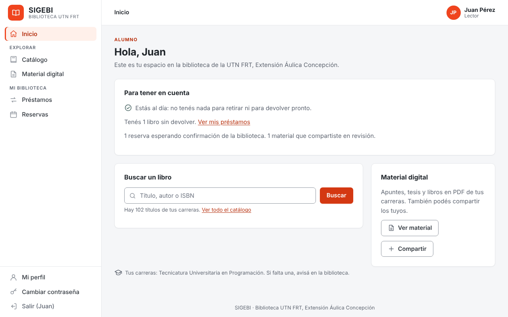

El inicio te muestra lo que tenés que tener en cuenta (préstamos vencidos o por vencer, reservas listas para
retirar, material en revisión), un buscador de libros y accesos al material digital.

El menú tiene tres partes:

| Grupo | Secciones |
|---|---|
| Explorar | **Catálogo** y **Material digital** |
| Mi biblioteca | **Préstamos** y **Reservas** |
| Al pie | **Mi perfil**, **Cambiar contraseña** y **Salir** |

## 23. Catálogo

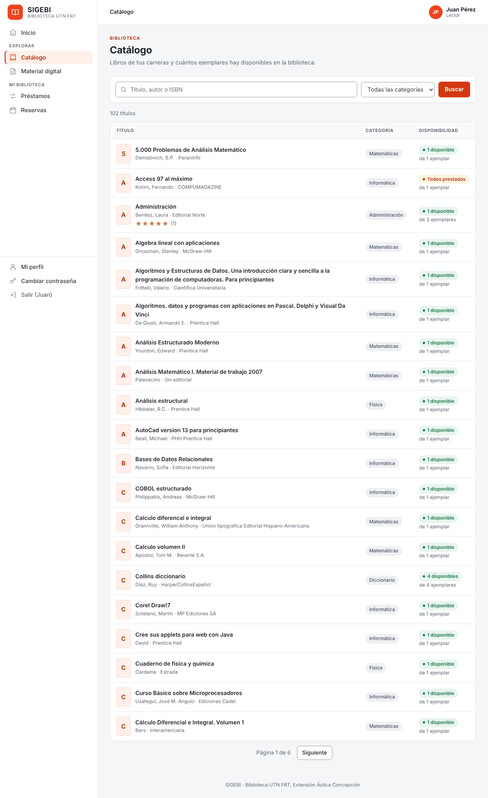

- Muestra los libros de **tus carreras**, con su categoría y la **disponibilidad**: cuántos ejemplares hay en
  la biblioteca, "Todos prestados" o "Sin ejemplares".
- **Buscar** por título, autor o ISBN, sin tildes. Podés filtrar por categoría y, si tenés más de una carrera,
  por carrera.
- Las estrellas indican el promedio de las opiniones publicadas.

## 24. Detalle de un libro: reservar y opinar

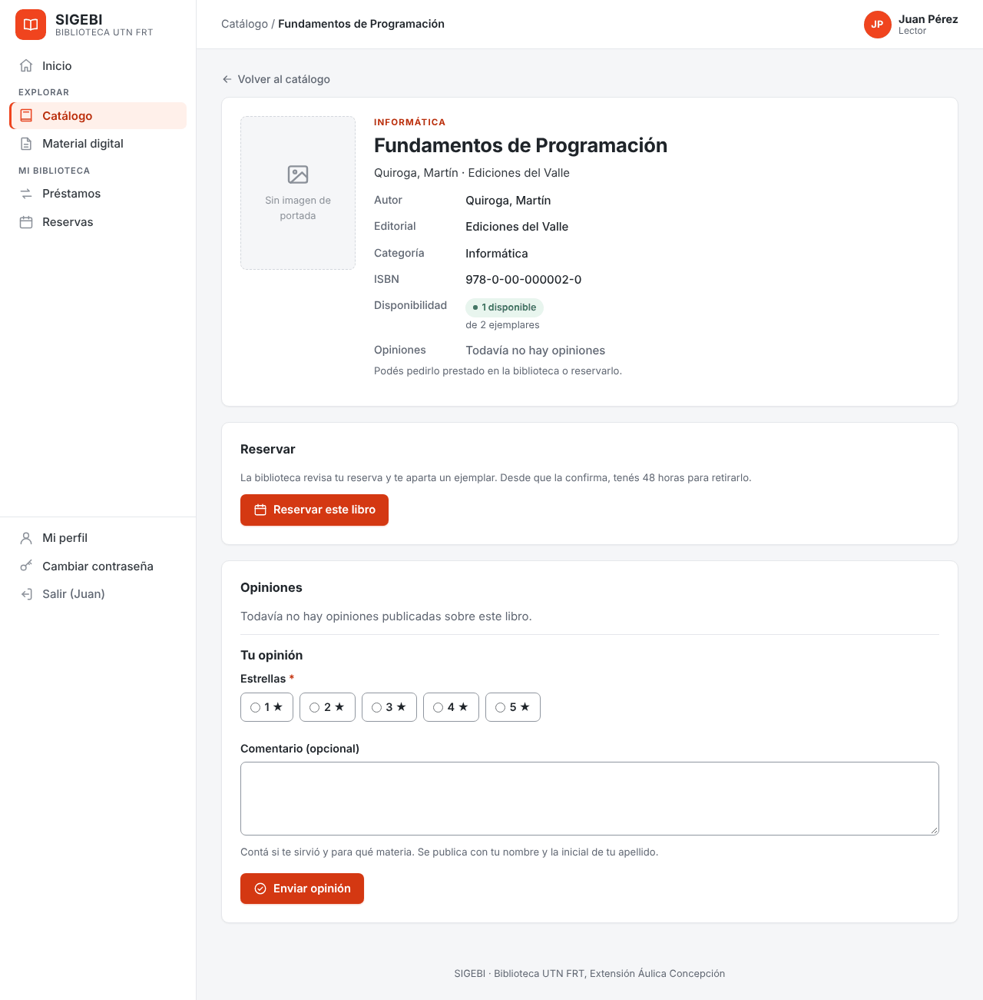

El detalle muestra los datos del libro y su disponibilidad. El portal nunca muestra quién tiene un libro prestado.

### 24.1. Reservar un libro

Tocá **Reservar este libro**. La biblioteca revisa la reserva y te aparta un ejemplar; te avisa por correo.
**Desde que la confirma, tenés 48 horas para retirarlo.** Al retirarlo se registra el préstamo de 14 días.

Reglas:

- Solo libros de tus carreras que tengan ejemplares en la biblioteca (aunque ahora estén prestados).
- **Como máximo 2 reservas activas**, y una por libro.
- No podés reservar si tenés **préstamos vencidos** o si estás dado de baja en la biblioteca.

Si no podés reservar, el detalle te dice por qué.

### 24.2. Opinar sobre un libro

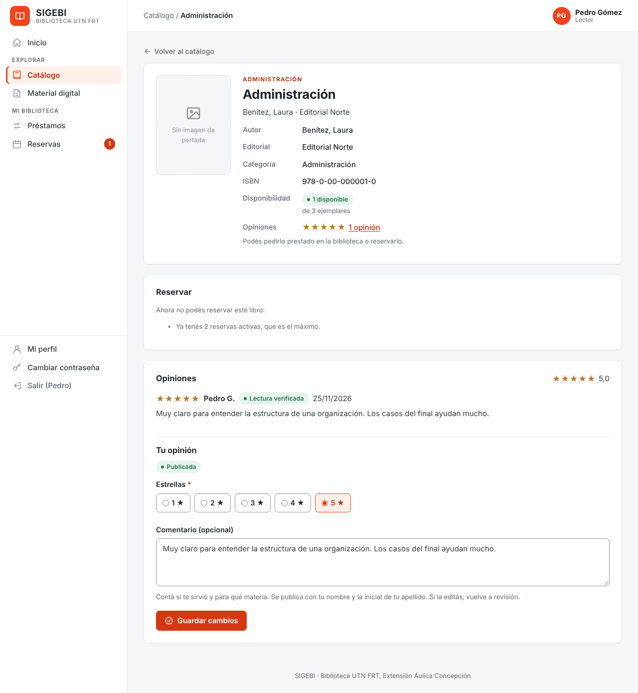

Si **tuviste el libro prestado**, podés poner de **1 a 5 estrellas** y un comentario (opcional, hasta 1000
caracteres). Tu opinión se publica **cuando la aprueba la biblioteca**, con tu nombre y la inicial de tu
apellido, y se marca como **Lectura verificada**. Podés editarla después; al editarla vuelve a revisión.

## 25. Material digital: consultar y compartir

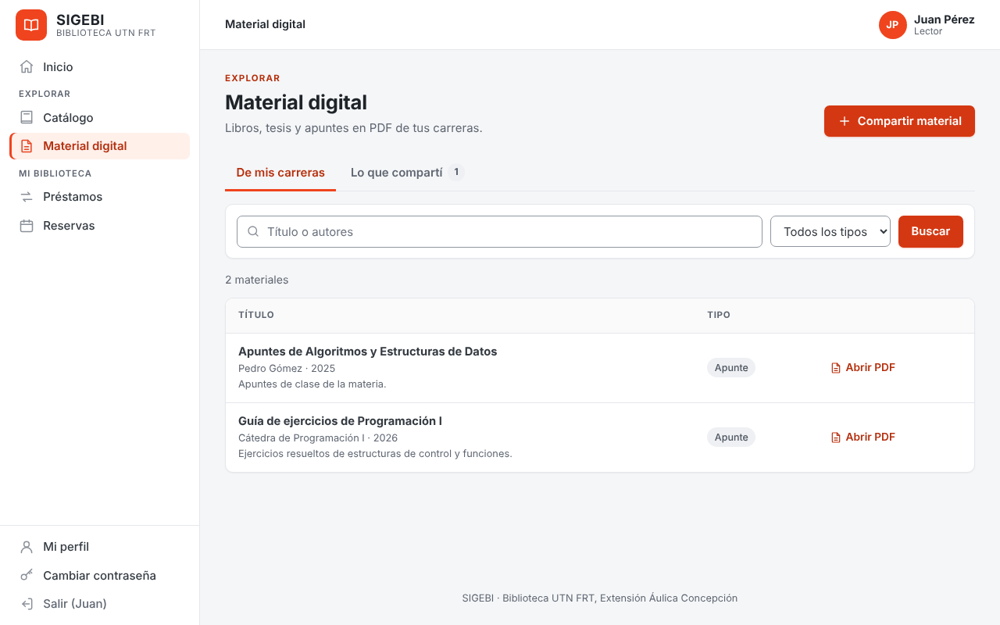

La pestaña **De mis carreras** tiene los libros, tesis, apuntes y otros PDF de tus carreras. Buscá por título o
autores, filtrá por tipo y tocá **Abrir PDF** para verlo o descargarlo. El material de otras carreras no se
puede abrir, ni siquiera con el enlace.

### 25.1. Compartir material

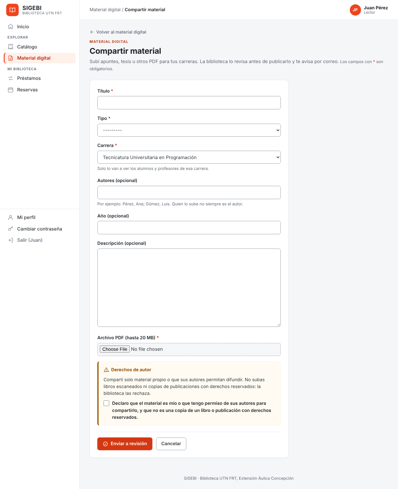

1. Tocá **Compartir material**.
2. Completá título, tipo y carrera (solo las tuyas), y elegí el **PDF** (hasta 20 MB). Autores, año y
   descripción son opcionales.
3. Leé el aviso de **derechos de autor** y marcá la declaración: compartí solo material propio o que sus autores
   permitan difundir. No se aceptan libros escaneados.
4. Tocá **Enviar a revisión**.

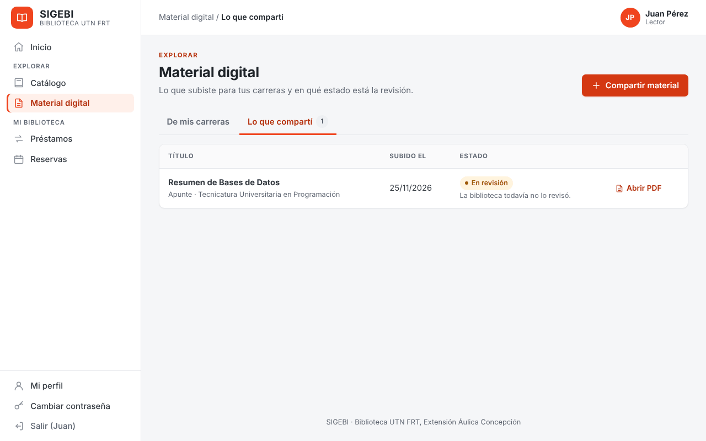

En la pestaña **Lo que compartí** ves el estado: **En revisión**, **Publicado** o **Rechazado** (con el motivo).
Te llega un correo cuando la biblioteca lo revisa.

## 26. Mis préstamos

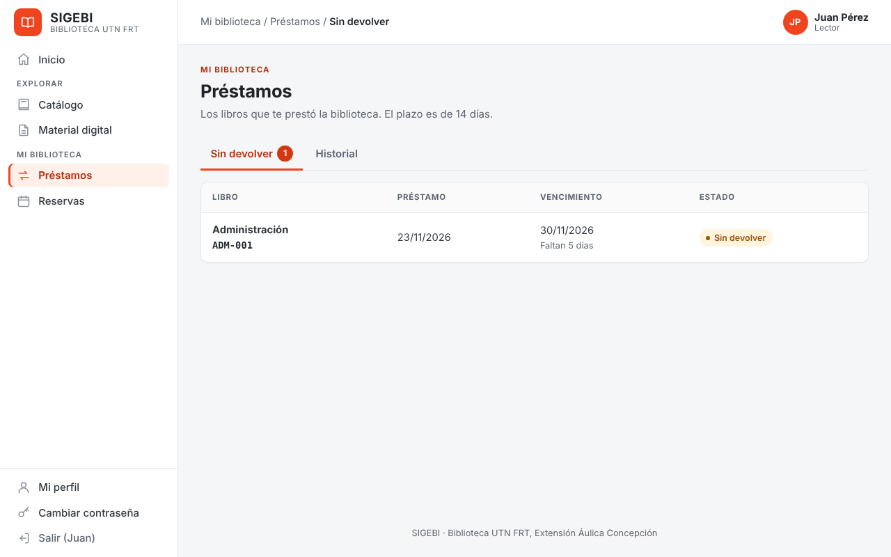

**Sin devolver** muestra los libros que tenés prestados, con el vencimiento y cuántos días faltan. Los vencidos
se resaltan en rojo. El plazo es de 14 días.

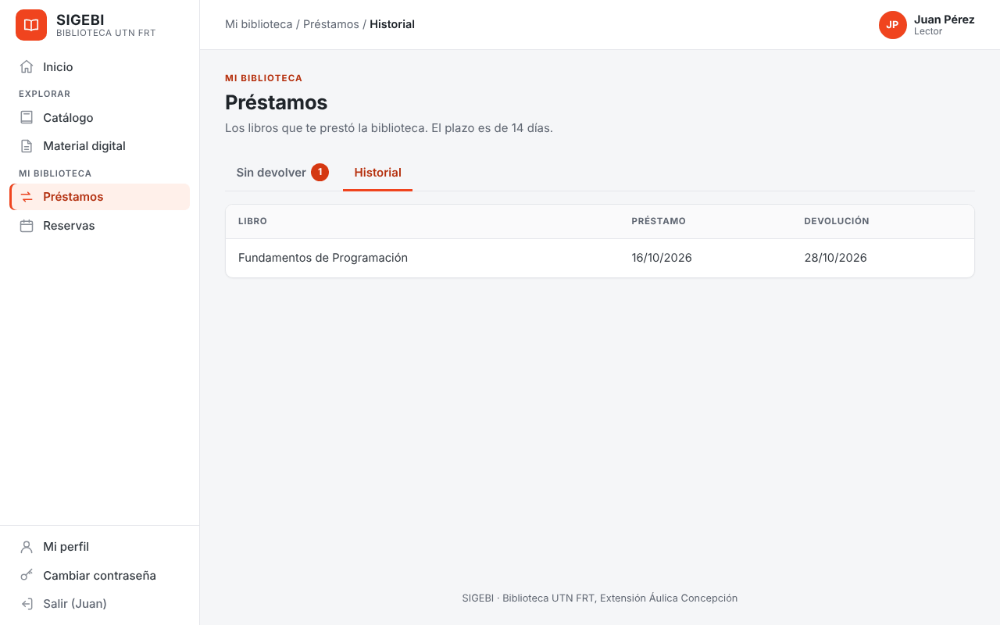

**Historial** muestra los préstamos que ya devolviste.

## 27. Mis reservas

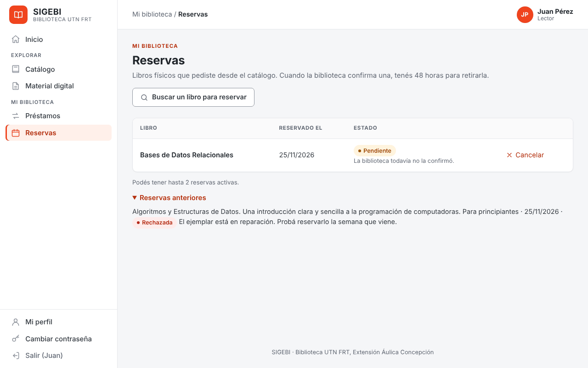

Muestra tus reservas activas con su estado:

| Estado | Qué significa |
|---|---|
| **Pendiente** | La biblioteca todavía no la confirmó. Podés **Cancelar** la reserva. |
| **Lista para retirar** | Te apartaron un ejemplar: retiralo antes de la fecha y hora indicadas (48 horas). |

En **Reservas anteriores** quedan las retiradas, rechazadas (con el motivo), canceladas y vencidas.

## 28. Mi perfil

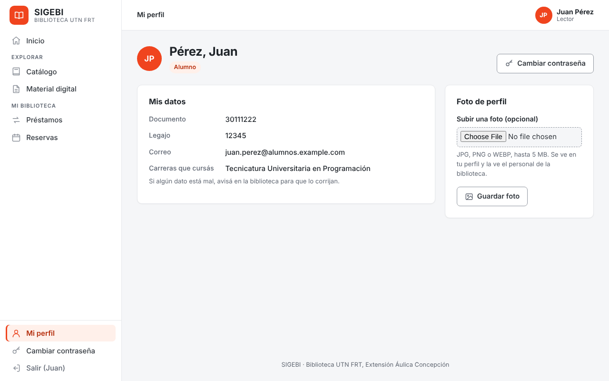

Tus datos: nombre, documento, legajo, correo y carreras. **No se pueden editar desde el portal:** si algo está
mal, avisá en la biblioteca para que lo corrijan. Podés subir una **foto de perfil** opcional (JPG, PNG o WEBP,
hasta 5 MB), que ven vos y el personal de la biblioteca, y cambiar tu contraseña.

## 29. El portal en el celular

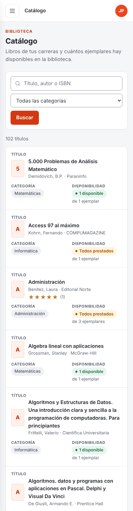

El portal se adapta al celular: el menú se abre con el botón **☰** y las tablas se muestran como tarjetas.

## 30. Mensajes frecuentes del portal

| Mensaje | Qué hacer |
|---|---|
| Tenés préstamos vencidos: devolvelos para poder reservar. | Devolver los libros vencidos en la biblioteca. |
| Ya tenés 2 reservas activas, que es el máximo. | Esperar a retirar una o cancelar alguna. |
| Ya tenés una reserva activa de este libro. | Ver el estado en **Reservas**. |
| La biblioteca no tiene ejemplares de este libro para prestar. | Consultar en la biblioteca. |
| Solo pueden opinar quienes tuvieron este libro prestado. | Se puede opinar después de haberlo tenido prestado. |
| No encontrado (al abrir un libro o un material) | Es de otra carrera. Si te falta una carrera, avisá en la biblioteca. |
| Acceso no permitido | Esa dirección es del sistema del personal. |
